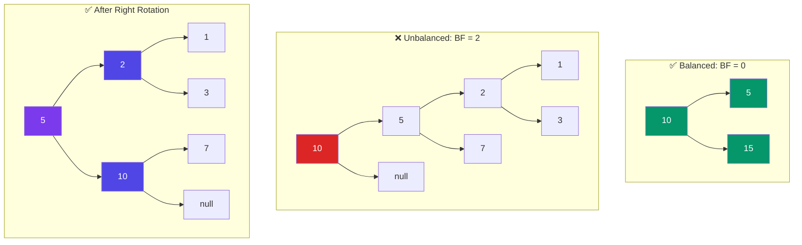

# AVL Tree

> An **AVL tree** is a self-balancing **Binary Search Tree** (BST). It ensures the height difference between left and right subtrees (called **balance factor**) is never more than 1.

---

## Balance Factor

```
balanceFactor = height(left) - height(right)

Allowed: -1, 0, 1
If balanceFactor goes below -1 or above 1 → rotate to fix!
```



---

## Rotations

There are four types of rotations to rebalance:

| Case | Description | Rotation |
|------|-------------|----------|
| **Left-Left** | Unbalanced to the left | Right rotate |
| **Right-Right** | Unbalanced to the right | Left rotate |
| **Left-Right** | Left child has right-heavy subtree | Left→Right rotate |
| **Right-Left** | Right child has left-heavy subtree | Right→Left rotate |

```javascript
// Right rotation (fixes Left-Left case)
function rotateRight(y) {
  const x = y.left;
  const T2 = x.right;

  x.right = y;
  y.left = T2;

  // Update heights
  y.height = Math.max(height(y.left), height(y.right)) + 1;
  x.height = Math.max(height(x.left), height(x.right)) + 1;

  return x; // new root
}

// Left rotation (fixes Right-Right case)
function rotateLeft(x) {
  const y = x.right;
  const T2 = y.left;

  y.left = x;
  x.right = T2;

  x.height = Math.max(height(x.left), height(x.right)) + 1;
  y.height = Math.max(height(y.left), height(y.right)) + 1;

  return y;
}
```

---

## Operations

| Operation | BST | AVL |
|-----------|:---:|:---:|
| Search | O(H) | **O(log N)** |
| Insert | O(H) | **O(log N)** |
| Delete | O(H) | **O(log N)** |

Where H could be N in a skewed BST. AVL guarantees **H = O(log N)**.

---

## In Simple Words

- AVL = BST that stays balanced after every insert/delete.
- Balance Factor = height(left) - height(right). Must be -1, 0, or 1.
- When unbalanced → rotate (one or two rotations fix it).
- Search is always O(log N) — no worst-case O(N) like a plain BST.
