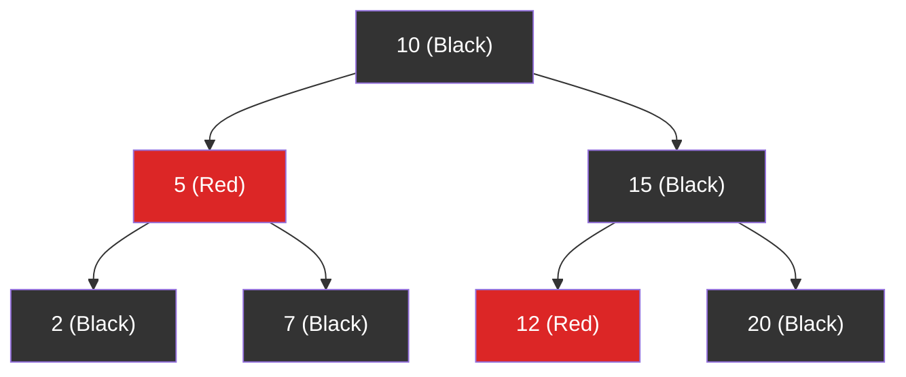

# Red-Black Tree

> A **Red-Black Tree** is a self-balancing BST where each node is colored **red** or **black**. It guarantees O(log N) operations with fewer rotations than AVL trees.

---

## Properties (Rules)

1. Every node is either **red** or **black**.
2. The **root** is always **black**.
3. **Red nodes** cannot have red children (no two reds in a row).
4. Every path from root to leaf has the **same number of black nodes**.

These rules keep the tree roughly balanced — the longest path is at most 2× the shortest.

---

## Visual: Red-Black Tree Structure

**Black height = 2** (every path has 2 black nodes, including the leaf nulls)

---

## Red-Black vs AVL

| Feature | AVL | Red-Black |
|---------|:---:|:---------:|
| Balance | Stricter (BF = -1, 0, 1) | Looser (2× height) |
| Search | ⚡ Faster (more balanced) | Slightly slower |
| Insert/Delete | Slower (more rotations) | ⚡ Faster (fewer rotations) |
| Use case | Lookup-heavy workloads | Write-heavy workloads |
| Real-world | Database indexes | TreeMap, TreeSet, std::map |

---

## Real-World Usage

- **Java:** `TreeMap`, `TreeSet`
- **C++:** `std::map`, `std::set`
- **Linux kernel:** Completely Fair Scheduler, memory management
- **JavaScript:** Not built-in, but `Map` and `Set` use hash tables (O(1) amortized)

---

## In Simple Words

- Red-Black Tree = self-balancing BST with looser rules than AVL.
- No two reds in a row, and equal black height on all paths.
- Fewer rotations than AVL → faster inserts/deletes, slightly slower lookups.
- Used everywhere: Java TreeMap, C++ std::map, Linux kernel.
