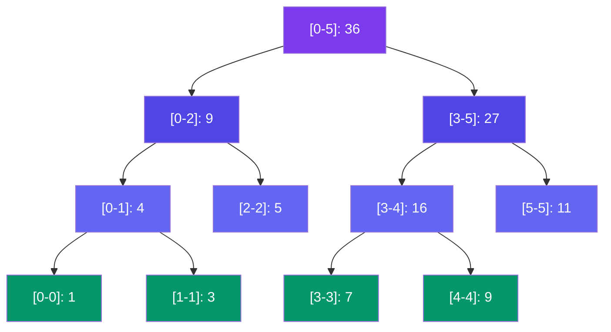

# Segment Tree

> A **Segment Tree** is a binary tree that stores information about ranges of an array. It answers range queries and handles point updates in **O(log N)** time.

---

## Visual: Segment Tree for Range Sum

```
Array: [1, 3, 5, 7, 9, 11]
```



**Query range sum [1-4]:** Traverse tree:
- [0-5] partially covers → go down
- [0-2] partially covers → go down
- [1-1] → return 3
- [2-2] → return 5
- [3-5] partially covers → go down
- [3-4] → return 16
- Total: 3 + 5 + 16 = **24**

---

## Implementation (Range Sum)

```javascript
class SegmentTree {
  constructor(arr) {
    this.n = arr.length;
    this.tree = new Array(4 * this.n); // safe size
    this._build(arr, 0, 0, this.n - 1);
  }

  _build(arr, node, start, end) {
    if (start === end) {
      this.tree[node] = arr[start];
    } else {
      const mid = Math.floor((start + end) / 2);
      const left = 2 * node + 1;
      const right = 2 * node + 2;
      this._build(arr, left, start, mid);
      this._build(arr, right, mid + 1, end);
      this.tree[node] = this.tree[left] + this.tree[right];
    }
  }

  // Query range sum [l, r]
  query(l, r) {
    return this._query(0, 0, this.n - 1, l, r);
  }

  _query(node, start, end, l, r) {
    if (r < start || l > end) return 0;          // no overlap
    if (l <= start && end <= r) return this.tree[node]; // full overlap
    const mid = Math.floor((start + end) / 2);
    const left = this._query(2 * node + 1, start, mid, l, r);
    const right = this._query(2 * node + 2, mid + 1, end, l, r);
    return left + right;
  }

  // Point update: arr[idx] = val
  update(idx, val) {
    this._update(0, 0, this.n - 1, idx, val);
  }

  _update(node, start, end, idx, val) {
    if (start === end) {
      this.tree[node] = val;
    } else {
      const mid = Math.floor((start + end) / 2);
      if (idx <= mid) {
        this._update(2 * node + 1, start, mid, idx, val);
      } else {
        this._update(2 * node + 2, mid + 1, end, idx, val);
      }
      this.tree[node] = this.tree[2 * node + 1] + this.tree[2 * node + 2];
    }
  }
}

// Usage
const st = new SegmentTree([1, 3, 5, 7, 9, 11]);
console.log(st.query(1, 4)); // 24
st.update(2, 6);             // array → [1, 3, 6, 7, 9, 11]
console.log(st.query(1, 4)); // 25
```

---

## Complexity

| Operation | Time |
|-----------|:----:|
| Build | **O(N)** |
| Range Query | **O(log N)** |
| Point Update | **O(log N)** |
| Space | **O(N)** |

---

## Variants

| Variant | Use |
|---------|-----|
| Range minimum query | Store `min` instead of sum |
| Range maximum query | Store `max` instead of sum |
| Lazy propagation | Handle range updates efficiently |
| 2D Segment Tree | Grid range queries |

---

## In Simple Words

- Segment tree = binary tree where each node stores info about a range of the array.
- Any range can be split into O(log N) nodes → fast queries.
- Works for sum, min, max, gcd, and any **associative** operation.
