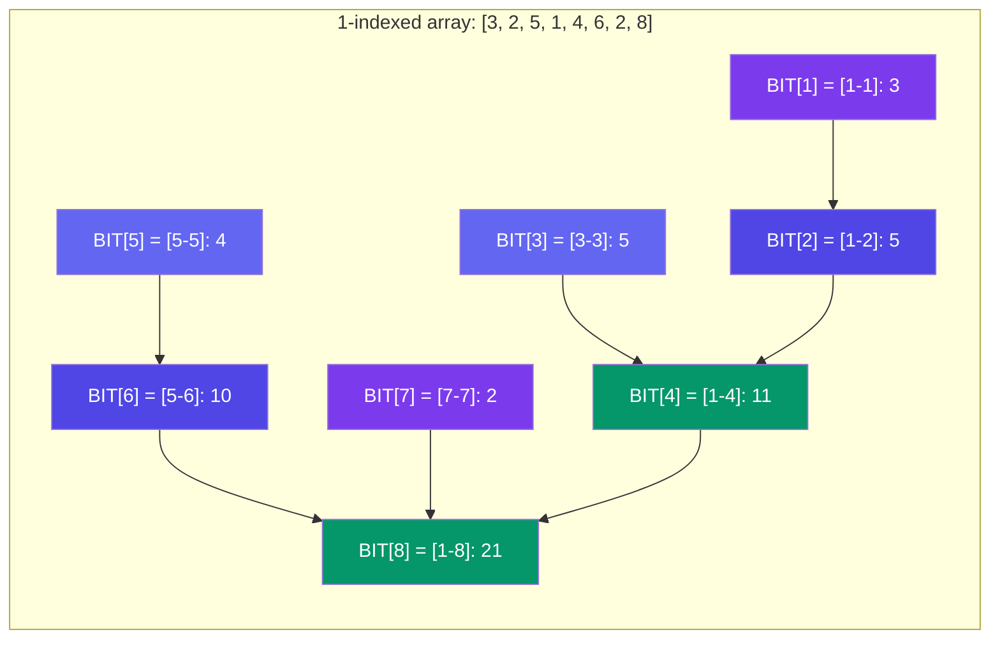

# Fenwick Tree (Binary Indexed Tree)

> A **Fenwick Tree** (also called Binary Indexed Tree or BIT) handles **prefix sum** queries and **point updates** in **O(log N)** time. It's simpler and more memory-efficient than a segment tree.

---

## Core Idea

Each index `i` stores the sum of a range ending at `i`. The range length depends on the lowest set bit of `i`.

```
Index (1-indexed):  1     2     3     4     5     6     7     8
Range stored:      [1-1] [1-2] [3-3] [1-4] [5-5] [5-6] [7-7] [1-8]
```

**Key operation:** `i & -i` (isolates the lowest set bit) — used to traverse the tree.

- **Get prefix sum:** subtract `i & -i` at each step
- **Update:** add `i & -i` at each step

---

## Visual: BIT Structure



---

## Implementation

```javascript
class FenwickTree {
  constructor(n) {
    this.n = n;
    this.bit = new Array(n + 1).fill(0); // 1-indexed
  }

  // Add val to arr[idx] (1-indexed)
  update(idx, val) {
    while (idx <= this.n) {
      this.bit[idx] += val;
      idx += idx & -idx; // move to parent
    }
  }

  // Sum of arr[1..idx]
  prefixSum(idx) {
    let sum = 0;
    while (idx > 0) {
      sum += this.bit[idx];
      idx -= idx & -idx; // move to sibling/parent
    }
    return sum;
  }

  // Sum of arr[l..r]
  rangeSum(l, r) {
    return this.prefixSum(r) - this.prefixSum(l - 1);
  }
}

// Example
const arr = [3, 2, 5, 1, 4, 6, 2, 8]; // 0-indexed
const bit = new FenwickTree(arr.length);

// Build BIT
for (let i = 0; i < arr.length; i++) {
  bit.update(i + 1, arr[i]);
}

console.log(bit.prefixSum(4));   // 3+2+5+1 = 11
console.log(bit.rangeSum(3, 6)); // 5+1+4+6 = 16 (indices 3-6)
bit.update(5, 10);               // add 10 to index 5
console.log(bit.rangeSum(3, 6)); // 5+1+14+6 = 26
```

---

## Complexity

| Operation | Time | Space |
|-----------|:----:|:-----:|
| Build | **O(N log N)** or O(N) | O(N) |
| Point Update | **O(log N)** | — |
| Prefix Sum | **O(log N)** | — |
| Range Sum | **O(log N)** | — |

---

## Segment Tree vs Fenwick Tree

| Aspect | Fenwick Tree | Segment Tree |
|--------|:------------:|:------------:|
| Implementation | ✅ Very simple | More code |
| Memory | **O(N)** | O(4N) |
| Operations | Prefix sum, point update | Range queries, range updates |
| Query flexibility | Sum only (with tricks) | Sum, min, max, gcd, etc. |
| Lazy propagation | ❌ Not supported | ✅ Supported |
| Best use | Prefix sums, counting inversions | General range queries |

---

## Use Cases

| Problem | How Fenwick Helps |
|---------|-------------------|
| **Range sum queries** | prefixSum(r) - prefixSum(l-1) |
| **Count inversions** | Walk array, update BIT, query how many larger seen |
| **Frequency counting** | BIT over value range |
| **Stock price changes** | Point update + range query |

---

## In Simple Words

- Fenwick Tree = simpler, smaller cousin of Segment Tree for prefix sums.
- Uses `idx += (idx & -idx)` to go up, `idx -= (idx & -idx)` to go down.
- Only handles prefix sums and point updates — but does them in O(log N) with very little code.
- Build by just updating each element — it's that simple.
