## What Are Design Patterns?

> **Design patterns** are reusable, battle-tested solutions to common problems in software design.

Think of them like **blueprints** — not finished code you copy-paste, but a template you adapt to your situation.

### Real-World Analogy

> A chef doesn't invent a new recipe every time someone orders an omelette. They follow a proven **pattern** — crack eggs, whisk, cook — and tweak it for the customer's taste.

Design patterns work the same way: proven solutions you customize for your app.

---

## The Gang of Four (GoF)

In 1994, four authors (Erich Gamma, Richard Helm, Ralph Johnson, John Vlissides) published *Design Patterns: Elements of Reusable Object-Oriented Software*. They cataloged **23 patterns** divided into 3 categories.

---

## The 3 Categories

```mermaid
flowchart TB
    GoF[Gang of Four<br/>23 Patterns] --> Creational[🏗️ Creational<br/>How objects are created]
    GoF --> Structural[🔧 Structural<br/>How objects are composed]
    GoF --> Behavioral[🔄 Behavioral<br/>How objects communicate]

    Creational --> S1[Singleton]
    Creational --> F1[Factory Method]
    Creational --> AF[Abstract Factory]
    Creational --> B1[Builder]
    Creational --> P1[Prototype]

    Structural --> Ad[Adapter]
    Structural --> Dec[Decorator]
    Structural --> Fac[Facade]
    Structural --> Pr[Proxy]
    Structural --> Com[Composite]
    Structural --> Br[Bridge]
    Structural --> Fly[Flyweight]

    Behavioral --> Ob[Observer]
    Behavioral --> St[Strategy]
    Behavioral --> Cmd[Command]
    Behavioral --> It[Iterator]
    Behavioral --> Sta[State]
    Behavioral --> TM[Template Method]
    Behavioral --> CoR[Chain of Resp.]
    Behavioral --> Med[Mediator]
    Behavioral --> Mem[Memento]
    Behavioral --> Vis[Visitor]

    style GoF fill:#7c3aed,color:#fff
    style Creational fill:#06b6d4,color:#fff
    style Structural fill:#f59e0b,color:#fff
    style Behavioral fill:#ef4444,color:#fff
```

### 🏗️ Creational Patterns (5)
**How objects are created.**

Instead of `new` everywhere, creational patterns give you flexible object creation.

| Pattern | What It Does |
|---------|-------------|
| **Singleton** | One shared instance for the whole app |
| **Factory Method** | Let subclasses decide which class to instantiate |
| **Abstract Factory** | Families of related objects without specifying concrete classes |
| **Builder** | Construct complex objects step by step |
| **Prototype** | Clone existing objects instead of creating new ones |

### 🔧 Structural Patterns (7)
**How objects are composed.**

Structural patterns assemble objects into larger structures while keeping them flexible.

| Pattern | What It Does |
|---------|-------------|
| **Adapter** | Make incompatible interfaces work together |
| **Decorator** | Add behavior to an object without changing its class |
| **Facade** | Provide a simple interface to a complex subsystem |
| **Proxy** | Control access to another object |
| **Composite** | Treat individual and group objects the same way |
| **Bridge** | Separate abstraction from implementation |
| **Flyweight** | Share data across many objects to save memory |

### 🔄 Behavioral Patterns (11)
**How objects communicate.**

Behavioral patterns manage algorithms, responsibilities, and communication between objects.

| Pattern | What It Does |
|---------|-------------|
| **Observer** | Notify multiple objects when something changes |
| **Strategy** | Swap algorithms at runtime |
| **Command** | Wrap a request as an object |
| **Iterator** | Traverse a collection without exposing internals |
| **State** | Change behavior when internal state changes |
| **Template Method** | Define skeleton, let subclasses fill details |
| **Chain of Responsibility** | Pass a request along a chain of handlers |
| **Mediator** | Centralize complex communication |
| **Memento** | Save and restore object state |
| **Visitor** | Add new operations without changing classes |

---

## Why Use Design Patterns?

| Reason | Explanation |
|--------|-------------|
| 🧠 **Proven** | Tested by thousands of developers over decades |
| 🗣️ **Shared vocabulary** | "Let's use an Observer here" — everyone understands |
| 🔧 **Maintainable** | Loosely coupled, easy to change code |
| 🚫 **Avoid reinvention** | Don't solve problems that have already been solved |

## When NOT to Use

- **Over-engineering**: Don't add a Factory for a single class
- **Simple problems**: A simple function is better than a pattern
- **Performance-critical**: Some patterns add overhead (Proxy, Decorator)

---

## In Simple Words

- Design patterns are **proven blueprints** for common coding problems
- There are **23 classic patterns** from the Gang of Four
- They're grouped into **3 categories**: Creational, Structural, Behavioral
- They give you a **shared vocabulary** with other developers
- Use them when the problem fits — but **don't force them**
