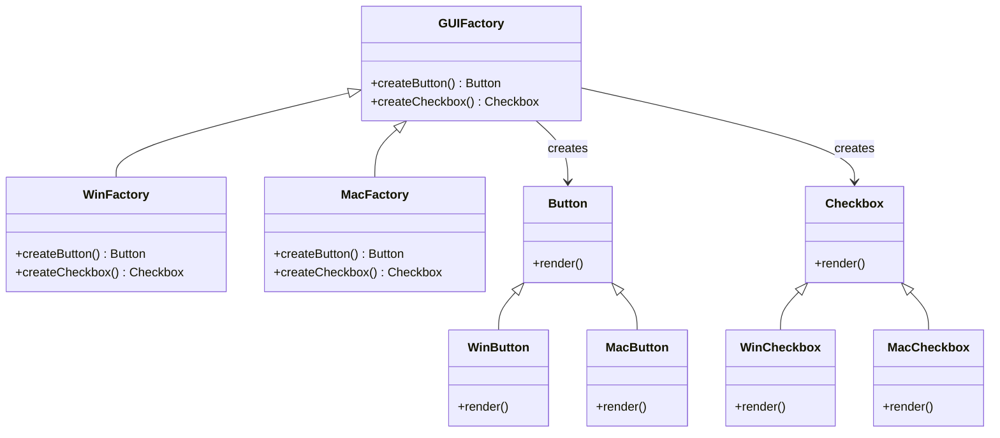

## Abstract Factory

> **Create families of related objects without specifying their concrete classes.**

### Real-World Analogy

> **IKEA sells furniture sets.** You buy a "Kitchen set" — you get a table, chairs, and cabinets that all match. You don't pick each item individually. The "kitchen factory" ensures everything coordinates.

---

## The Pattern



---

## ✅ Example

```js
// Abstract products
class Button {
  render() { throw new Error('Override'); }
}

class Checkbox {
  render() { throw new Error('Override'); }
}

// Concrete products — Windows
class WinButton extends Button {
  render() { return 'Rendering Windows-style button'; }
}

class WinCheckbox extends Checkbox {
  render() { return 'Rendering Windows-style checkbox'; }
}

// Concrete products — Mac
class MacButton extends Button {
  render() { return 'Rendering Mac-style button'; }
}

class MacCheckbox extends Checkbox {
  render() { return 'Rendering Mac-style checkbox'; }
}

// Abstract Factory
class GUIFactory {
  createButton() { throw new Error('Override'); }
  createCheckbox() { throw new Error('Override'); }
}

// Concrete Factories
class WinFactory extends GUIFactory {
  createButton() { return new WinButton(); }
  createCheckbox() { return new WinCheckbox(); }
}

class MacFactory extends GUIFactory {
  createButton() { return new MacButton(); }
  createCheckbox() { return new MacCheckbox(); }
}

// Usage
function renderUI(factory) {
  const button = factory.createButton();
  const checkbox = factory.createCheckbox();
  console.log(button.render());
  console.log(checkbox.render());
}

renderUI(new WinFactory());
// "Rendering Windows-style button"
// "Rendering Windows-style checkbox"

renderUI(new MacFactory());
// "Rendering Mac-style button"
// "Rendering Mac-style checkbox"
```

---

## Factory Method vs Abstract Factory

| | Factory Method | Abstract Factory |
|---|---|---|
| Creates | **One** product | **Families** of related products |
| Implementation | Single method | Multiple methods |
| Example | `createLogger()` | `createButton()` + `createCheckbox()` |

---

## When to Use

- Your system needs to work with **multiple product families** (Windows/Mac, iOS/Android)
- You want to ensure products from the same family work together
- **Adding a new family** is easy (just a new factory class)

## When NOT to Use

- You only create one type of product — use Factory Method instead
- Adding a new product type requires changing every factory

---

## In Simple Words

- A **factory of factories** — groups related factories together
- Ensures all products in a **family** are compatible
- Add a new operating system? Add a new factory — **existing code untouched**
