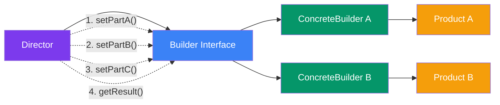

## Builder

> **Construct complex objects step by step.**

### Real-World Analogy

> At a **Subway sandwich shop**, you build your sandwich step by step: choose bread → choose protein → add veggies → choose sauce → toast → wrap. The final "object" varies, but the **process** is always the same.

---

## The Pattern



---

## ❌ Bad Example

```js
class Pizza {
  constructor(size, cheese, pepperoni, mushrooms, olives, sauce, crustType) {
    this.size = size;
    this.cheese = cheese;
    this.pepperoni = pepperoni;
    this.mushrooms = mushrooms;
    this.olives = olives;
    this.sauce = sauce;
    this.crustType = crustType;
  }
}

// 😵 Hard to read and easy to mix up parameters
const pizza = new Pizza('large', true, true, true, false, 'tomato', 'thin');
```

---

## ✅ Fixed Example

```js
class Pizza {
  constructor() {
    this.size = 'medium';
    this.cheese = false;
    this.pepperoni = false;
    this.mushrooms = false;
  }
}

class PizzaBuilder {
  constructor() {
    this.pizza = new Pizza();
  }

  setSize(size) {
    this.pizza.size = size;
    return this; // For chaining
  }

  addCheese() {
    this.pizza.cheese = true;
    return this;
  }

  addPepperoni() {
    this.pizza.pepperoni = true;
    return this;
  }

  addMushrooms() {
    this.pizza.mushrooms = true;
    return this;
  }

  build() {
    return this.pizza;
  }
}

// Usage
const pizza = new PizzaBuilder()
  .setSize('large')
  .addCheese()
  .addPepperoni()
  .addMushrooms()
  .build();

console.log(pizza);
// { size: 'large', cheese: true, pepperoni: true, mushrooms: true }
```

### With a Director

```js
class PizzaDirector {
  makeMargherita(builder) {
    return builder
      .setSize('medium')
      .addCheese()
      .build();
  }

  makeVeggie(builder) {
    return builder
      .setSize('large')
      .addCheese()
      .addMushrooms()
      .build();
  }
}

const director = new PizzaDirector();
const margherita = director.makeMargherita(new PizzaBuilder());
```

---

## When to Use

- Objects with **many optional parameters**
- Complex construction **steps** that vary
- Creating **different representations** of the same object

## When NOT to Use

- Simple objects with a few required parameters — just use a constructor
- When you don't need different variations

---

## In Simple Words

- Build objects **step by step** using method chaining
- Makes complex constructors **readable**
- Same process can create **different variations**
- The **Director** controls the building steps; the **Builder** knows how to do them
