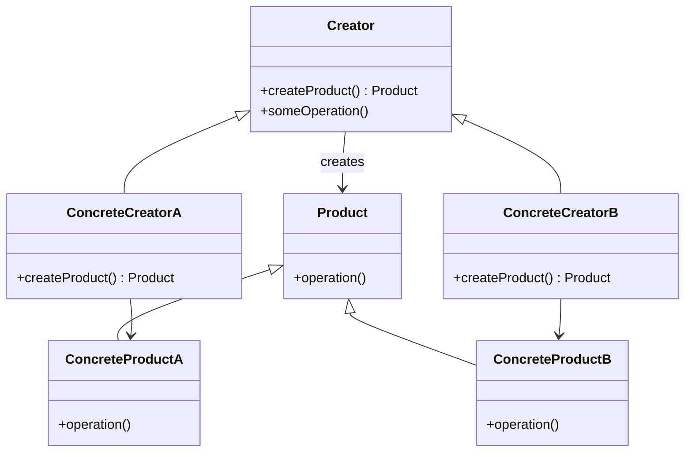

## Factory Method

> **Define an interface for creating objects, but let subclasses decide which class to instantiate.**

### Real-World Analogy

> A **car factory** doesn't build every car itself. It has a method: "Build me a car." Subclasses (SUVFactory, SedanFactory) decide which specific car to produce.

---

## The Pattern



---

## ❌ Bad Example

```js
class NotificationApp {
  sendNotification(type, message) {
    if (type === 'email') {
      // Create email notification
      console.log(`Email: ${message}`);
    } else if (type === 'sms') {
      // Create SMS notification
      console.log(`SMS: ${message}`);
    }
    // ❌ Every new type = modify this method
  }
}
```

---

## ✅ Fixed Example

```js
// Product
class Notification {
  send(message) {
    throw new Error('Override this');
  }
}

class EmailNotification extends Notification {
  send(message) {
    console.log(`📧 Email: ${message}`);
  }
}

class SMSNotification extends Notification {
  send(message) {
    console.log(`📱 SMS: ${message}`);
  }
}

class PushNotification extends Notification {
  send(message) {
    console.log(`🔔 Push: ${message}`);
  }
}

// Creator with factory method
class NotificationFactory {
  createNotification(type) {
    switch (type) {
      case 'email': return new EmailNotification();
      case 'sms': return new SMSNotification();
      case 'push': return new PushNotification();
      default: throw new Error('Unknown type');
    }
  }
}

// Usage
const factory = new NotificationFactory();
const emailNotif = factory.createNotification('email');
emailNotif.send('Hello!'); // "📧 Email: Hello!"

const pushNotif = factory.createNotification('push');
pushNotif.send('Hello!'); // "🔔 Push: Hello!"
```

---

## When to Use

- The exact type of object isn't known until runtime
- You want to **centralize object creation** (avoid `new` everywhere)
- Adding new types should not modify existing code (Open/Closed)

## When NOT to Use

- Simply creating one or two objects — just use `new`
- When you don't expect to add new types

---

## In Simple Words

- A **factory** creates objects, hiding the creation logic
- Subclasses decide **which concrete object** to create
- Keeps creation logic in **one place**
- Adding a new type = new class, **no modification** to existing code
