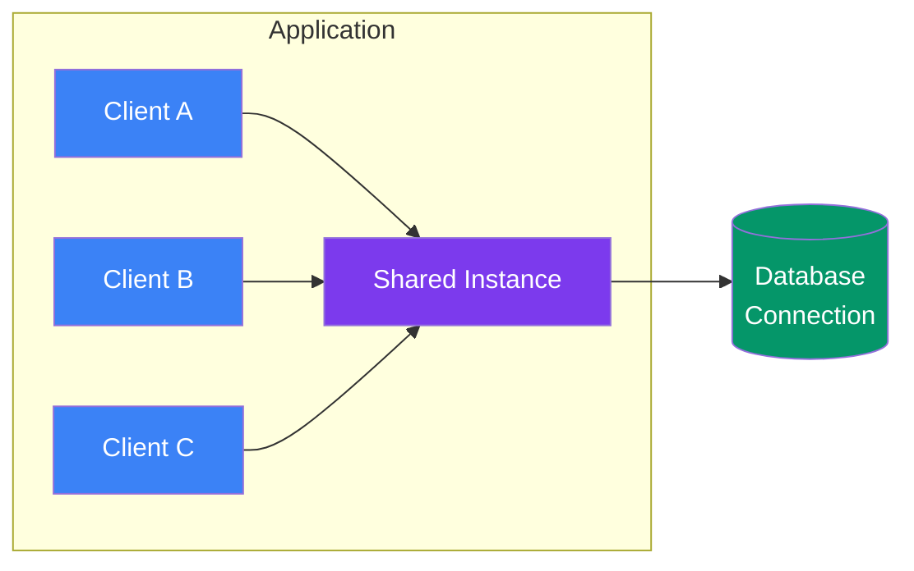

## Singleton

> **Ensure a class has exactly one instance. Provide a global access point to it.**

### Real-World Analogy

> A country's **president** — there's only one at any time. Everyone goes through the same office.

---

## The Pattern



---

## ✅ Example

```js
class DatabaseConnection {
  constructor() {
    if (DatabaseConnection.instance) {
      return DatabaseConnection.instance;
    }

    this.connection = this.#connect();
    DatabaseConnection.instance = this;
  }

  #connect() {
    console.log('Connecting to database...');
    return { connected: true };
  }

  query(sql) {
    console.log(`Executing: ${sql}`);
  }
}

// Usage
const db1 = new DatabaseConnection(); // "Connecting to database..."
const db2 = new DatabaseConnection(); // Returns existing instance

console.log(db1 === db2); // true — same instance

db1.query('SELECT * FROM users');
```

### Alternative — Using a Module

In JavaScript, modules are singletons by default:

```js
// db.js
class Database { /* ... */ }
export default new Database();

// app.js
import db from './db.js'; // Same instance everywhere
```

---

## When to Use

| Use | Don't Use |
|-----|-----------|
| Shared resource (DB connection, logger, config) | Stateless utility functions |
| Cache manager | When you need multiple instances |
| Global state store | In testable code (hard to mock) |

## When NOT to Use

- **Testing** — singletons make unit tests harder (global state between tests)
- **Concurrent environments** — shared mutable state causes race conditions
- **Overuse** — many "singletons" are better as injected dependencies

---

## In Simple Words

- **One instance** shared across the whole app
- Prevents creating multiple connections/resources
- **JavaScript modules** are natural singletons
- Use sparingly — it's basically a **global variable**
