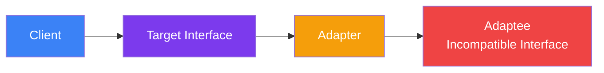

## Adapter

> **Allow objects with incompatible interfaces to collaborate.**

### Real-World Analogy

> A **travel adapter** lets you plug a US plug (flat pins) into a European socket (round holes). The adapter converts one interface to another.

---

## The Pattern



---

## ❌ Bad Example — Directly Using Incompatible Code

```js
// Old system — returns XML
class OldWeatherAPI {
  getXML() {
    return '<weather><temp>25</temp></weather>';
  }
}

// New system — expects JSON
class WeatherApp {
  display(data) {
    console.log(`Temperature: ${data.temp}°C`);
  }
}

// ❌ Can't directly use OldWeatherAPI with WeatherApp
const oldAPI = new OldWeatherAPI();
const app = new WeatherApp();
// app.display(oldAPI.getXML()); // Won't work — expects JSON
```

---

## ✅ Fixed Example

```js
// Target interface
class WeatherApp {
  display(data) {
    console.log(`Temperature: ${data.temp}°C`);
  }
}

// Adaptee (incompatible)
class OldWeatherAPI {
  getXML() {
    return '<weather><temp>25</temp></weather>';
  }
}

// Adapter
class WeatherAdapter {
  constructor(oldAPI) {
    this.oldAPI = oldAPI;
  }

  getJSON() {
    const xml = this.oldAPI.getXML();
    // Simple XML to JSON conversion
    const temp = xml.match(/<temp>(\d+)<\/temp>/)[1];
    return { temp: parseInt(temp) };
  }
}

// Usage
const oldAPI = new OldWeatherAPI();
const adapter = new WeatherAdapter(oldAPI);
const app = new WeatherApp();

app.display(adapter.getJSON()); // "Temperature: 25°C" ✅
```

---

## When to Use

- You have an existing class with an **incompatible interface**
- You want to use a **third-party library** without changing your code
- You need to wrap **legacy code** behind a modern interface

## When NOT to Use

- You can modify the source code — just change the interface directly
- The interfaces are already compatible

---

## In Simple Words

- **Wraps** an incompatible object so it looks like what the client expects
- Like a **power adapter** between two different plug types
- Lets old and new code **work together** without changing either
