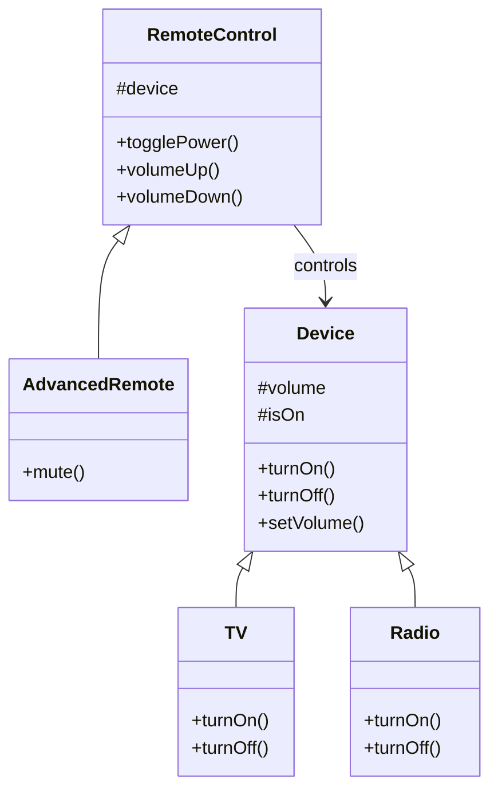

## Bridge

> **Decouple an abstraction from its implementation so the two can vary independently.**

### Real-World Analogy

> **Remote controls and devices.** A TV remote works for Sony, Samsung, and LG. The remote (abstraction) is separate from the device (implementation). You can have any remote with any TV — they vary independently.

---

## The Pattern



**Abstraction** (RemoteControl) and **Implementation** (Device) vary independently.

---

## ✅ Example

```js
// Implementation hierarchy
class Device {
  constructor() {
    this.volume = 50;
    this.isOn = false;
  }
  turnOn() { throw new Error('Override'); }
  turnOff() { throw new Error('Override'); }
  setVolume(vol) { this.volume = vol; }
}

class TV extends Device {
  turnOn() { console.log('📺 TV turned on'); }
  turnOff() { console.log('📺 TV turned off'); }
}

class Radio extends Device {
  turnOn() { console.log('📻 Radio turned on'); }
  turnOff() { console.log('📻 Radio turned off'); }
}

// Abstraction hierarchy
class RemoteControl {
  constructor(device) {
    this.device = device;
  }

  togglePower() {
    if (this.device.isOn) {
      this.device.turnOff();
      this.device.isOn = false;
    } else {
      this.device.turnOn();
      this.device.isOn = true;
    }
  }

  volumeUp() {
    this.device.setVolume(this.device.volume + 10);
    console.log(`Volume: ${this.device.volume}`);
  }

  volumeDown() {
    this.device.setVolume(this.device.volume - 10);
    console.log(`Volume: ${this.device.volume}`);
  }
}

class AdvancedRemoteControl extends RemoteControl {
  mute() {
    this.device.setVolume(0);
    console.log('Muted 🔇');
  }
}

// Usage
const tv = new TV();
const remote = new RemoteControl(tv);
remote.togglePower();  // "📺 TV turned on"
remote.volumeUp();     // "Volume: 60"

const radio = new Radio();
const advancedRemote = new AdvancedRemoteControl(radio);
advancedRemote.togglePower();  // "📻 Radio turned on"
advancedRemote.mute();         // "Muted 🔇"
```

---

## Bridge vs Adapter

| Aspect | Bridge | Adapter |
|--------|--------|---------|
| **When** | Designed upfront | After the fact |
| **Purpose** | Let both abstraction & implementation vary | Make existing code work together |
| **Focus** | Future flexibility | Current incompatibility |

---

## When to Use

- You want to avoid a **permanent binding** between abstraction and implementation
- Both the abstraction and implementation should be **extensible by subclassing**
- Changes to implementation should **not affect** the client

---

## In Simple Words

- **Separate** what something does (abstraction) from how it does it (implementation)
- Both can **change independently**
- Instead of many rigid classes (TVWithBasicRemote, TVWithAdvancedRemote, RadioWithBasicRemote...), you have **flexible combinations**
