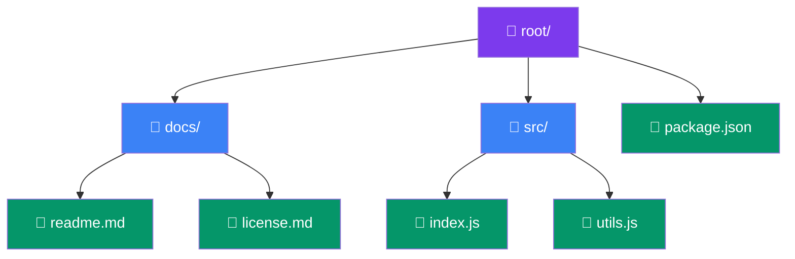

## Composite

> **Treat individual objects and groups of objects uniformly.**

### Real-World Analogy

> A **file system**: A folder contains files and other folders. You can "delete" a single file or a whole folder (which deletes everything inside). Both files and folders support the same operations.

---

## The Pattern



**Composite** = folders (can contain children)
**Leaf** = files (cannot contain children)

---

## ✅ Example

```js
// Component — unified interface
class FileSystemNode {
  getName() { return this.name; }
  getSize() { return this.size; }
}

// Leaf
class File extends FileSystemNode {
  constructor(name, size) {
    super();
    this.name = name;
    this.size = size;
  }

  display(indent = 0) {
    console.log(`${'  '.repeat(indent)}📄 ${this.name} (${this.size}KB)`);
  }
}

// Composite
class Folder extends FileSystemNode {
  constructor(name) {
    super();
    this.name = name;
    this.children = [];
  }

  add(node) {
    this.children.push(node);
  }

  getSize() {
    return this.children.reduce((sum, child) => sum + child.getSize(), 0);
  }

  display(indent = 0) {
    console.log(`${'  '.repeat(indent)}📁 ${this.name}/ (${this.getSize()}KB)`);
    this.children.forEach(child => child.display(indent + 1));
  }
}

// Usage
const root = new Folder('root');
const docs = new Folder('docs');
docs.add(new File('readme.md', 5));
docs.add(new File('license.md', 2));

const src = new Folder('src');
src.add(new File('index.js', 10));
src.add(new File('utils.js', 7));

root.add(docs);
root.add(src);
root.add(new File('package.json', 1));

root.display();
// 📁 root/ (25KB)
//   📁 docs/ (7KB)
//     📄 readme.md (5KB)
//     📄 license.md (2KB)
//   📁 src/ (17KB)
//     📄 index.js (10KB)
//     📄 utils.js (7KB)
//   📄 package.json (1KB)

console.log(`Total size: ${root.getSize()}KB`); // "Total size: 25KB"
```

---

## When to Use

- **Tree-like structures** (file systems, UI components, organization charts)
- You want to treat **individual and group objects the same way**
- Recursive structures

## When NOT to Use

- Simple flat structures — no tree needed
- When leaf and composite objects have very different behaviors

---

## Real-World Examples

| Example | Leaves | Composites |
|---------|--------|------------|
| **DOM** | Text nodes | Elements (`<div>`) |
| **React** | `<div>` | `<App>` containing many components |
| **Graphics** | Circle, Square | Group of shapes |

---

## In Simple Words

- **Leaves** (individual items) and **composites** (groups) share the same interface
- You can perform the same operation on **one item or a whole tree**
- Works great for **hierarchical, recursive data**
- The client doesn't need to know if it's dealing with one item or many
