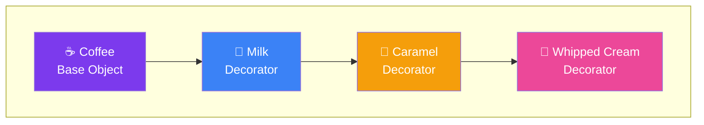

## Decorator

> **Add behavior to an object without changing its class.**

### Real-World Analogy

> At a coffee shop, you start with a basic coffee. Then you **decorate** it with milk, sugar, caramel, or whipped cream. Each addition doesn't change how coffee works — it just adds new flavor.

---

## The Pattern



---

## ✅ Example

```js
// Component
class Coffee {
  cost() {
    return 5;
  }

  description() {
    return 'Plain coffee';
  }
}

// Decorator
class MilkDecorator {
  constructor(coffee) {
    this.coffee = coffee;
  }

  cost() {
    return this.coffee.cost() + 2;
  }

  description() {
    return this.coffee.description() + ' + milk';
  }
}

class CaramelDecorator {
  constructor(coffee) {
    this.coffee = coffee;
  }

  cost() {
    return this.coffee.cost() + 3;
  }

  description() {
    return this.coffee.description() + ' + caramel';
  }
}

class WhippedCreamDecorator {
  constructor(coffee) {
    this.coffee = coffee;
  }

  cost() {
    return this.coffee.cost() + 1.5;
  }

  description() {
    return this.coffee.description() + ' + whipped cream';
  }
}

// Usage
let coffee = new Coffee();
console.log(`${coffee.description()} = $${coffee.cost()}`);
// "Plain coffee = $5"

coffee = new MilkDecorator(coffee);
coffee = new CaramelDecorator(coffee);
coffee = new WhippedCreamDecorator(coffee);

console.log(`${coffee.description()} = $${coffee.cost()}`);
// "Plain coffee + milk + caramel + whipped cream = $11.5"
```

---

## Real-World Examples

| Library/Feature | Decorator Pattern |
|----------------|-------------------|
| **Express.js middleware** | Each middleware wraps the request/response |
| **Higher-Order Components (React)** | `withAuth(Component)` wraps a component |
| **Python decorators** | `@cache`, `@login_required` |
| **TypeScript decorators** | `@Injectable`, `@Component` |

---

## When to Use

- You need to add behavior to **many objects** without subclassing
- You need to add behaviors **dynamically** at runtime
- You want to avoid "class explosion" (too many subclasses)

## When NOT to Use

- The wrapping itself becomes complex (too many layers)
- You want to remove wrapped functionality (can't easily unwrap)

---

## In Simple Words

- Wrap an object with **layers** that add new behavior
- Like adding toppings to a pizza or subs — each addition wraps the previous
- Keeps classes **small and focused**
- Combine multiple decorators for **endless combinations**
