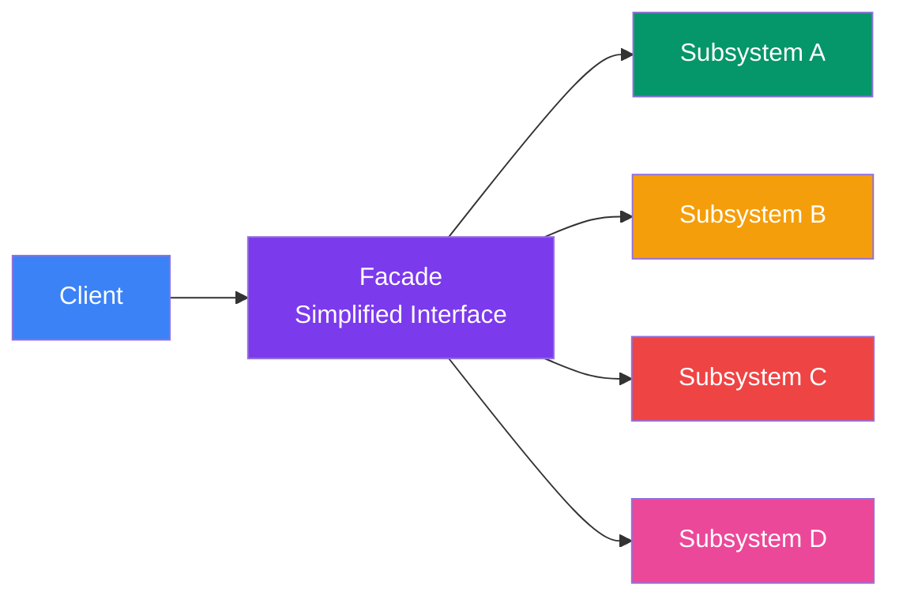

## Facade

> **Provide a simple, unified interface to a complex subsystem.**

### Real-World Analogy

> A **restaurant waiter** is a facade. You don't go into the kitchen, cook food, wash dishes, or handle the cash register. You just tell the waiter what you want, and they handle the complex system behind the scenes.

---

## The Pattern



---

## ❌ Bad Example — Client Does Everything

```js
// Client needs to start a computer:
const cpu = new CPU();
const memory = new Memory();
const hardDrive = new HardDrive();
const bios = new BIOS();
const os = new OperatingSystem();

cpu.initialize();
memory.loadBootLoader();
hardDrive.readBootSector();
bios.checkHardware();
bios.selectBootDevice();
os.load();
os.startServices();
// 😵 So many steps!
```

---

## ✅ Fixed Example

```js
// Complex subsystem
class CPU {
  initialize() { console.log('CPU initialized'); }
}
class Memory {
  loadBootLoader() { console.log('Boot loader loaded'); }
}
class HardDrive {
  readBootSector() { console.log('Boot sector read'); }
}
class BIOS {
  checkHardware() { console.log('Hardware check OK'); }
  selectBootDevice() { console.log('Boot device selected'); }
}
class OperatingSystem {
  load() { console.log('OS loaded'); }
  startServices() { console.log('Services started'); }
}

// Facade
class Computer {
  constructor() {
    this.cpu = new CPU();
    this.memory = new Memory();
    this.hardDrive = new HardDrive();
    this.bios = new BIOS();
    this.os = new OperatingSystem();
  }

  start() {
    this.cpu.initialize();
    this.memory.loadBootLoader();
    this.hardDrive.readBootSector();
    this.bios.checkHardware();
    this.bios.selectBootDevice();
    this.os.load();
    this.os.startServices();
    console.log('✅ Computer ready!');
  }
}

// Client — just calls one method
const computer = new Computer();
computer.start();
// One simple call instead of 7 steps
```

---

## Real-World Examples

| Facade | Behind the Scenes |
|--------|-------------------|
| **jQuery** | `$('.btn').hide()` hides complex DOM & CSS manipulation |
| **Axios** | `axios.get('/api')` wraps XMLHttpRequest, parsing, error handling |
| **Stripe Checkout** | One embed handles payment processing, receipts, security |

---

## When to Use

- You want to **simplify** a complex API for common use cases
- You want to **decouple** client code from complex subsystems
- You want to provide a **single entry point** for a set of features

## When NOT to Use

- The subsystem is already simple enough
- Clients need fine-grained control over subsystems

---

## In Simple Words

- A **simple front door** to a complex house
- Hides many moving parts behind one easy-to-use method
- Not a "god object" — it delegates, it doesn't do everything itself
- Makes the common task **one line** instead of ten
