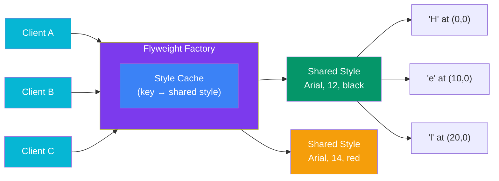

## Flyweight

> **Share common data across many objects to save memory.**

### Real-World Analogy

> In a **text editor**, every character 'a' doesn't store its own font and size data. Instead, all 'a' characters **share** the same formatting data (glyph, font, size). Each 'a' only stores its **position** — the unique part.

---

## The Pattern



**Intrinsic state** (shared): font, size, color
**Extrinsic state** (unique): character, position

---

## ✅ Example

```js
// Flyweight — shared, intrinsic state
class CharacterStyle {
  constructor(font, size, color) {
    this.font = font;
    this.size = size;
    this.color = color;
  }

  render(char, position) {
    console.log(`'${char}' at (${position.x}, ${position.y}) — [${this.font}, ${this.size}, ${this.color}]`);
  }
}

// Flyweight Factory
class StyleFactory {
  constructor() {
    this.styles = new Map();
  }

  getStyle(font, size, color) {
    const key = `${font}-${size}-${color}`;
    if (!this.styles.has(key)) {
      this.styles.set(key, new CharacterStyle(font, size, color));
      console.log(`   💡 Created new style: ${key}`);
    }
    return this.styles.get(key);
  }

  getTotalStyles() {
    return this.styles.size;
  }
}

// Usage
const factory = new StyleFactory();

function renderDocument() {
  const document = [
    { char: 'H', style: ['Arial', 12, 'black'], pos: { x: 0, y: 0 } },
    { char: 'e', style: ['Arial', 12, 'black'], pos: { x: 10, y: 0 } },
    { char: 'l', style: ['Arial', 12, 'black'], pos: { x: 20, y: 0 } },
    { char: 'l', style: ['Arial', 12, 'black'], pos: { x: 30, y: 0 } },
    { char: 'o', style: ['Arial', 12, 'black'], pos: { x: 40, y: 0 } },
    { char: '!', style: ['Arial', 14, 'red'], pos: { x: 50, y: 0 } },
  ];

  document.forEach(({ char, style, pos }) => {
    const charStyle = factory.getStyle(...style);
    charStyle.render(char, pos);
  });

  console.log(`\nTotal characters: ${document.length}`);
  console.log(`Unique styles created: ${factory.getTotalStyles()}`);
  // Only 2 styles created for 6 characters — saves memory!
}

renderDocument();
```

---

## When to Use

- You have **thousands/millions** of similar objects
- Object creation is expensive in memory
- Many objects share **common data** that can be separated (intrinsic state)
- The unique data per object is small (extrinsic state)

## When NOT to Use

- Small numbers of objects — the overhead isn't worth it
- Objects don't share common data

---

## In Simple Words

- Split objects into **shared** (intrinsic) and **unique** (extrinsic) parts
- The shared part is stored once and reused across many objects
- The unique part (like position) is passed in when needed
- **Saves lots of memory** when you have many similar objects
