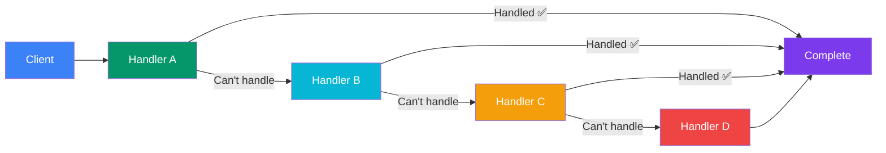

## Chain of Responsibility

> **Pass a request along a chain of handlers. Each handler decides to process the request or pass it to the next handler.**

### Real-World Analogy

> **Customer support ticket**: Level 1 support tries to resolve → if too complex, escalates to Level 2 → Level 2 tries → if needed, escalates to Manager → Manager resolves or rejects. The request moves along the chain.

---

## The Pattern



---

## ✅ Example

```js
// Handler
class SupportHandler {
  constructor() {
    this.nextHandler = null;
  }

  setNext(handler) {
    this.nextHandler = handler;
    return handler; // For chaining
  }

  handle(request) {
    if (this.nextHandler) {
      this.nextHandler.handle(request);
    }
  }
}

// Concrete Handlers
class Level1Support extends SupportHandler {
  handle(request) {
    if (request.level <= 1) {
      console.log(`✅ Level 1 resolved: "${request.issue}"`);
    } else {
      console.log('⏫ Escalating to Level 2...');
      super.handle(request);
    }
  }
}

class Level2Support extends SupportHandler {
  handle(request) {
    if (request.level <= 2) {
      console.log(`✅ Level 2 resolved: "${request.issue}"`);
    } else {
      console.log('⏫ Escalating to Manager...');
      super.handle(request);
    }
  }
}

class Manager extends SupportHandler {
  handle(request) {
    if (request.level <= 3) {
      console.log(`✅ Manager resolved: "${request.issue}"`);
    } else {
      console.log('❌ Cannot resolve — requires new feature');
    }
  }
}

// Build chain
const level1 = new Level1Support();
const level2 = new Level2Support();
const manager = new Manager();

level1.setNext(level2).setNext(manager);

// Usage
level1.handle({ issue: 'Password reset', level: 1 });
// ✅ Level 1 resolved: "Password reset"

level1.handle({ issue: 'Refund request', level: 2 });
// ⏫ Escalating to Level 2...
// ✅ Level 2 resolved: "Refund request"

level1.handle({ issue: 'Legal issue', level: 3 });
// ⏫ Escalating to Level 2...
// ⏫ Escalating to Manager...
// ✅ Manager resolved: "Legal issue"
```

---

## Real-World Examples

| Technology | Chain of Responsibility |
|-----------|------------------------|
| **Express.js middleware** | Each middleware processes or passes to `next()` |
| **Event bubbling (DOM)** | Event goes from target → parent → ancestor |
| **Build pipelines** | Each build step passes to the next |
| **Filter chains** (Java servlets) | Each filter processes or passes along |

---

## When to Use

- You have **multiple handlers** that could process a request
- You don't know which handler will process it at compile time
- The order of handlers **matters**
- You want to **add/remove handlers** without changing code

## When NOT to Use

- Simple if/else suffices
- Handlers don't have a clear order
- You always know which handler should process the request

---

## In Simple Words

- Build a **chain** of handlers; each one decides: "Handle or pass?"
- Like an **assembly line** — each station inspects and either fixes or passes along
- **Decouples** the sender from the receiver
- Add new handlers **without modifying** existing ones
