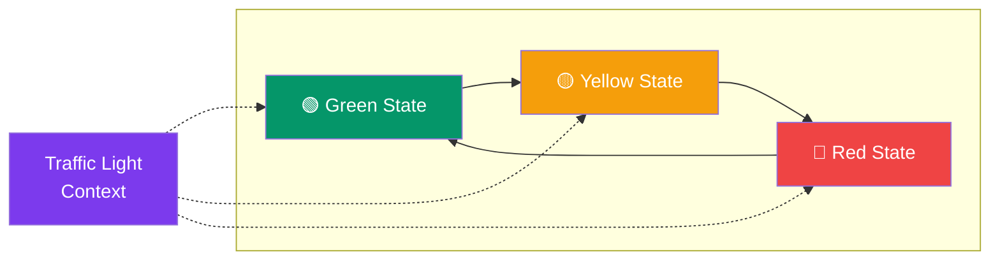

## State

> **An object changes its behavior when its internal state changes.**

### Real-World Analogy

> A **traffic light** — at any moment it's in one state (red, yellow, green). Each state determines what happens next. You don't tell the light "turn red, then yellow, then green." The light transitions itself based on its current state.

---

## The Pattern



---

## ✅ Example

```js
// State interface
class OrderState {
  constructor(order) {
    this.order = order;
  }
  pay() { throw new Error('Override'); }
  ship() { throw new Error('Override'); }
  cancel() { throw new Error('Override'); }
}

// Concrete states
class PendingState extends OrderState {
  pay() {
    console.log('✅ Payment received');
    this.order.setState(new PaidState(this.order));
  }
  ship() {
    console.log('❌ Cannot ship — order not paid yet');
  }
  cancel() {
    console.log('❌ Order cancelled');
    this.order.setState(new CancelledState(this.order));
  }
}

class PaidState extends OrderState {
  pay() {
    console.log('❌ Already paid');
  }
  ship() {
    console.log('🚚 Order shipped!');
    this.order.setState(new ShippedState(this.order));
  }
  cancel() {
    console.log('💸 Refund issued');
    this.order.setState(new CancelledState(this.order));
  }
}

class ShippedState extends OrderState {
  pay() {
    console.log('❌ Already paid');
  }
  ship() {
    console.log('❌ Already shipped');
  }
  cancel() {
    console.log('❌ Cannot cancel — already shipped');
  }
}

class CancelledState extends OrderState {
  pay() {
    console.log('❌ Order was cancelled');
  }
  ship() {
    console.log('❌ Order was cancelled');
  }
  cancel() {
    console.log('❌ Already cancelled');
  }
}

// Context
class Order {
  constructor() {
    this.state = new PendingState(this);
  }

  setState(state) {
    this.state = state;
  }

  pay() { this.state.pay(); }
  ship() { this.state.ship(); }
  cancel() { this.state.cancel(); }
}

// Usage
const order = new Order();
order.ship();  // "❌ Cannot ship — order not paid yet"
order.pay();   // "✅ Payment received"
order.ship();  // "🚚 Order shipped!"
order.cancel(); // "❌ Cannot cancel — already shipped"
```

---

## State vs Strategy

| Aspect | State | Strategy |
|--------|-------|----------|
| **States know** about each other | Often yes (transitions) | No |
| **Who changes** the algorithm | Object itself | Client |
| **Analogy** | Traffic light | GPS route options |

---

## When to Use

- An object's behavior depends on its **state**, and the state changes often
- You have **large conditionals** based on state (`if (status === 'paid')`)
- States have **well-defined transitions**

## When NOT to Use

- Only two or three simple states — a simple if/else is fine
- State transitions are rare

---

## In Simple Words

- The object **changes its behavior** when its state changes
- Each state is its own class with **rules for what can happen**
- Eliminates messy `if (state === X)` conditionals
- Makes state transitions **explicit and easy to follow**
