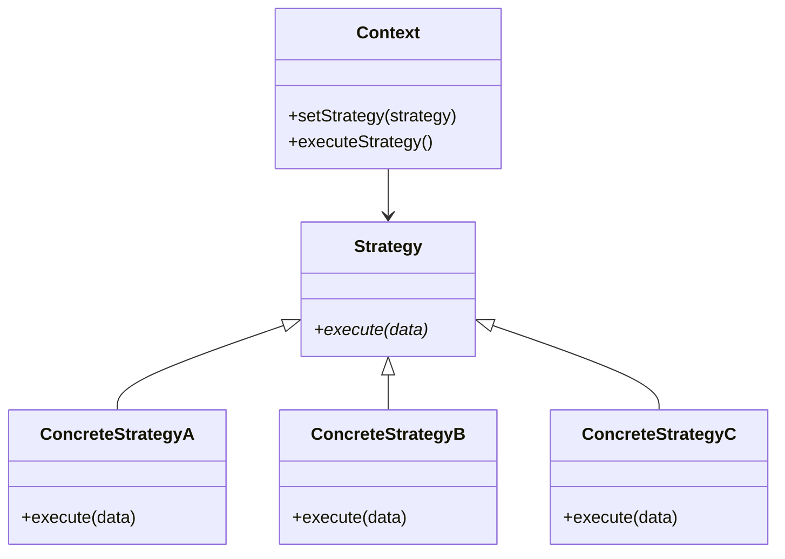

## Strategy

> **Define a family of algorithms, encapsulate each one, and make them interchangeable.**

### Real-World Analogy

> **A GPS navigation app** — you can choose different routes: fastest, shortest, avoid highways, scenic. The app (context) doesn't change; you just swap the routing algorithm (strategy).

---

## The Pattern



---

## ✅ Example

```js
// Strategies
class CreditCardPayment {
  pay(amount) {
    console.log(`💳 Paid $${amount} with Credit Card (2% fee)`);
    return amount * 1.02;
  }
}

class PayPalPayment {
  pay(amount) {
    console.log(`🅿️ Paid $${amount} with PayPal`);
    return amount;
  }
}

class CryptoPayment {
  pay(amount) {
    console.log(`₿ Paid $${amount} with Bitcoin`);
    return amount * 0.99; // 1% discount
  }
}

// Context
class ShoppingCart {
  constructor() {
    this.items = [];
    this.paymentStrategy = null;
  }

  addItem(item) {
    this.items.push(item);
  }

  setPaymentStrategy(strategy) {
    this.paymentStrategy = strategy;
  }

  checkout() {
    const total = this.items.reduce((sum, item) => sum + item.price, 0);
    const finalAmount = this.paymentStrategy.pay(total);
    console.log(`Total paid: $${finalAmount}`);
  }
}

// Usage
const cart = new ShoppingCart();
cart.addItem({ name: 'Book', price: 20 });
cart.addItem({ name: 'Pen', price: 5 });

// User chooses PayPal
cart.setPaymentStrategy(new PayPalPayment());
cart.checkout();
// "🅿️ Paid $25 with PayPal"
// "Total paid: $25"

// Another user chooses Credit Card
const cart2 = new ShoppingCart();
cart2.addItem({ name: 'Laptop', price: 1000 });
cart2.setPaymentStrategy(new CreditCardPayment());
cart2.checkout();
// "💳 Paid $1000 with Credit Card (2% fee)"
// "Total paid: $1020"
```

---

## Strategy vs State

| Aspect | Strategy | State |
|--------|----------|-------|
| **Purpose** | Swap algorithms | Change behavior based on state |
| **Who decides** | The client | The object itself |
| **Example** | Choosing payment method | Order status: new → paid → shipped |

---

## When to Use

- You have **multiple variants of an algorithm**
- You want to avoid **massive conditionals** (if/switch)
- Algorithms should be **swappable at runtime**

## When NOT to Use

- Only one algorithm is needed
- The algorithm doesn't vary
- The strategies are very simple — a function parameter suffices

---

## In Simple Words

- Encapsulate **different ways of doing something** in separate classes
- The context **delegates** the work to the chosen strategy
- Add new strategies **without changing** the context
- Like choosing **different modes** (map, satellite, terrain) on Google Maps
