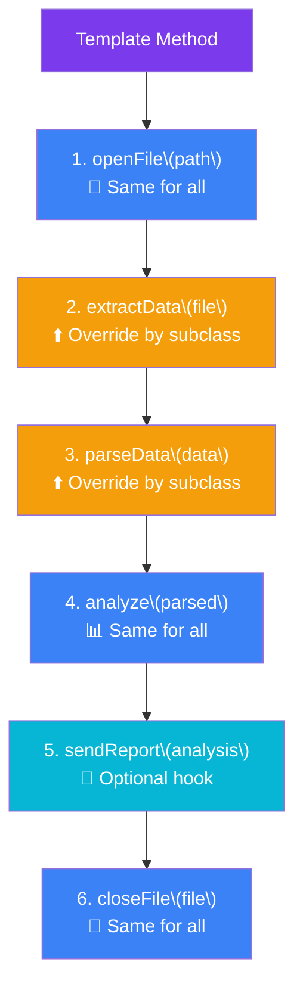

## Template Method

> **Define the skeleton of an algorithm. Let subclasses fill in the details.**

### Real-World Analogy

> **Baking a cake** — the process is always the same: mix ingredients → bake → cool → decorate. But the specific ingredients (chocolate, vanilla, carrot) vary. The "cake recipe" is the template.

---

## The Pattern



**Fixed steps** (blue) — defined in abstract class
**Overridable steps** (orange) — subclasses provide implementation
**Optional hooks** (teal) — subclasses may override

---

## ✅ Example

```js
// Abstract class with template method
class DataMiner {
  // Template method — defines the skeleton
  mine(path) {
    console.log(`\n--- Mining data from ${path} ---`);
    const file = this.openFile(path);
    const data = this.extractData(file);
    const parsed = this.parseData(data);
    const analysis = this.analyze(parsed);
    this.sendReport(analysis);
    this.closeFile(file);
  }

  // Steps that subclasses override
  openFile(path) {
    console.log(`Opening file: ${path}`);
    return { path, content: '...' };
  }

  extractData(file) {
    throw new Error('Subclass must implement extractData');
  }

  parseData(data) {
    throw new Error('Subclass must implement parseData');
  }

  analyze(parsed) {
    console.log(`Analysis complete: ${JSON.stringify(parsed)}`);
    return parsed;
  }

  // Optional step with default (hook)
  sendReport(analysis) {
    console.log('Report sent to admin');
  }

  closeFile(file) {
    console.log(`Closing file: ${file.path}`);
  }
}

// Concrete subclass — CSV
class CSVMiner extends DataMiner {
  extractData(file) {
    console.log('Extracting CSV data...');
    return 'raw csv text';
  }

  parseData(data) {
    console.log('Parsing CSV...');
    return { format: 'CSV', rows: 100 };
  }
}

// Concrete subclass — PDF
class PDFMiner extends DataMiner {
  extractData(file) {
    console.log('Extracting PDF data...');
    return 'raw pdf text';
  }

  parseData(data) {
    console.log('Parsing PDF with OCR...');
    return { format: 'PDF', pages: 5 };
  }

  // Override hook
  sendReport(analysis) {
    console.log(`PDF report encrypted and sent: ${JSON.stringify(analysis)}`);
  }
}

// Usage
const csvMiner = new CSVMiner();
csvMiner.mine('data.csv');

const pdfMiner = new PDFMiner();
pdfMiner.mine('document.pdf');
```

---

## When to Use

- Different classes share the **same algorithm structure** but differ in specific steps
- You want to **avoid code duplication** by putting common steps in a base class
- You want to control **which steps** subclasses can override (template vs hooks)

## When NOT to Use

- The algorithm has very few steps — a simple function with callbacks is clearer
- Subclasses need to change the algorithm structure (not just steps)

---

## In Simple Words

- The **skeleton** is in the parent class; **details** are in subclasses
- Subclasses can **override specific steps** but not change the overall flow
- "Hollywood Principle" — **"Don't call us, we'll call you"** (parent calls child methods)
- Great for **frameworks** where the framework controls the flow but lets you plug in behavior
