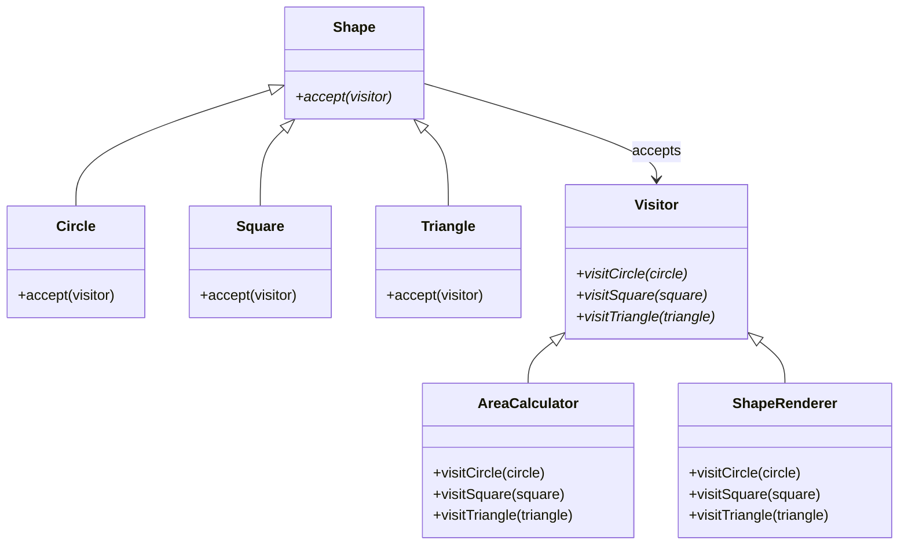

## Visitor

> **Add new operations to existing classes without changing them.**

### Real-World Analogy

> An **insurance salesperson** visits different types of clients. For a family, they offer home insurance. For a business, they offer commercial insurance. The clients don't change — the visitor just behaves differently for each type.

---

## The Pattern



**Elements** (shapes) accept a **Visitor**. Each visitor implements operations for every element type.

---

## ✅ Example

```js
// Elements — accept visitors
class Shape {
  accept(visitor) {
    throw new Error('Override');
  }
}

class Circle extends Shape {
  constructor(radius) {
    super();
    this.radius = radius;
  }

  accept(visitor) {
    return visitor.visitCircle(this);
  }
}

class Square extends Shape {
  constructor(side) {
    super();
    this.side = side;
  }

  accept(visitor) {
    return visitor.visitSquare(this);
  }
}

class Triangle extends Shape {
  constructor(base, height) {
    super();
    this.base = base;
    this.height = height;
  }

  accept(visitor) {
    return visitor.visitTriangle(this);
  }
}

// Visitors — new operations
class AreaCalculator {
  visitCircle(circle) {
    return Math.PI * circle.radius * circle.radius;
  }
  visitSquare(square) {
    return square.side * square.side;
  }
  visitTriangle(triangle) {
    return 0.5 * triangle.base * triangle.height;
  }
}

class ShapeRenderer {
  visitCircle(circle) {
    return `⭕ Drawing circle (r=${circle.radius})`;
  }
  visitSquare(square) {
    return `⬛ Drawing square (side=${square.side})`;
  }
  visitTriangle(triangle) {
    return `🔺 Drawing triangle (${triangle.base}x${triangle.height})`;
  }
}

// Usage
const shapes = [new Circle(5), new Square(4), new Triangle(3, 6)];

const areaCalc = new AreaCalculator();
const renderer = new ShapeRenderer();

shapes.forEach(shape => {
  console.log(`Area: ${shape.accept(areaCalc).toFixed(2)}`);
  console.log(shape.accept(renderer));
});
// Area: 78.54
// ⭕ Drawing circle (r=5)
// Area: 16.00
// ⬛ Drawing square (side=4)
// Area: 9.00
// 🔺 Drawing triangle (3x6)
```

---

## When to Use

- You need to add operations to a **stable set of classes**
- Many unrelated operations need to be applied to the same objects
- You want to **follow Open/Closed** — add operations without modifying classes

## When NOT to Use

- Classes change frequently (adding a new class means updating all visitors)
- You have only a few operations — just add methods to the classes directly

---

## In Simple Words

- **Separates** an operation from the objects it operates on
- Add new operations by creating **new visitors**, not by modifying existing classes
- Great when you have a stable class hierarchy but need many operations
- Trade-off: adding a new class means updating **all visitors**
