## Choosing a Pattern

Not sure which pattern to use? Start with the **problem** you're trying to solve.

---

## Quick Decision Tree

```mermaid
flowchart TB
    Q1["What's your problem?"] --> Q1a["Object creation?"]
    Q1 --> Q1b["Object structure?"]
    Q1 --> Q1c["Object behavior?"]

    Q1a --> C1["One instance only?"] --> Singleton
    Q1a --> C2["Complex construction?"] --> Builder
    Q1a --> C3["Many related types?"] --> FactoryMethod
    Q1a --> C4["Families of objects?"] --> AbstractFactory
    Q1a --> C5["Clone objects?"] --> Prototype

    Q1b --> S1["Incompatible interfaces?"] --> Adapter
    Q1b --> S2["Add behavior dynamically?"] --> Decorator
    Q1b --> S3["Simplify complex system?"] --> Facade
    Q1b --> S4["Control access?"] --> Proxy
    Q1b --> S5["Tree structure?"] --> Composite
    Q1b --> S6["Varying abstraction?"] --> Bridge

    Q1c --> B1["One-to-many notifications?"] --> Observer
    Q1c --> B2["Swap algorithms?"] --> Strategy
    Q1c --> B3["Encapsulate requests?"] --> Command
    Q1c --> B4["Traverse collection?"] --> Iterator
    Q1c --> B5["Behavior changes with state?"] --> State
    Q1c --> B6["Define algorithm skeleton?"] --> TemplateMethod
    Q1c --> B7["Chain of handlers?"] --> ChainOfResp
    Q1c --> B8["Complex communication?"] --> Mediator
    Q1c --> B9["Undo/redo?"] --> Memento
    Q1c --> B10["New operations on stable classes?"] --> Visitor

    style Q1 fill:#7c3aed,color:#fff
    style Q1a fill:#3b82f6,color:#fff
    style Q1b fill:#059669,color:#fff
    style Q1c fill:#f59e0b,color:#fff
    style Singleton fill:#06b6d4,color:#fff
    style Builder fill:#06b6d4,color:#fff
    style FactoryMethod fill:#06b6d4,color:#fff
    style AbstractFactory fill:#06b6d4,color:#fff
    style Prototype fill:#06b6d4,color:#fff
    style Adapter fill:#f59e0b,color:#fff
    style Decorator fill:#f59e0b,color:#fff
    style Facade fill:#f59e0b,color:#fff
    style Proxy fill:#f59e0b,color:#fff
    style Composite fill:#f59e0b,color:#fff
    style Bridge fill:#f59e0b,color:#fff
    style Observer fill:#ef4444,color:#fff
    style Strategy fill:#ef4444,color:#fff
    style Command fill:#ef4444,color:#fff
    style Iterator fill:#ef4444,color:#fff
    style State fill:#ef4444,color:#fff
    style TemplateMethod fill:#ef4444,color:#fff
    style ChainOfResp fill:#ef4444,color:#fff
    style Mediator fill:#ef4444,color:#fff
    style Memento fill:#ef4444,color:#fff
    style Visitor fill:#ef4444,color:#fff
```

---

## By Problem Category

### 🏗️ Need to create objects?

| Problem | Pattern |
|---------|---------|
| I need exactly **one instance** shared globally | **Singleton** |
| Object creation is **complex** (many steps) | **Builder** |
| I don't know the **exact type** until runtime | **Factory Method** |
| I need **families of related** objects | **Abstract Factory** |
| Creating objects is **expensive**; clone instead | **Prototype** |

### 🔧 Need to structure objects?

| Problem | Pattern |
|---------|---------|
| Existing code has an **incompatible API** | **Adapter** |
| Add behavior **without modifying** the class | **Decorator** |
| Hide a **complex subsystem** behind a simple API | **Facade** |
| I need **lazy loading, caching, or access control** | **Proxy** |
| I have a **tree-like structure** (folders/files) | **Composite** |
| I want to **vary abstraction & implementation** independently | **Bridge** |
| Save memory by **sharing common data** | **Flyweight** |

### 🔄 Need to manage behavior?

| Problem | Pattern |
|---------|---------|
| **Notify many** objects when something changes | **Observer** |
| **Swap algorithms** at runtime | **Strategy** |
| **Undo/redo** or queue actions | **Command** |
| **Traverse** a collection without exposing internals | **Iterator** |
| Object behavior **changes with state** | **State** |
| Define **common algorithm skeleton**, let subclasses fill steps | **Template Method** |
| **Request passes through** multiple handlers | **Chain of Responsibility** |
| **Complex communication** between many objects | **Mediator** |
| **Save and restore** object state | **Memento** |
| Add **new operations** to stable classes | **Visitor** |

---

## Quick Cheatsheet by Complexity

### Beginner-friendly patterns
- **Singleton** — simplest pattern
- **Facade** — just wrap complex calls
- **Observer** — event-based, intuitive
- **Iterator** — you already use it (for...of)

### Intermediate patterns
- **Factory Method**, **Builder**, **Adapter**, **Decorator**, **Strategy**, **Template Method**, **Command**

### Advanced patterns
- **Abstract Factory**, **Bridge**, **Composite**, **Proxy**, **State**, **Mediator**, **Visitor**, **Flyweight**, **Memento**, **Chain of Responsibility**

---

## In Simple Words

- **Start with the problem**, not the pattern
- The three categories help narrow down: creation, structure, or behavior?
- Don't force a pattern — the right solution is often simpler than you think
- **Master the simple patterns first** (Singleton, Observer, Factory), then move to advanced ones
