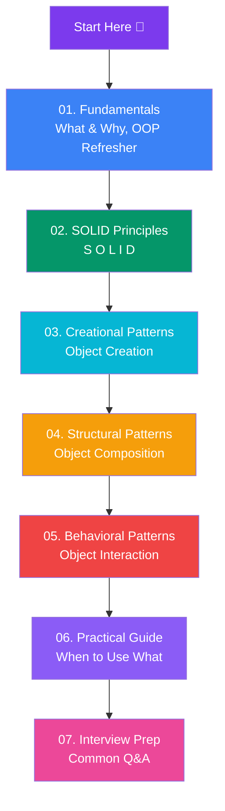
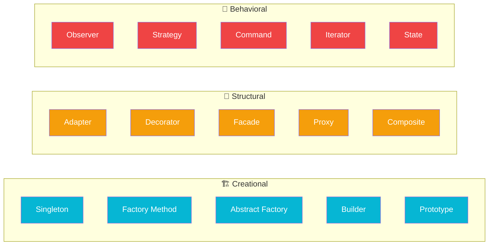

# Design Patterns & SOLID

A beginner-friendly guide to design patterns — reusable solutions to common software problems. Learn the **Gang of Four patterns**, **SOLID principles**, and when to apply them.

## Learning Path

## The 3 Categories — At a Glance

## All Patterns — Quick Reference

| Pattern | Category | Purpose |
|---------|----------|---------|
| **Singleton** | Creational | One global instance |
| **Factory Method** | Creational | Delegate object creation to subclasses |
| **Abstract Factory** | Creational | Families of related objects |
| **Builder** | Creational | Step-by-step object construction |
| **Prototype** | Creational | Clone existing objects |
| **Adapter** | Structural | Make incompatible interfaces work together |
| **Decorator** | Structural | Add behavior without changing the class |
| **Facade** | Structural | Simplified interface to a complex system |
| **Proxy** | Structural | Control access to another object |
| **Composite** | Structural | Treat individual & group objects uniformly |
| **Bridge** | Structural | Separate abstraction from implementation |
| **Flyweight** | Structural | Share data to save memory |
| **Observer** | Behavioral | One-to-many notifications |
| **Strategy** | Behavioral | Swap algorithms at runtime |
| **Command** | Behavioral | Encapsulate requests as objects |
| **Iterator** | Behavioral | Traverse collections without exposing internals |
| **State** | Behavioral | Change behavior when state changes |
| **Template Method** | Behavioral | Define skeleton, let subclasses fill details |
| **Chain of Responsibility** | Behavioral | Pass request along a chain of handlers |
| **Mediator** | Behavioral | Centralize communication between objects |
| **Memento** | Behavioral | Save & restore object state |
| **Visitor** | Behavioral | Add operations without changing classes |

## Sections

### 📖 01. Fundamentals
- [What Are Design Patterns?](/DSA-Notes-Problems/design-patterns/01-fundamentals/what-are-design-patterns)
- [OOP Refresher](/DSA-Notes-Problems/design-patterns/01-fundamentals/oop-refresher)

### 🎯 02. SOLID Principles
- [Single Responsibility (S)](/DSA-Notes-Problems/design-patterns/02-solid/single-responsibility)
- [Open/Closed (O)](/DSA-Notes-Problems/design-patterns/02-solid/open-closed)
- [Liskov Substitution (L)](/DSA-Notes-Problems/design-patterns/02-solid/liskov-substitution)
- [Interface Segregation (I)](/DSA-Notes-Problems/design-patterns/02-solid/interface-segregation)
- [Dependency Inversion (D)](/DSA-Notes-Problems/design-patterns/02-solid/dependency-inversion)

### 🏗️ 03. Creational
- [Singleton](/DSA-Notes-Problems/design-patterns/03-creational/singleton)
- [Factory Method](/DSA-Notes-Problems/design-patterns/03-creational/factory-method)
- [Abstract Factory](/DSA-Notes-Problems/design-patterns/03-creational/abstract-factory)
- [Builder](/DSA-Notes-Problems/design-patterns/03-creational/builder)
- [Prototype](/DSA-Notes-Problems/design-patterns/03-creational/prototype)

### 🔧 04. Structural
- [Adapter](/DSA-Notes-Problems/design-patterns/04-structural/adapter)
- [Decorator](/DSA-Notes-Problems/design-patterns/04-structural/decorator)
- [Facade](/DSA-Notes-Problems/design-patterns/04-structural/facade)
- [Proxy](/DSA-Notes-Problems/design-patterns/04-structural/proxy)
- [Composite](/DSA-Notes-Problems/design-patterns/04-structural/composite)
- [Bridge](/DSA-Notes-Problems/design-patterns/04-structural/bridge)
- [Flyweight](/DSA-Notes-Problems/design-patterns/04-structural/flyweight)

### 🔄 05. Behavioral
- [Observer](/DSA-Notes-Problems/design-patterns/05-behavioral/observer)
- [Strategy](/DSA-Notes-Problems/design-patterns/05-behavioral/strategy)
- [Command](/DSA-Notes-Problems/design-patterns/05-behavioral/command)
- [Iterator](/DSA-Notes-Problems/design-patterns/05-behavioral/iterator)
- [State](/DSA-Notes-Problems/design-patterns/05-behavioral/state)
- [Template Method](/DSA-Notes-Problems/design-patterns/05-behavioral/template-method)
- [Chain of Responsibility](/DSA-Notes-Problems/design-patterns/05-behavioral/chain-of-responsibility)
- [Mediator](/DSA-Notes-Problems/design-patterns/05-behavioral/mediator)
- [Memento](/DSA-Notes-Problems/design-patterns/05-behavioral/memento)
- [Visitor](/DSA-Notes-Problems/design-patterns/05-behavioral/visitor)

### 💡 06. Practical
- [Choosing a Pattern](/DSA-Notes-Problems/design-patterns/06-practical/choosing-a-pattern)
- [Anti-Patterns](/DSA-Notes-Problems/design-patterns/06-practical/anti-patterns)
- [Patterns in Real Frameworks](/DSA-Notes-Problems/design-patterns/06-practical/patterns-in-real-frameworks)

### 🎤 07. Interview
- [Interview Questions](/DSA-Notes-Problems/design-patterns/07-interview/interview-questions)
