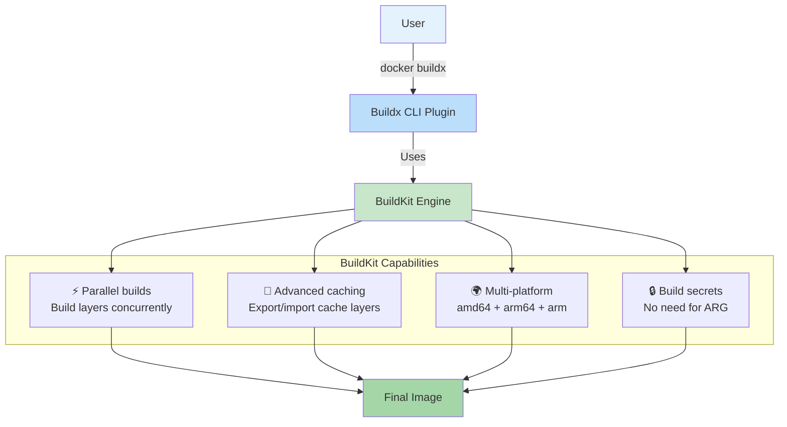

## 4. BuildKit & Buildx

### 🚀 What Are BuildKit and Buildx?

**BuildKit** is Docker's next-generation build engine. It replaced the old legacy builder starting from Docker 23.0. It's faster, has better caching, supports parallel builds, and can build images for different CPU architectures.

**Buildx** is the CLI tool (`docker buildx`) that uses BuildKit. It adds features like multi-platform builds, custom build drivers, and advanced cache options.

**Analogy:** The old builder was like a single chef cooking one dish at a time. BuildKit is a full kitchen with multiple chefs cooking multiple dishes in parallel, reusing leftovers efficiently.



---

### 🔧 Setting Up Buildx

```bash
# Check if buildx is available
docker buildx version

# Output:
# github.com/docker/buildx v0.12.0 ...

# List available builders
docker buildx ls

# Output:
# NAME/NODE       DRIVER/ENDPOINT  STATUS
# default         docker
#   default       default          running

# Create a new builder with multi-platform support
docker buildx create --name mybuilder --use

# Start the builder
docker buildx inspect --bootstrap

# Now you can build for multiple architectures!
```

---

### ⚡ Key Benefits of BuildKit / Buildx

| Feature | Old Builder | BuildKit / Buildx |
|---------|-------------|-------------------|
| Build speed | Sequential layer builds | **Parallel** layer builds |
| Cache export | No | Yes (to registry, local, S3) |
| Multi-platform | No | Yes (amd64, arm64, arm/v7) |
| Build secrets | No (had to use ARG — insecure) | Yes (`--secret`) |
| SSH mounts | No | Yes (`--ssh`) |
| .dockerignore | Fully processed in client | **Respected in server** (avoids unnecessary context upload) |

---

### 🌍 Multi-Platform Builds

The most popular use of buildx: build images for **both Intel (amd64) and ARM (arm64)** — like Apple Silicon Macs and AWS Graviton.

```bash
# Build for multiple platforms at once
docker buildx build \
  --platform linux/amd64,linux/arm64,linux/arm/v7 \
  -t username/myapp:latest \
  --push .

# Single platform (fastest for local dev)
docker buildx build \
  --platform linux/amd64 \
  -t myapp:latest \
  --load .

# Build for local architecture only
docker buildx build \
  --platform linux/amd64,linux/arm64 \
  -t username/myapp:latest \
  --push .
```

> **💡 Tip:** Use `--load` to load the image into your local Docker daemon (supports only one platform at a time). Use `--push` to push directly to a registry.

---

### 🔐 Build Secrets — Safer Than ARG

Never bake passwords or API keys into your image. Use build secrets:

```dockerfile
# Dockerfile
FROM node:18-alpine

WORKDIR /app
COPY . .

# Use a secret during build — NOT stored in the image
RUN --mount=type=secret,id=npmrc \
  cp /run/secrets/npmrc .npmrc && \
  npm ci --only=production
```

```bash
# Build with secret (file-based)
echo "//registry.npmjs.org/:_authToken=secret-token-here" > .npmrc
docker buildx build \
  --secret id=npmrc,src=.npmrc \
  -t myapp:latest .

# Build with secret (env var -- macOS/Linux)
docker buildx build \
  --secret id=mysecret,env=MY_SECRET \
  -t myapp:latest .
```

**Why this matters:**
- Without secrets: you use `ARG` + `ENV` → the secret stays in the image layers
- With secrets: the secret is available during build but **not in the final image**
- Anyone running `docker history` can't see your secret

---

### 💾 Advanced Cache Options

BuildKit can **export and import build cache**, making CI/CD pipelines dramatically faster:

```bash
# Cache to and from a registry (GitHub Container Registry, Docker Hub, etc.)
docker buildx build \
  --cache-from=type=registry,ref=username/myapp:cache \
  --cache-to=type=registry,ref=username/myapp:cache,mode=max \
  -t username/myapp:latest \
  --push .

# Cache to local directory (good for CI runners)
docker buildx build \
  --cache-from=type=local,src=/tmp/cache \
  --cache-to=type=local,dest=/tmp/cache,mode=max \
  -t myapp:latest .
```

**Cache modes:**
| Mode | Description |
|------|-------------|
| `min` | Cache only the final stage — fast export, but less reusable |
| `max` | Cache all intermediate layers — slower export, best cache reuse for CI |

---

### 🏗️ BuildKit Dockerfile Features

BuildKit supports advanced `RUN` mount types that the old builder doesn't:

```dockerfile
# Syntax directive — tells Docker to use BuildKit
# syntax=docker/dockerfile:1

FROM node:18-alpine AS builder
WORKDIR /app

# ── Cache npm packages between builds ═════════════════
RUN --mount=type=cache,target=/root/.npm \
  npm ci

# ── Mount SSH agent for private repo access ═══════════
RUN --mount=type=ssh \
  npm ci

# ── Mount bind mount (read from host during build) ════
RUN --mount=type=bind,source=./package.json,target=/app/package.json \
  npm install

FROM node:18-alpine AS production
WORKDIR /app

# Copy from builder — but BuildKit can do it parallel
COPY --from=builder /app/node_modules ./node_modules
COPY . .

EXPOSE 3000
CMD ["node", "server.js"]
```

---

### 🤖 Buildx in CI/CD (GitHub Actions)

```yaml
# .github/workflows/build.yml
name: Multi-Platform Build

on:
  push:
    branches: [main]

jobs:
  build:
    runs-on: ubuntu-latest
    steps:
      - uses: actions/checkout@v4
      
      - name: Set up Docker Buildx
        uses: docker/setup-buildx-action@v3
      
      - name: Log in to GitHub Container Registry
        uses: docker/login-action@v3
        with:
          registry: ghcr.io
          username: ${{ github.actor }}
          password: ${{ secrets.GITHUB_TOKEN }}
      
      - name: Build and push multi-platform image
        uses: docker/build-push-action@v5
        with:
          context: .
          platforms: linux/amd64,linux/arm64
          push: true
          tags: ghcr.io/${{ github.repository }}:latest
          cache-from: type=gha
          cache-to: type=gha,mode=max
```

---

### 📦 Build Drivers

Buildx supports different **build drivers** that control where the build happens:

| Driver | Builds On | Best For |
|--------|-----------|----------|
| `docker` | Local Docker daemon | Simple local builds |
| `docker-container` | A dedicated container | Multi-platform builds |
| `kubernetes` | Kubernetes cluster | Scaling builds across pods |
| `remote` | Remote BuildKit server | Centralized build infrastructure |

```bash
# Create a container driver for multi-platform builds
docker buildx create --name container --driver docker-container --use

# Build with the container driver
docker buildx build --platform linux/amd64,linux/arm64 -t myapp:latest --push .
```

---

### ✅ In Simple Words

- **BuildKit** is the modern, faster, parallel build engine that replaced Docker's old builder.
- **Buildx** is the CLI frontend (`docker buildx`) that enables multi-platform builds and advanced caching.
- Buildx can build images for **Intel (amd64) and ARM (arm64)** simultaneously — essential for Apple Silicon and AWS Graviton.
- **Build secrets** (`--secret`) let you use passwords during build without storing them in the final image.
- **Cache export/import** makes CI/CD pipelines much faster by reusing build layers between runs.
- Use `--cache-from=type=gha` in GitHub Actions for the best performance.
