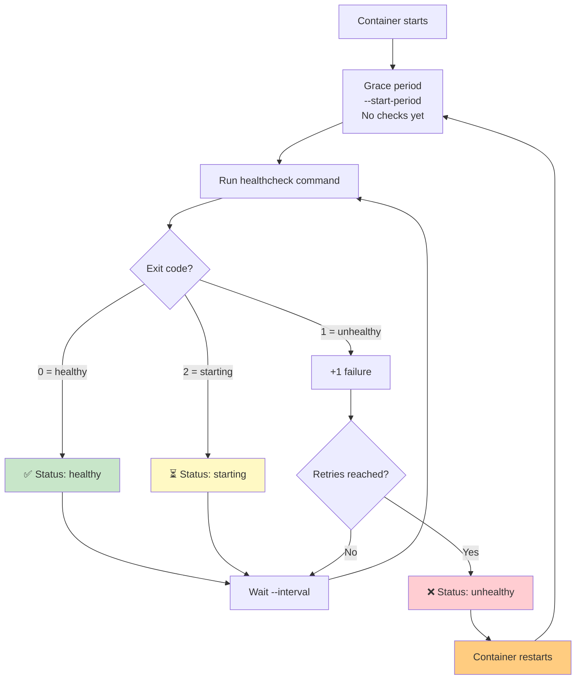

## 15. Healthchecks

### ❤️ What Is a Healthcheck?

A **healthcheck** is a command that Docker runs periodically to check if your container is truly **healthy** — not just running, but actually working.

**Analogy:** A person can be alive (heartbeat) but not healthy (working properly). A container can be "running" (process exists) but be completely broken (app crashes on every request). A healthcheck is like asking "How are you feeling?" every few seconds — and restarting if the answer is "Terrible."

**Without healthcheck:** Docker only knows if the process is running or not.
**With healthcheck:** Docker knows if the app is **responding correctly**.

---

### 🏗️ HEALTHCHECK in Dockerfile

```dockerfile
FROM node:18-alpine

WORKDIR /app
COPY . .
RUN npm ci --only=production

EXPOSE 3000

# Basic healthcheck — curl the health endpoint
HEALTHCHECK --interval=30s --timeout=5s --start-period=10s --retries=3 \
  CMD wget --no-verbose --tries=1 --spider http://localhost:3000/health || exit 1

CMD ["node", "server.js"]
```

**Healthcheck options:**

| Option | Default | Description |
|--------|---------|-------------|
| `--interval` | 30s | How often to run the check |
| `--timeout` | 30s | Max time for a single check to complete |
| `--start-period` | 0s | Grace period before health checks begin (app startup time) |
| `--retries` | 3 | Consecutive failures before marking as unhealthy |

---

### 🔄 Healthcheck Return Values

| Exit Code | Status | Meaning |
|-----------|--------|---------|
| 0 | ✅ healthy | Container is working properly |
| 1 | ❌ unhealthy | Container is not working — will be restarted |
| 2 | ⚠️ starting | Container is still starting (used during startup) |

```bash
# Simple healthcheck with curl
HEALTHCHECK CMD curl -f http://localhost:3000/health || exit 1

# Healthcheck with a custom script
HEALTHCHECK CMD /healthcheck.sh

# Healthcheck for a database
HEALTHCHECK CMD pg_isready -U postgres || exit 1

# Healthcheck for nginx
HEALTHCHECK CMD service nginx status || exit 1
```

---

### 📋 Viewing Health Status

```bash
# Check container health
docker ps

# Output — shows "healthy" or "unhealthy" in STATUS column:
# CONTAINER ID   IMAGE    COMMAND                  CREATED          STATUS                    PORTS
# a1b2c3d4e5f6   myapp    "node server.js"         2 minutes ago    Up 2 minutes (healthy)    0.0.0.0:3000->3000/tcp

# Detailed healthcheck history
docker inspect --format='{{json .State.Health}}' myapp

# Output:
# {
#   "Status": "healthy",
#   "FailingStreak": 0,
#   "Log": [
#     {"Start": "2024-01-15T10:30:00Z", "Output": "...", "ExitCode": 0},
#     {"Start": "2024-01-15T10:30:30Z", "Output": "...", "ExitCode": 0}
#   ]
# }
```

---

### 🔄 Healthcheck Lifecycle



---

### 📝 Healthcheck in Docker Compose

```yaml
# docker-compose.yml
services:
  api:
    build: .
    ports:
      - "3000:3000"
    healthcheck:
      test: ["CMD", "wget", "--no-verbose", "--tries=1", "--spider", "http://localhost:3000/health"]
      interval: 30s
      timeout: 5s
      retries: 3
      start_period: 10s
    restart: unless-stopped

  database:
    image: postgres:15
    environment:
      POSTGRES_PASSWORD: secret
    healthcheck:
      test: ["CMD-SHELL", "pg_isready -U postgres"]
      interval: 10s
      timeout: 5s
      retries: 5

  # App waits for database to be healthy before starting
  app:
    depends_on:
      database:
        condition: service_healthy
```

---

### 🎯 Best Practices for Healthchecks

**Do:**
- Expose a **dedicated `/health` endpoint** in your app that checks dependencies (DB, cache, API) and returns proper status
- Keep the healthcheck **lightweight** — don't do heavy computation
- Set a reasonable **start period** that covers your app's boot time
- Use `curl -f` or `wget --spider` for HTTP services

**Don't:**
- Don't check external services — healthchecks should verify the container itself
- Don't set intervals too short (can overload the container)
- Don't set timeouts too long (delays recovery)
- Don't skip the healthcheck — it's essential for self-healing systems

---

### 🩺 Real App Health Endpoint

```javascript
// server.js — Example health endpoint
const express = require('express');
const app = express();

app.get('/health', async (req, res) => {
  try {
    // Check database connection
    await db.raw('SELECT 1');
    
    // Check cache connection
    await redis.ping();
    
    // All good!
    res.status(200).json({
      status: 'healthy',
      timestamp: new Date().toISOString(),
      uptime: process.uptime()
    });
  } catch (error) {
    res.status(503).json({
      status: 'unhealthy',
      error: error.message
    });
  }
});
```

---

### 📊 Health States in `docker ps`

```bash
# Different health states you'll see:
docker ps -a

# CONTAINER ID   STATUS                        MEANING
# a1b2           Up 2 minutes (healthy)        ✅ Running and healthy
# b2c3           Up 5 minutes (unhealthy)      ❌ Running but failing healthcheck
# c3d4           Up 1 minute (health: starting) ⏳ Still within start period
# d4e5           Up 2 minutes                  ⚪ No healthcheck defined
```

---

### ✅ In Simple Words

- A **healthcheck** tells Docker to run a test command periodically to verify your app is working.
- Exit code **0** = healthy, **1** = unhealthy, **2** = still starting.
- If healthcheck fails repeatedly, Docker restarts the container (if `--restart` is set).
- `--start-period` gives your app time to boot before checks begin.
- Always define a health endpoint (`/health`) and use it in your healthcheck.
- In Docker Compose, `depends_on` with `condition: service_healthy` ensures services start in the right order.
