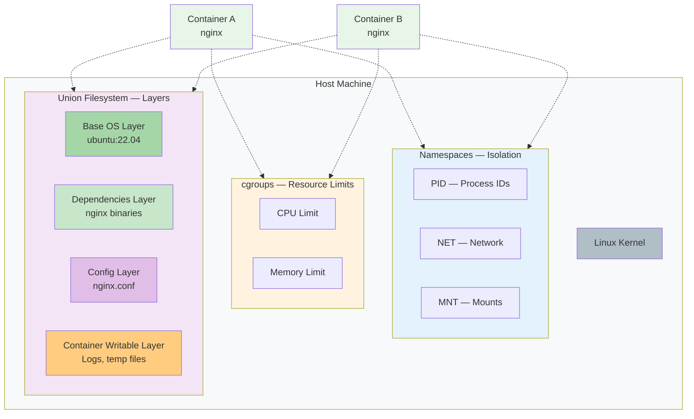
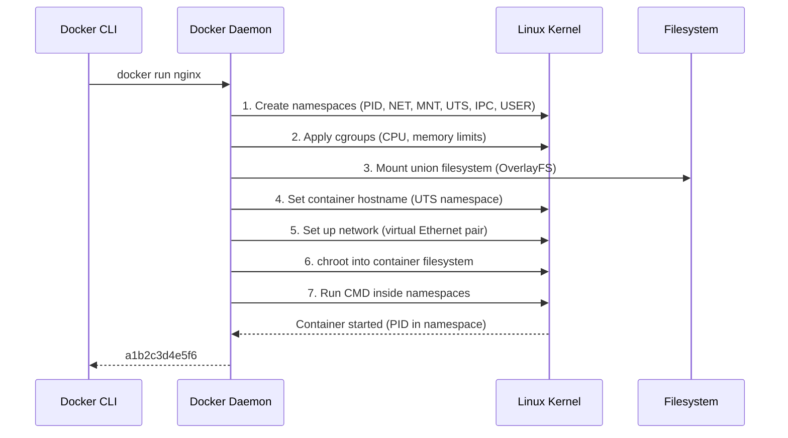

## 4. How Containers Work (Internals)

### 🤔 What Makes a Container a Container?

A container looks and feels like a lightweight virtual machine — but it's not. Under the hood, Docker uses **three Linux kernel features** that work together to create container magic:

1. **Namespaces** — Isolation (what can this process see?)
2. **cgroups** — Resource limits (how much can this process use?)
3. **Union Filesystem** — Image layers (how is the filesystem built?)

**Analogy:** Think of a container like a **child's room**:
- **Namespaces** = the walls and door. The child can only see what's inside their room, not the rest of the house.
- **cgroups** = a rule like "you can only spend $20 on toys per month." The child can't use more than their share.
- **Union Filesystem** = a stack of transparent sheets with drawings. Each sheet has one thing (bed, desk, toys), and stacked together they make the whole room. When the child redecorates, their changes go on a new top sheet — the original sheets stay untouched.

---

### 🏗️ Container vs Virtual Machine

```mermaid
flowchart TB
    subgraph VM[Virtual Machines]
        direction TB
        HW1[🖥️ Physical Hardware<br/>CPU, RAM, Disk]
        HOS1[Host OS]
        HYP1[Hypervisor]
        
        subgraph VM1[VM 1 — 4 GB]
            GOS1[Guest OS<br/>Full OS Kernel]
            APP1[App + Libs]
        end
        
        subgraph VM2[VM 2 — 4 GB]
            GOS2[Guest OS<br/>Full OS Kernel]
            APP2[App + Libs]
        end
    end
    
    subgraph Container[Docker Containers]
        direction TB
        HW2[🖥️ Physical Hardware<br/>CPU, RAM, Disk]
        HOS2[Host OS + Docker Engine<br/>Shared Linux Kernel]
        
        subgraph C1[Container 1 — ~50 MB]
            LIBS1[Libraries + Runtime<br/>No Guest OS]
            APP3[App A]
        end
        
        subgraph C2[Container 2 — ~50 MB]
            LIBS2[Libraries + Runtime<br/>No Guest OS]
            APP4[App B]
        end
    end
    
    style VM fill:#e3f2fd,color:#333
    style Container fill:#e8f5e9,color:#333
    style HYP1 fill:#ef9a9a,color:#333
    style HW1 fill:#b0bec5,color:#333
    style HOS1 fill:#90caf9,color:#333
    style VM1 fill:#bbdefb,color:#333
    style VM2 fill:#bbdefb,color:#333
    style GOS1 fill:#90caf9,color:#333
    style GOS2 fill:#90caf9,color:#333
    style HW2 fill:#b0bec5,color:#333
    style HOS2 fill:#a5d6a7,color:#333
    style C1 fill:#c8e6c9,color:#333
    style C2 fill:#c8e6c9,color:#333
```



| Feature | Virtual Machine | Docker Container |
|---------|----------------|-----------------|
| OS | Each VM has its own full OS | Shares host OS kernel |
| Isolation | Hardware-level | Process-level (namespaces) |
| Size | 2–10 GB | 10–500 MB |
| Boot time | 1–5 minutes | Milliseconds |
| Resource usage | Heavy (full OS per VM) | Lightweight (just the app) |

---

### 🧱 1. Namespaces — Isolation

Namespaces make a process **think it has its own world**. Docker creates several namespaces for each container:

| Namespace | What It Isolates | Why It Matters |
|-----------|-----------------|----------------|
| **PID** | Process IDs | Container sees only its own processes (PID 1 = entrypoint) |
| **NET** | Network stack | Container has its own IP, ports, routing tables |
| **MNT** | Filesystem mounts | Container sees only its own filesystem |
| **UTS** | Hostname | Container can have its own hostname |
| **IPC** | Inter-process communication | Container can't see host's shared memory/signals |
| **USER** | User IDs | Container can run as "root" inside but maps to a non-root user outside |

```bash
# On the host, you see ALL processes
ps aux | grep nginx

# Inside a container, you see ONLY its own processes
docker exec web ps aux
# Output: only nginx and shell processes
```

**In simple words:** Namespaces are like giving each container its own pair of blinders. A container can only see what's inside its namespace — it can't peek at other containers or the host.

---

### ⚖️ 2. cgroups — Resource Limits

cgroups (**control groups**) let Docker limit how much CPU, memory, disk I/O, and network a container can use.

Without cgroups, one container could hog all system resources and starve others. cgroups prevent the "noisy neighbor" problem.

```bash
# Limit a container to 0.5 CPU cores and 256MB memory
docker run -d --cpus="0.5" --memory="256m" --name limited nginx

# Check actual resource usage
docker stats limited

# Output:
# CONTAINER ID   NAME      CPU %   MEM USAGE / LIMIT
# a1b2c3d4e5f6   limited   12.3%   42.5MiB / 256MiB
```

**Real-world example:**
```bash
# Without limits — this could freeze your machine
docker run -d --name bad-node node node -e "while(true){}"

# With limits — safe, capped at 0.5 core
docker run -d --cpus="0.5" --name good-node node node -e "while(true){}"
```

**In simple words:** cgroups are like a "budget app" for your containers. Each container gets an allowance of CPU and memory. If it tries to spend more, the system says "nope, use what you have."

---

### 📂 3. Union Filesystem (OverlayFS)

This is how Docker makes images efficient. Instead of copying everything, Docker stacks **layers** on top of each other using OverlayFS (or similar union filesystem).



**Key points:**
- The base image layers are **read-only** — shared across all containers
- Each container gets its own thin **writable layer** on top
- When a container reads a file, it starts at the top layer and works down
- When a container writes a file, it's stored in the writable layer (Copy-on-Write)

```bash
# See the layers that make up an image
docker history nginx:latest

# Output (simplified):
# IMAGE          CREATED       CREATED BY                                      SIZE
# a1b2c3d4e5f6   2 weeks ago   CMD ["nginx" "-g" "daemon off;"]               0B
# f6e5d4c3b2a1   2 weeks ago   COPY nginx.conf ...                            12kB
# e5d4c3b2a1f6   2 weeks ago   RUN apt-get update && apt-get install ...      45MB
# d4c3b2a1f6e5   3 weeks ago   /bin/sh -c #(nop)  ENV NGINX_VERSION=1.25.0   0B
# c3b2a1f6e5d4   3 weeks ago   /bin/sh -c #(nop)  FROM ubuntu:22.04           0B
```

---

### 🔬 How Docker Creates a Container (Step by Step)



---

### 🆚 Quick Comparison: Docker vs Traditional VM

| Aspect | Docker Container | Virtual Machine |
|--------|----------------|-----------------|
| Starts in | < 1 second | 1–5 minutes |
| Size | MBs | GBs |
| Kernel | Shares host | Has its own |
| Isolation | Namespaces (process-level) | Full hardware virtualization |
| Performance | Near-native | Has overhead |
| Best for | Microservices, dev, fast iteration | Running different OS, legacy apps |

---

### ✅ In Simple Words

- **Namespaces** isolate what a container can **see** — it gets its own process list, network, and filesystem.
- **cgroups** limit what a container can **use** — CPU, memory, and disk are capped per container.
- **Union Filesystem** (OverlayFS) keeps images **small and fast** by stacking read-only layers + a thin writable layer per container.
- Containers share the **host's kernel** — that's why they're so much lighter than VMs.
- Linux kernel features make containers possible — Docker is just the friendly wrapper around them.
