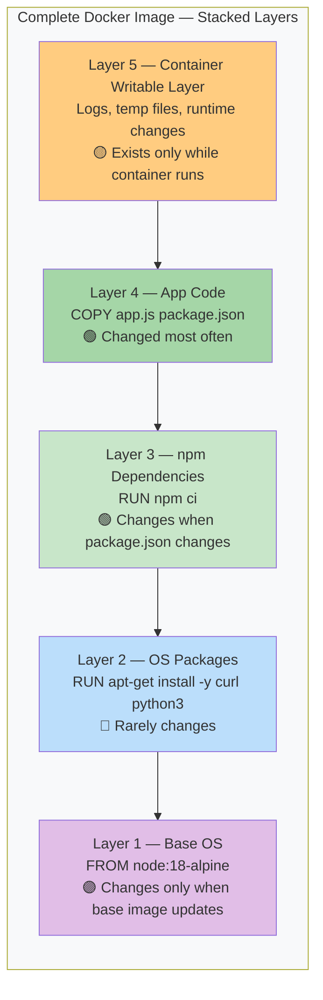
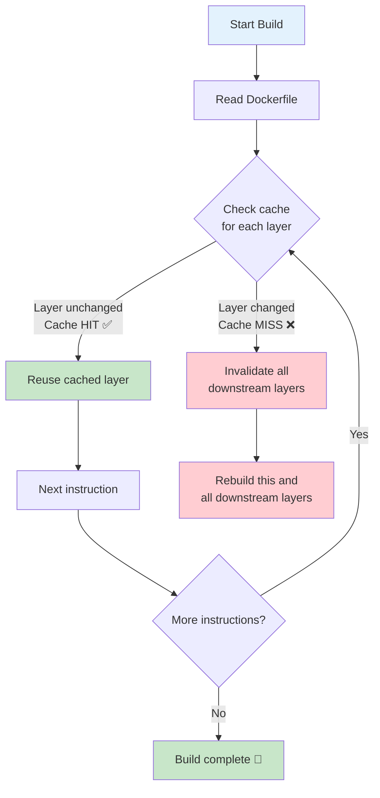
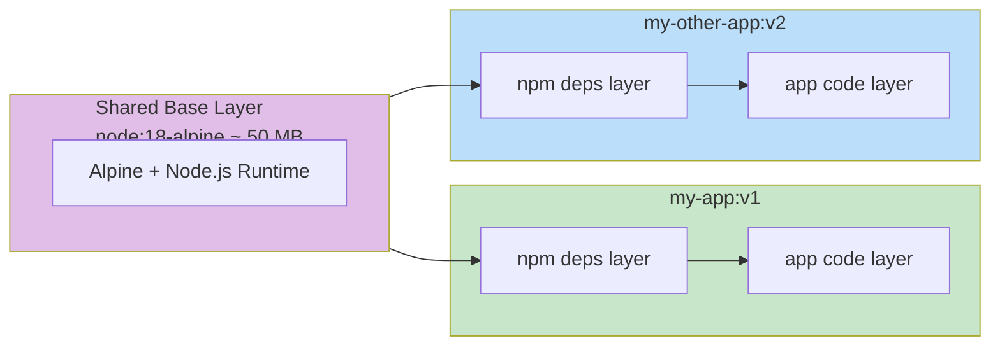
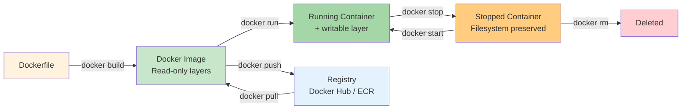

## 7. Image Layers & Build Caching

### 🧅 What Are Image Layers?

A Docker image is a **stack of read-only layers**. Each layer is the filesystem change caused by a single Dockerfile instruction (`FROM`, `RUN`, `COPY`, etc.).

**Analogy:** Think of image layers like a stack of **transparent sheets**. Each sheet has one change (install Python, copy app code, etc.). Stack them up, and you see the complete image. Change one sheet at the bottom, and everything above needs to be rebuilt.



**Key rules:**
- Each instruction = one layer
- Layers are **read-only** (except the container's writable layer)
- Layers are **cached** — unchanged layers are reused between builds
- If a layer **changes**, all layers **below it** are still cached, but all layers **above it** must rebuild

---

### 🔄 How the Build Cache Works



---

### ⚡ Why Layer Order Matters

This is the single most important optimization for Dockerfile performance.

**Bad order — every code change reinstalls dependencies:**

```dockerfile
FROM node:18-alpine

# App code first (changes on every edit)
COPY . .

# Then dependencies (re-runs every time code changes!)
RUN npm ci
```

**Good order — dependencies are cached unless package.json changes:**

```dockerfile
FROM node:18-alpine

# Dependencies first (rarely changes)
COPY package*.json ./
RUN npm ci

# App code last (changes on every edit)
COPY . .
```

**Result with good order:**
- 1st build: ~60 seconds
- 2nd build (only app code changed): **~3 seconds** (npm layer cached!)
- 3rd build (package.json changed): ~60 seconds (deps rebuild)

---

### 🔍 See Layers in Action

```bash
# View all layers of an image
docker history nginx:latest

# Output (simplified):
# IMAGE          CREATED       CREATED BY                                      SIZE
# d4c3b2a1f6e5   2 weeks ago   /bin/sh -c #(nop)  CMD ["nginx" "-g" "daemon…   0B
# c3b2a1f6e5d4   2 weeks ago   /bin/sh -c #(nop)  EXPOSE 80                    0B
# b2a1f6e5d4c3   2 weeks ago   /bin/sh -c #(nop)  STOPSIGNAL SIGQUIT           0B
# a1f6e5d4c3b2   2 weeks ago   /bin/sh -c #(nop)  ENTRYPOINT ["/docker-entr…   0B
# f6e5d4c3b2a1   2 weeks ago   /bin/sh -c #(nop)  COPY file:09a3... in /       12kB
# e5d4c3b2a1f6   2 weeks ago   /bin/sh -c apt-get update && apt-get install…   45MB
# d4c3b2a1f6e5   3 weeks ago   /bin/sh -c #(nop)  ENV NGINX_VERSION=1.25.0     0B
# c3b2a1f6e5d4   3 weeks ago   /bin/sh -c #(nop)  FROM ubuntu:22.04            0B
```

Notice: The bottom layers (base OS, apt packages) are large but rarely change. The top layers (config, CMD) are tiny but change more often.

---

### 📦 Layer Sharing Between Images

When you pull multiple images that share a common base, Docker reuses the layers:

```bash
# Both images use node:18-alpine as base
# The base layers are downloaded ONCE and shared
docker pull my-app:v1
docker pull my-other-app:v2
```



---

### 🏗️ Build → Image → Container Lifecycle



---

### 🛠️ Commands to Inspect Layers

```bash
# See layer history
docker history node:18-alpine

# See image size breakdown (detailed)
docker history node:18-alpine --no-trunc

# Inspect image metadata
docker inspect node:18-alpine

# See how much space images use
docker system df

# Output (simplified):
# TYPE            TOTAL     ACTIVE    SIZE      RECLAIMABLE
# Images          5         2         1.2GB     800MB (66%)
# Containers      3         1         50MB      40MB (80%)
# Local Volumes   2         2         100MB     0B (0%)
# Build Cache     12        0         200MB     200MB
```

---

### ⚠️ Common Mistakes with Layers

- **Putting code before deps** — every code change reinstalls all dependencies
- **Not using `.dockerignore`** — the entire directory is sent to Docker context, including `node_modules`
- **Running `apt upgrade`** — changes the base layer, invalidating the entire cache
- **Multiple `RUN` commands instead of one** — each `RUN` is a layer, but more layers mean more metadata overhead
- **Not using `--no-cache` for `apt-get`** — package lists linger in the layer, wasting space

---

### ✅ In Simple Words

- Every Dockerfile instruction creates a **layer** — a snapshot of file changes.
- Docker **caches** each layer. If a layer hasn't changed, it's reused from the cache.
- **Layer order matters**: put things that rarely change (base image, dependencies) first, and things that change often (app code) last.
- Multiple images sharing the same base (like `node:18-alpine`) **share the same layers** on disk — no duplicate downloads.
- The container's **writable layer** sits on top of all image layers — changes made at runtime only modify this thin top layer.
