# Docker

Complete Docker guide split topic-wise into fundamentals and advanced production-ready concepts.

## Learning Path

```mermaid
flowchart TB
    Start[Start here 🚀] --> Intro[Introduction to Docker<br/>What, Why, How]
    Intro --> Containers[What are Containers<br/>Containers vs VMs]
    Containers --> Arch[Docker Architecture<br/>Client → Daemon → Registry]
    Arch --> Internals[How Containers Work<br/>Namespaces, cgroups, OverlayFS]
    Internals --> Install[Installing Docker]
    Install --> Images[Docker Images
Pull, list, inspect]
    Images --> Layers[Image Layers & Caching
Layer order, build cache]
    Layers --> Running[Docker Containers
Run, stop, exec, logs]
    Running --> CLI[Docker CLI Deep Dive
All core commands]
    CLI --> Networking[Docker Networks
Bridge, host, overlay]
    Networking --> Volumes[Docker Volumes
Persist data]
    Volumes --> Resources[Resource Limits
Memory & CPU limits]
    Resources --> Health[Healthchecks
Auto healing]
    Health --> Advanced[Advanced Docker 🏗️]
    
    Advanced --> Dockerfile[Deep Dive: Dockerfile
All instructions]
    Dockerfile --> Optimization[Dockerfile Optimization
Smaller, faster builds]
    Optimization --> Multistage[Multi-Stage Builds
Tiny production images]
    Multistage --> BuildKit[BuildKit & Buildx
Modern builds, multi-platform]
    BuildKit --> Compose[Docker Compose
Multi-container apps]
    Compose --> Production[Docker in Production
Deploy, restart policies]
    Production --> Security[Docker Security
Scanning, least privilege]
    Security --> CICD[Docker CI/CD
GitHub Actions integration]
    
    CICD --> Orchestration[Orchestration 🐝]
    
    Orchestration --> WhyOrch[Why Orchestration?
Scaling across machines]
    WhyOrch --> Swarm[Docker Swarm
Built-in orchestrator]
    Swarm --> K8s[Intro to Kubernetes
Pods, Deployments, Services]
    K8s --> CICDBack[CICD → Deploy → Done ✅]
    
    style Start fill:#7c3aed,color:#fff
    style Advanced fill:#7c3aed,color:#fff
    style Orchestration fill:#7c3aed,color:#fff
    style CICDBack fill:#c8e6c9,color:#333
```

## Docker Fundamentals

Beginner-friendly Docker notes covering containers, images, Docker CLI, volumes, networks, Docker Hub, best practices, and interview questions.

- [Introduction to Docker](/DSA-Notes-Problems/docker/fundamentals/introduction-to-docker)
- [What are Containers](/DSA-Notes-Problems/docker/fundamentals/what-are-containers)
- [Docker Architecture](/DSA-Notes-Problems/docker/fundamentals/docker-architecture)
- [How Containers Work (Internals)](/DSA-Notes-Problems/docker/fundamentals/how-containers-work-internals) — *NEW*
- [Installing Docker](/DSA-Notes-Problems/docker/fundamentals/installing-docker)
- [Docker Images](/DSA-Notes-Problems/docker/fundamentals/docker-images)
- [Image Layers & Caching](/DSA-Notes-Problems/docker/fundamentals/image-layers-and-caching) — *NEW*
- [Docker Containers](/DSA-Notes-Problems/docker/fundamentals/docker-containers)
- [Docker CLI Deep Dive](/DSA-Notes-Problems/docker/fundamentals/docker-cli-deep-dive)
- [Port Mapping](/DSA-Notes-Problems/docker/fundamentals/port-mapping)
- [Docker Volumes](/DSA-Notes-Problems/docker/fundamentals/docker-volumes)
- [Docker Networks](/DSA-Notes-Problems/docker/fundamentals/docker-networks)
- [Environment Variables](/DSA-Notes-Problems/docker/fundamentals/environment-variables)
- [Resource Limits](/DSA-Notes-Problems/docker/fundamentals/resource-limits) — *NEW*
- [Healthchecks](/DSA-Notes-Problems/docker/fundamentals/healthchecks) — *NEW*
- [Docker Logs and Monitoring](/DSA-Notes-Problems/docker/fundamentals/docker-logs-and-monitoring)
- [Docker Exec](/DSA-Notes-Problems/docker/fundamentals/docker-exec)
- [Docker Hub](/DSA-Notes-Problems/docker/fundamentals/docker-hub)
- [Real Project Examples](/DSA-Notes-Problems/docker/fundamentals/real-project-examples)
- [Common Docker Commands Cheat Sheet](/DSA-Notes-Problems/docker/fundamentals/common-docker-commands-cheat-sheet)
- [Common Mistakes Beginners Make](/DSA-Notes-Problems/docker/fundamentals/common-mistakes-beginners-make)
- [Best Practices](/DSA-Notes-Problems/docker/fundamentals/best-practices)
- [Interview Questions](/DSA-Notes-Problems/docker/fundamentals/interview-questions)
- [Summary](/DSA-Notes-Problems/docker/fundamentals/summary)

## Advanced Docker

Advanced Docker notes covering Dockerfiles, optimization, multi-stage builds, Compose, production, registries, CI/CD, monitoring, backup, and troubleshooting.

- [Deep Dive into Dockerfile](/DSA-Notes-Problems/docker/advanced/deep-dive-into-dockerfile)
- [Dockerfile Optimization](/DSA-Notes-Problems/docker/advanced/dockerfile-optimization)
- [Multi-Stage Builds](/DSA-Notes-Problems/docker/advanced/multi-stage-builds)
- [BuildKit & Buildx](/DSA-Notes-Problems/docker/advanced/buildkit-and-buildx) — *NEW*
- [Docker Compose](/DSA-Notes-Problems/docker/advanced/docker-compose)
- [Real Multi-Container Projects](/DSA-Notes-Problems/docker/advanced/real-multi-container-projects)
- [Docker Networking Advanced](/DSA-Notes-Problems/docker/advanced/docker-networking-advanced)
- [Docker Volumes Advanced](/DSA-Notes-Problems/docker/advanced/docker-volumes-advanced)
- [Docker Security](/DSA-Notes-Problems/docker/advanced/docker-security)
- [Docker in Production](/DSA-Notes-Problems/docker/advanced/docker-in-production)
- [Docker Registry](/DSA-Notes-Problems/docker/advanced/docker-registry)
- [Docker CI/CD Integration](/DSA-Notes-Problems/docker/advanced/docker-cicd-integration)
- [Monitoring Containers](/DSA-Notes-Problems/docker/advanced/monitoring-containers)
- [Docker Backup and Recovery](/DSA-Notes-Problems/docker/advanced/docker-backup-and-recovery)
- [Docker Best Practices](/DSA-Notes-Problems/docker/advanced/docker-best-practices)
- [Docker Troubleshooting](/DSA-Notes-Problems/docker/advanced/docker-troubleshooting)
- [Docker vs Kubernetes](/DSA-Notes-Problems/docker/advanced/docker-vs-kubernetes)
- [Docker Interview Questions](/DSA-Notes-Problems/docker/advanced/docker-interview-questions)
- [Practice Exercises](/DSA-Notes-Problems/docker/advanced/practice-exercises) — *NEW*
- [Final Learning Roadmap](/DSA-Notes-Problems/docker/advanced/final-learning-roadmap)

## Docker Orchestration

Container orchestration — Docker Swarm and Kubernetes — for managing containers across multiple machines.

- [Why Orchestration?](/DSA-Notes-Problems/docker/orchestration/why-orchestration)
- [Docker Swarm](/DSA-Notes-Problems/docker/orchestration/docker-swarm)
- [Intro to Kubernetes](/DSA-Notes-Problems/docker/orchestration/intro-to-kubernetes)
