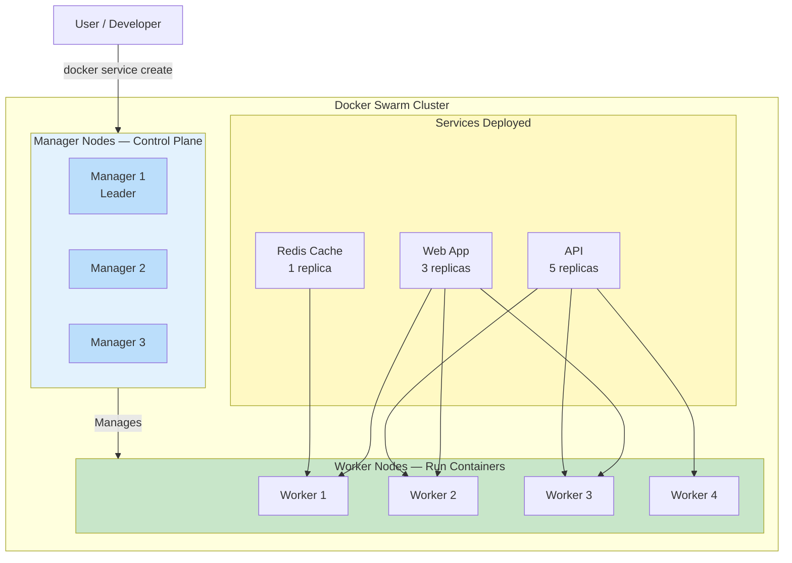
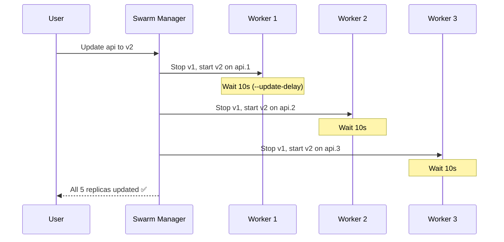

## 2. Docker Swarm

### 🐝 What Is Docker Swarm?

**Docker Swarm** is Docker's built-in container orchestration tool. It turns a group of Docker hosts (servers) into a single **cluster** that you can deploy containers to — just using regular Docker commands.

**Analogy:** A single Docker host is like a single food truck. A Swarm is like a fleet of food trucks that share orders — any truck can serve any customer, and if one breaks down, orders go to another truck.

**The best part:** No new CLI to learn. You keep using `docker service create` instead of `docker run`, but everything feels familiar.

---

### 🏛️ Swarm Architecture: Managers and Workers



**Node types:**

| Node Type | Role | Number in Cluster |
|-----------|------|-------------------|
| **Manager** | Controls the cluster, schedules services, maintains state | 3 or 5 (odd number for consensus) |
| **Worker** | Runs the actual containers (tasks) | As many as you need |

**Key rules:**
- Manager nodes use **Raft consensus** to agree on cluster state
- If the leader manager fails, another manager takes over
- Worker nodes receive tasks from managers and report back status
- You can have as many workers as you need

---

### 🚀 Initialize a Swarm

```bash
# On the first server — initialize the swarm
docker swarm init --advertise-addr 192.168.1.10

# Output:
# Swarm initialized: current node (abc123...) is now a manager.
# 
# To add a worker to this swarm, run the following command:
#   docker swarm join --token SWMTKN-1-... 192.168.1.10:2377
#
# To add a manager, run 'docker swarm join-token manager' and follow the instructions.

# Get the join token for workers
docker swarm join-token worker

# Output:
# docker swarm join --token SWMTKN-1-... 192.168.1.10:2377

# On each worker server — join the swarm
docker swarm join --token SWMTKN-1-... 192.168.1.10:2377

# List all nodes in the swarm
docker node ls

# Output:
# ID           HOSTNAME    STATUS  AVAILABILITY  MANAGER STATUS
# abc123...    manager-1   Ready   Active        Reachable
# def456...    manager-2   Ready   Active        Leader
# ghi789...    worker-1    Ready   Active        
# jkl012...    worker-2    Ready   Active
```

---

### 📦 Deploy Services

In Swarm, you use `docker service` instead of `docker run`:

```bash
# Deploy a simple web service with 3 replicas
docker service create \
  --name web \
  --replicas 3 \
  --publish published=80,target=80 \
  nginx:latest

# List services
docker service ls

# Output:
# ID           NAME    MODE        REPLICAS  IMAGE
# abc123...    web     replicated  3/3       nginx:latest

# See where replicas are running
docker service ps web

# Output:
# ID           NAME    IMAGE         NODE        DESIRED STATE  CURRENT STATE
# def456...    web.1   nginx:latest  worker-1    Running         Running 2 min ago
# ghi789...    web.2   nginx:latest  worker-2    Running         Running 2 min ago
# jkl012...    web.3   nginx:latest  worker-1    Running         Running 2 min ago

# Scale the service to 5 replicas
docker service scale web=5

# Update to a new image with rolling update
docker service update \
  --image nginx:1.25 \
  --update-parallelism 1 \
  --update-delay 10s \
  web

# View service logs
docker service logs web

# Remove a service
docker service rm web
```

---

### 🔄 Rolling Updates in Action

When you update a service, Swarm updates replicas one by one:

```bash
# Deploy a service
docker service create --name api --replicas 5 myapp:v1

# Update to v2 — one container at a time, 10 seconds apart
docker service update \
  --image myapp:v2 \
  --update-parallelism 1 \
  --update-delay 10s \
  api

# If v2 is broken, roll back
docker service rollback api
```



---

### 🔐 Secrets and Configs

```bash
# Create a secret
echo "my-db-password" | docker secret create db_password -

# Use the secret in a service
docker service create \
  --name api \
  --secret db_password \
  --replicas 3 \
  myapp:latest

# Create a config (non-sensitive data)
docker config create nginx.conf ./nginx.conf

# Use the config in a service
docker service create \
  --name web \
  --config source=nginx.conf,target=/etc/nginx/nginx.conf \
  nginx:latest
```

---

### 🌐 Swarm Networking (Overlay Network)

Swarm creates an **overlay network** that spans all nodes — containers can talk to each other across servers:

```bash
# Create an overlay network (spans all nodes)
docker network create --driver overlay my-network

# Deploy services on the same network
docker service create --name api --network my-network --replicas 3 myapp:latest
docker service create --name redis --network my-network redis:latest

# The api containers can reach "redis:6379" — even across different servers!
```

---

### 🩺 Swarm Health Checks

```yaml
# docker-compose.yml for Swarm
version: "3.9"

services:
  api:
    image: myapp:latest
    deploy:
      replicas: 5
      update_config:
        parallelism: 1
        delay: 10s
        failure_action: rollback
      restart_policy:
        condition: any
        max_attempts: 3
      resources:
        limits:
          cpus: "0.5"
          memory: 256M
    healthcheck:
      test: ["CMD", "curl", "-f", "http://localhost:3000/health"]
      interval: 30s
      timeout: 5s
      retries: 3
      start_period: 10s
    networks:
      - overlay-net

networks:
  overlay-net:
    driver: overlay
```

```bash
# Deploy stack from compose file
docker stack deploy -c docker-compose.yml myapp

# List stacks
docker stack ls

# List services in stack
docker stack services myapp
```

---

### ⚠️ Swarm Limitations

| Limitation | Explanation |
|------------|-------------|
| Less popular than K8s | Kubernetes has won the orchestration war |
| Less feature-rich | No built-in auto-scaling, no service mesh |
| Stateful apps tricky | Persistent volumes are harder than in K8s |
| Smaller community | Fewer tutorials, tools, and third-party integrations |

---

### ✅ In Simple Words

- **Docker Swarm** is Docker's built-in orchestrator — no extra installation needed.
- **Manager nodes** control the cluster; **worker nodes** run the containers.
- Use `docker service create` instead of `docker run` to deploy to Swarm.
- Swarm handles **scaling, rolling updates, self-healing, and networking** across machines.
- Services can be **rolled back** instantly if a new version fails.
- Swarm is great for small-to-medium deployments — simple, familiar, built into Docker.
- For large-scale deployments, most teams choose **Kubernetes** instead.
