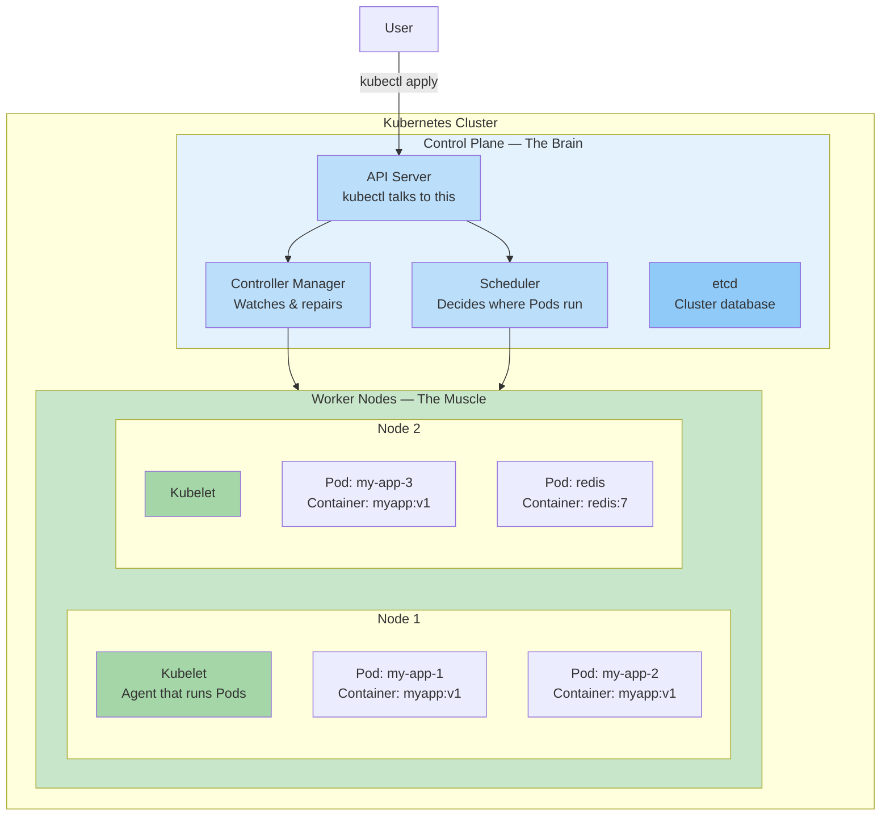
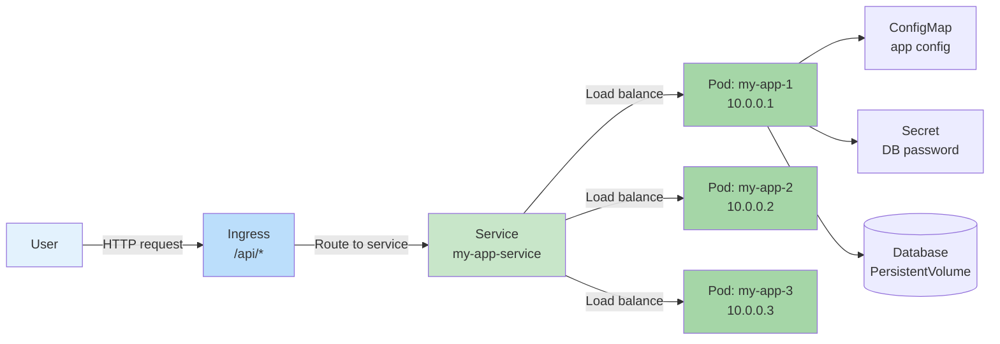

## 3. Intro to Kubernetes

### 🚢 What Is Kubernetes?

**Kubernetes** (often called **K8s** — "K" + 8 letters + "s") is the industry standard for container orchestration. It was originally built by Google and is now maintained by the Cloud Native Computing Foundation (CNCF).

**Analogy:** If Docker containers are shipping containers, Kubernetes is the **port authority** — it decides which ship gets which container, where each container goes, what to do if a container falls into the water, and how containers get loaded and unloaded.



---

### 📦 Key Concepts in Simple Words

#### 1. Pod — The smallest unit

A **Pod** is the smallest thing in Kubernetes. It wraps one or more containers.

```yaml
# pod.yaml
apiVersion: v1
kind: Pod
metadata:
  name: my-app
spec:
  containers:
    - name: app
      image: myapp:latest    # Your Docker image!
      ports:
        - containerPort: 3000
```

```bash
# Run a pod
kubectl apply -f pod.yaml

# See pods
kubectl get pods

# Output:
# NAME      READY   STATUS    RESTARTS   AGE
# my-app    1/1     Running   0          10s
```

**Analogy:** A Pod is like a **lunchbox** — it can hold one or more containers (like a sandwich and a drink). Containers in the same Pod share the same network and storage.

#### 2. Deployment — The manager

A **Deployment** tells Kubernetes how many Pod replicas to run and how to update them.

```yaml
# deployment.yaml
apiVersion: apps/v1
kind: Deployment
metadata:
  name: my-app
spec:
  replicas: 3                      # Run 3 copies
  selector:
    matchLabels:
      app: my-app
  template:
    metadata:
      labels:
        app: my-app
    spec:
      containers:
        - name: app
          image: myapp:latest      # Your Docker image
          ports:
            - containerPort: 3000
          resources:
            limits:
              memory: "256Mi"
              cpu: "500m"          # 0.5 CPU cores
```

```bash
# Deploy
kubectl apply -f deployment.yaml

# Scale
kubectl scale deployment my-app --replicas=5

# Rolling update (change image)
kubectl set image deployment/my-app app=myapp:v2

# Rollback
kubectl rollout undo deployment/my-app
```

**Analogy:** A Deployment is like a **manager** who says "I want 3 people working on this task." If someone quits (Pod crashes), the manager hires a replacement immediately.

#### 3. Service — The network endpoint

A **Service** provides a stable network address to reach your Pods, even as they come and go.

```yaml
# service.yaml
apiVersion: v1
kind: Service
metadata:
  name: my-app-service
spec:
  selector:
    app: my-app                    # Which Pods to route to
  ports:
    - port: 80                     # External port
      targetPort: 3000             # Container port
  type: LoadBalancer               # Gives you an external IP
```

```bash
kubectl apply -f service.yaml
kubectl get services

# Output:
# NAME              TYPE           CLUSTER-IP      EXTERNAL-IP   PORT(S)
# my-app-service    LoadBalancer   10.96.0.1       x.x.x.x       80:3000/TCP
```

**Analogy:** A Service is like a **receptionist**. You call the receptionist (Service IP), and they route you to whoever is available (any Pod with the right label).

---

### 🗺️ How a Request Flows Through Kubernetes



---

### 🐳 Your Docker Image on Kubernetes

The Docker images you build are **directly used** by Kubernetes. Nothing changes about how you build:

```bash
# 1. Build your Docker image as usual
docker build -t myapp:latest .

# 2. Push to a registry (Docker Hub / ECR / GHCR)
docker push myapp:latest

# 3. Reference the image in Kubernetes
kubectl set image deployment/my-app app=myapp:latest
```

**Important:** Kubernetes does NOT build Docker images. It only **pulls and runs** them. You still build images with Docker, and Kubernetes orchestrates them.

---

### 🔑 Essential kubectl Commands

```bash
# ─── PODS ─────────────────────────────────────────────
kubectl get pods                    # List all pods
kubectl get pods -o wide            # Show pod IPs and nodes
kubectl describe pod my-app         # Detailed info
kubectl logs my-app                 # View logs
kubectl logs -f my-app              # Follow logs
kubectl exec -it my-app -- sh       # Shell into container

# ─── DEPLOYMENTS ──────────────────────────────────────
kubectl get deployments
kubectl scale deployment my-app --replicas=5
kubectl rollout status deployment/my-app
kubectl rollout undo deployment/my-app

# ─── SERVICES ─────────────────────────────────────────
kubectl get services
kubectl describe service my-app-service

# ─── NODES ────────────────────────────────────────────
kubectl get nodes                   # List all nodes
kubectl describe node worker-1      # Node details

# ─── CLUSTER INFO ─────────────────────────────────────
kubectl cluster-info                # Cluster info
kubectl get all                     # Everything!
```

---

### 🆚 Docker Commands → Kubernetes Equivalents

| Docker | Kubernetes | What It Does |
|--------|------------|-------------|
| `docker run` | `kubectl run` or Deployment | Run a container |
| `docker ps` | `kubectl get pods` | List running containers |
| `docker logs` | `kubectl logs` | View container logs |
| `docker exec` | `kubectl exec` | Run command in container |
| `docker compose up` | `kubectl apply -f deployment.yaml` | Deploy multi-container app |
| `docker stats` | `kubectl top pods` | Resource usage |
| `docker network create` | Kubernetes Service + NetworkPolicy | Container networking |

---

### 🔄 Kubernetes vs Docker Swarm

| Feature | Docker Swarm | Kubernetes |
|---------|-------------|------------|
| Installation | Built into Docker | Must install separately |
| Setup time | Minutes | Hours to days |
| CLI | `docker service` (familiar) | `kubectl` (new to learn) |
| Learning curve | Low | Steep |
| Scaling | `docker service scale` | Auto-scaling (HPA) built-in |
| Self-healing | Yes | Yes (more sophisticated) |
| Rolling updates | Yes | Yes (canary, blue-green) |
| Service mesh | No | Istio, Linkerd |
| Secrets | Yes (basic) | Yes (more advanced) |
| Community size | Small | Massive |

---

### 🛠️ When to Use Kubernetes

**Use Kubernetes when:**
- You have 10+ microservices
- You need advanced deployment strategies (canary, blue-green)
- Your team has the skills to manage it
- You need auto-scaling based on CPU/memory/custom metrics
- You run on multiple cloud providers

**Don't use Kubernetes when:**
- You have 1–3 services
- Your team is small and doesn't have K8s experience
- Your app runs fine on a single server
- You don't need advanced orchestration features

---

### ✅ In Simple Words

- **Kubernetes (K8s)** is the industry standard orchestrator — think "port authority for containers."
- **Pods** are the smallest unit (wraps one or more containers).
- **Deployments** manage how many Pod replicas run and how they're updated.
- **Services** provide a stable network address to reach Pods.
- Your Docker images **run directly on Kubernetes** — you build with Docker, K8s runs them.
- Kubernetes is more **powerful but more complex** than Docker Swarm.
- Start with Docker Compose → move to Swarm → graduate to Kubernetes as you scale.
