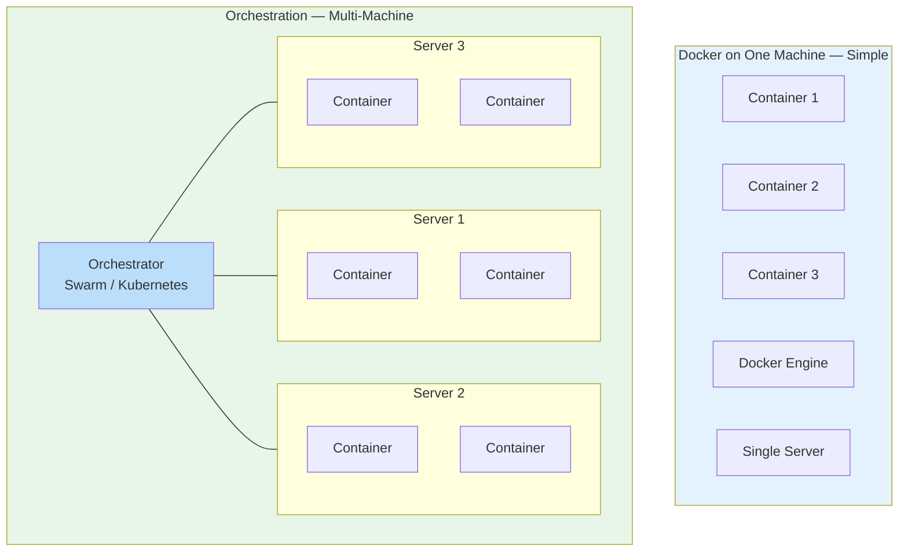

## 1. Why Orchestration?

### 🤔 The Problem: Docker Alone Isn't Enough

Docker is great for running containers on a **single machine**. But what happens when:

- You have **50 servers** running containers?
- One server crashes and takes down 20 containers?
- You need to **scale your app** from 2 to 100 instances?
- A new version needs a **zero-downtime rollout** (no dropping requests)?
- Containers on different servers need to **talk to each other**?

Running `docker run` on each machine manually doesn't work anymore. You need **orchestration**.

**Analogy:** Docker is like cooking a meal for yourself. Orchestration is like running a restaurant kitchen:

- You have multiple chefs (servers) working together
- Orders (requests) need to go to any available chef
- If one chef is sick, others take over (self-healing)
- During lunch rush, you scale up (more chefs)
- The head chef decides who does what (scheduler)

---

### 🛠️ What Orchestration Solves

| Problem | Without Orchestration | With Orchestration |
|---------|----------------------|-------------------|
| Server failure | You manually restart containers on another machine | **Self-healing** — containers are moved automatically |
| Traffic spikes | Your single container crashes under load | **Auto-scaling** — more instances are spun up |
| Deployments | Downtime while you restart containers | **Rolling updates** — zero-downtime |
| Networking | Containers can't find each other across machines | **Service discovery** — built-in DNS |
| Config management | You SSH into each machine to update config | **Declarative config** — update a file, orchestrator applies it |
| Resource efficiency | Some servers overloaded, others idle | **Scheduling** — balanced across all machines |

---

### 🏗️ A Day Without Orchestration

---

### 🏗️ A Day With Orchestration

---

### 🔑 Key Orchestration Features

**1. Cluster Management**
- Turns a group of servers into a single logical unit
- You don't care which server your container runs on

**2. Scheduling**
- Decides where each container runs based on available resources
- "This container needs 2 CPUs and 4 GB RAM — put it on the least busy server"

**3. Service Discovery & Networking**
- Containers find each other by name across different machines
- No need to hardcode IP addresses

**4. Load Balancing**
- Distributes traffic across all running instances
- If one instance fails, traffic is routed away

**5. Self-Healing**
- If a container crashes → restart it
- If a server crashes → move containers to healthy servers

**6. Rolling Updates & Rollbacks**
- Update containers one by one with zero downtime
- If something goes wrong, roll back instantly

---

### 🆚 Docker Swarm vs Kubernetes

| Feature | Docker Swarm | Kubernetes |
|---------|-------------|------------|
| Setup complexity | Very simple — built into Docker | Complex — many components to configure |
| Learning curve | Low — familiar Docker commands | High — entirely new concepts |
| Built-in | Yes — `docker swarm init` | No — must install separately |
| Feature depth | Basic (scaling, rolling updates) | Advanced (auto-scaling, service mesh, operators) |
| Community | Small | Massive (the industry standard) |
| Best for | Small teams, simple deployments | Large-scale, complex applications |

---

### 🎯 When Do You Need Orchestration?

**You probably don't need orchestration if:**
- You run containers on 1–3 servers
- You're developing locally
- Your app can tolerate a few minutes of downtime

**You need orchestration if:**
- You have 5+ servers running containers
- You need zero-downtime deployments
- Your app must self-heal from failures
- You need to scale up/down based on traffic
- You have microservices that need to discover each other across machines

---

### ✅ In Simple Words

- **Docker** is perfect for running containers on a **single machine**.
- **Orchestration** is for running containers across **many machines** automatically.
- Orchestration handles **deployment, scaling, networking, self-healing, and load balancing** — all automatically.
- **Docker Swarm** is Docker's built-in orchestrator — simple and easy to start with.
- **Kubernetes** is the industry standard for large-scale orchestration — more powerful, but more complex.
- You don't need orchestration for small projects — Docker Compose is enough. But for production at scale, orchestration is essential.
