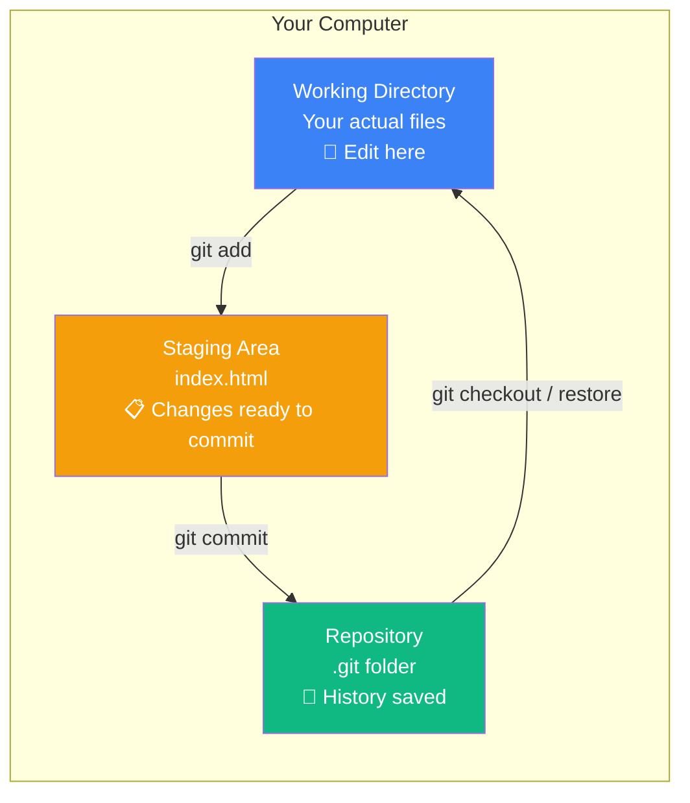

## The Three Areas of Git

### 🤔 The Three Areas

Git has three main areas where your code lives. Think of it like preparing a meal:

- **Working Directory** = Your kitchen counter (messy, food everywhere)
- **Staging Area** = Your prep bowl (ingredients ready to cook)
- **Repository** = The cooked dish (saved forever)



---

### 📋 How Files Move Between Areas

| Command | From | To | What it does |
|---------|------|----|-------------|
| `git add <file>` | Working Dir | Staging | Stage changes for commit |
| `git commit -m "msg"` | Staging | Repository | Save staged changes permanently |
| `git restore <file>` | Repository | Working Dir | Discard unstaged changes |
| `git restore --staged <file>` | Staging | Working Dir | Unstage a file (keep changes) |

### 🖼️ Visual Flow

```
WORKING DIRECTORY          STAGING AREA              REPOSITORY
─────────────────     ─────────────────     ─────────────────────
  index.html     ──►     index.html      ──►     Commit #3
  (modified)              (staged)                "Fix navbar"
                                           
  style.css                                            ▲
  (modified)              (not staged)                │
                                                  Commit #2
                                                  "Add dark mode"
                                                      
                                                  Commit #1
                                                  "Initial commit"
```

---

### 🧪 Try It Yourself

```bash
# 1. Check status (see which area files are in)
git status

# 2. Edit a file in your working directory
echo "Hello" >> index.html

# 3. Stage it
git add index.html

# 4. Commit it to the repository
git commit -m "Add hello message"

# 5. Check the log
git log --oneline
```

> **Result:** The file moves from Working Directory → Staging Area → Repository with each command.

---

### 🗺️ Real World Workflow

```bash
# 1. Starting point — all clean
git status
# On branch main
# nothing to commit, working tree clean

# 2. Edit files (they're now in Working Directory)
# (edit index.html in your editor)

# 3. Check what changed
git status
# Changes not staged for commit:
#   modified:   index.html

# 4. Stage the file
git add index.html

# 5. Check again
git status
# Changes to be committed:
#   modified:   index.html

# 6. Commit
git commit -m "Update homepage title"

# 7. Clean again
git status
# nothing to commit, working tree clean
```

---

### In Simple Words

- **Working Directory** — where you edit files (messy)
- **Staging Area** — where you gather changes for your next commit (prep)
- **Repository** — where commits are saved forever (history)
- `git add` moves files from working → staging
- `git commit` moves files from staging → repository
- `git status` shows which area each file is in
