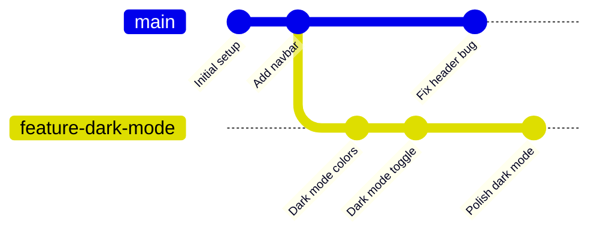

## Branches

### 🤔 What is a Branch?

A branch is a **separate line of development**. Think of it like a **separate copy of a document**:

- You have the main document (the `main` branch)
- You make a copy to experiment (a feature branch)
- If the experiment works, you merge it back



> **Result:** `main` progresses normally while `feature-dark-mode` has its own commits. The branches diverge from a common ancestor.

---

### 🌿 Working with Branches

```bash
# List all branches
git branch
# * main          (the * means you're on main)

# Create a new branch
git branch feature-login

# Switch to a branch
git checkout feature-login
# OR (modern way)
git switch feature-login

# Create and switch in one command
git checkout -b feature-login
git switch -c feature-login

# Rename a branch (while on it)
git branch -m new-name

# Delete a branch (after merging)
git branch -d feature-login

# Force delete (changes not merged)
git branch -D feature-login
```

---

### 📋 How Branching Works

A branch is just a **pointer to a specific commit**. When you make a new commit on a branch, the pointer moves forward.

```
Before creating a branch:
    main
      ▼
  ┌───┐   ┌───┐   ┌───┐
  │ A │──▶│ B │──▶│ C │
  └───┘   └───┘   └───┘

After creating feature-login (pointing to same commit):
    main
      ▼
  ┌───┐   ┌───┐   ┌───┐
  │ A │──▶│ B │──▶│ C │
  └───┘   └───┘   └───┘
                    ▲
              feature-login

After committing on feature-login:
    main
      ▼
  ┌───┐   ┌───┐   ┌───┐   ┌───┐
  │ A │──▶│ B │──▶│ C │──▶│ D │
  └───┘   └───┘   └───┘   └───┘
                            ▲
                      feature-login
```

---

### ✅ Why Branch?

- **Isolate work** — experiment without breaking the main code
- **Collaborate** — multiple people work on different features simultaneously
- **Review** — changes are reviewed before merging (pull requests)
- **Organize** — features, bug fixes, and experiments each have their own branch

---

### In Simple Words

- A **branch** is a separate line of development — like a copy of your project
- `git branch <name>` creates a branch; `git switch <name>` moves to it
- Use `git switch -c <name>` to create and switch in one step
- Branches let you work on features without affecting `main`
- Delete branches with `git branch -d <name>` after merging
