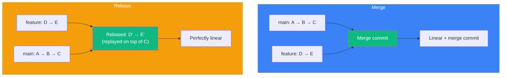

## Merge vs Rebase

### 🤔 What's the Difference?

Both `merge` and `rebase` combine changes from one branch into another — but they do it very differently.

**Merge** creates a new commit that ties two histories together.
**Rebase** replays your commits on top of another branch, creating a linear history.



**Visual timeline:**

```
Merge:
main:    A ──▶ B ──▶ C ──────────▶ F (merge commit)
                      \           /
feature:               D ──────── E

Rebase:
main:    A ──▶ B ──▶ C
                      │
feature:              ├─▶ D' ──▶ E' (replayed, new hashes)
(original D and E are discarded)
```

---

### 🔄 How Rebase Works

```bash
# Current situation: feature branch is behind main
git switch feature
git rebase main

# What happens step by step:
# 1. Git finds the common ancestor (commit where feature branched off)
# 2. Git temporarily sets aside feature's commits (D, E)
# 3. Git moves feature to point to main's tip (C)
# 4. Git replays D and E on top of C → D' and E' (new commits with new hashes)
```

---

### 📋 Command Comparison

```bash
# MERGE — keeps all history
git switch main
git merge feature

# REBASE — rewrites history
git switch feature
git rebase main
git switch main
git merge feature    # now a fast-forward!
```

---

### ⚠️ The Golden Rule of Rebase

> **Never rebase commits that have been pushed to a shared branch.**

If you rebase a branch that others are working on, their local copies will have different commit history. It's like rewriting history in a shared textbook — chaos ensues.

**Safe to rebase:** ✅ Your local feature branch (never pushed)
**Never rebase:** ❌ `main`, `develop`, or any branch others have pulled from

---

### 🎯 When to Use What

| Use Merge when... | Use Rebase when... |
|------------------|-------------------|
| You want to preserve exact history | You want a clean, linear history |
| Working on a shared branch | Working on a local feature branch |
| You want to see when branches diverged | You want to avoid merge commits |
| Collaborating with a team | Updating your branch with latest main |

---

### In Simple Words

- **Merge** creates a commit that ties two branches together (preserves history)
- **Rebase** replays your commits on top of another branch (linear history)
- **Golden rule:** Never rebase commits you've already pushed to a shared branch
- Merge is safer for collaboration; rebase gives cleaner history
- After rebasing, you can fast-forward merge into main for a straight line
