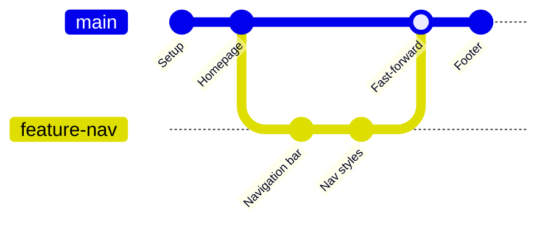
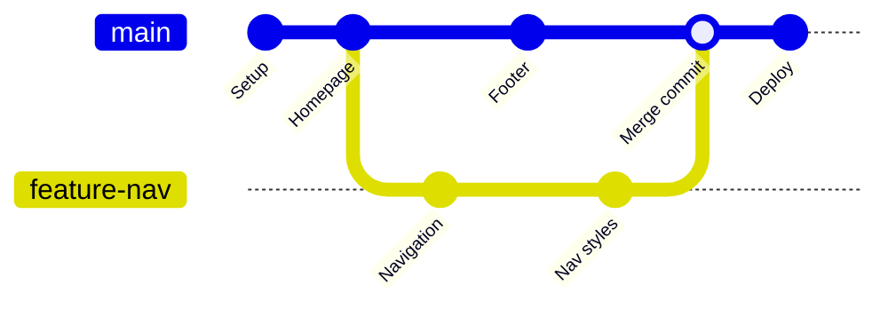

## Merging

### 🤔 What is Merging?

Merging takes changes from one branch and adds them to another. Think of it like **two people editing the same document**:

- You edit chapters 1-3, your colleague edits chapters 4-6
- You merge your changes into one complete document

```bash
# First, switch to the branch you want to merge INTO
git switch main

# Then merge the feature branch INTO main
git merge feature-login
```

---

### ⚡ Fast-Forward Merge

A fast-forward merge happens when the target branch hasn't changed since you branched off. Git simply moves the pointer forward.



**Before merge:**
```
main ──▶ A ──▶ B
                  ▲
           feature-nav (pointing to B)
```

**After fast-forward merge:**
```
main ──▶ A ──▶ B
                ▲
           main & feature-nav (both at B)
```

```bash
git switch main
git merge feature-nav
# Updating a1b2c3d..f6e5d4c
# Fast-forward
```

> **Result:** No new merge commit is created. The history stays linear.

---

### 🔀 3-Way Merge

A 3-way merge happens when the target branch has **also moved forward** since you branched off.



**Before merge:**
```
main:     A ──▶ B ──▶ C
                   
feature:  A ──▶ B ──▶ D ──▶ E
```

**After 3-way merge:**
```
main:     A ──▶ B ──▶ C ──▶ F (merge commit)
                  \         /
                   D ───── E
```

```bash
git switch main
git merge feature-nav
# Merge made by the 'ort' strategy.
# (editor opens for a merge commit message)
```

> **Result:** Git creates a **merge commit** with two parents — one from main, one from the feature branch. History shows both branches.

---

### 🧪 Try It Yourself

```bash
# 1. Setup
git init
echo "Initial" > file.txt
git add . && git commit -m "Initial commit"

# 2. Create and work on a branch
git checkout -b feature
echo "Feature work" >> file.txt
git add . && git commit -m "Feature commit"

# 3. Switch back and make changes on main
git checkout main
echo "Main work" >> file.txt
git add . && git commit -m "Main commit"

# 4. Merge feature into main
git merge feature
# (this will create a merge commit)
```

---

### 📊 Fast-Forward vs 3-Way

| Feature | Fast-Forward | 3-Way Merge |
|---------|-------------|-------------|
| When it happens | Target branch hasn't moved | Both branches have new commits |
| Creates a merge commit? | ❌ No | ✅ Yes |
| History | Linear (clean) | Branched (accurate) |
| Default behavior | Git does it automatically | Git prompts for commit message |

---

### In Simple Words

- **Merging** combines changes from one branch into another
- **Fast-forward** = simple pointer move (no new commit, clean history)
- **3-way merge** = creates a merge commit when both branches moved forward
- Always switch to the **target** branch first (`git switch main`), then merge
- After merging, you can safely delete the feature branch
