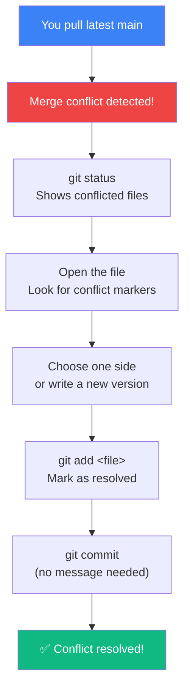

## Resolving Conflicts

### 🤔 Why Do Conflicts Happen?

A conflict occurs when two branches modify the **same line** in the **same file** differently. Git doesn't know which change to keep.

Think of it like two people editing the same sentence in a document:

- You write: "The color is **blue**."
- Your colleague writes: "The color is **red**."
- Git asks: **Which one is correct?**



---

### 🔍 What a Conflict Looks Like

When a conflict happens, Git puts **conflict markers** in the file:

```txt
<<<<<<< HEAD
The color is blue.
=======
The color is red.
>>>>>>> feature-branch
```

| Marker | Meaning |
|--------|---------|
| `<<<<<<< HEAD` | Start of **your** version (current branch) |
| `=======` | Separator between the two versions |
| `>>>>>>> feature-branch` | End of **their** version (incoming branch) |

---

### 🛠️ Step-by-Step Fix

**1. See which files have conflicts:**
```bash
git status
# both modified:   index.html
```

**2. Open the conflicted file in your editor:**
```bash
code index.html   # VS Code
```

**3. Find the conflict markers and fix them:**
```txt
<<<<<<< HEAD
The color is blue.
=======
The color is red.
>>>>>>> feature-branch
```

**4. Decide what to keep — one side, both, or something new:**
```txt
The color is purple.    ← You wrote a completely new version
```

**5. Save the file, then mark it as resolved:**
```bash
git add index.html
git commit        # Git provides a default merge message
```

---

### 🧪 Practice Creating a Conflict

```bash
# 1. Setup
git init
echo "Hello" > file.txt
git add . && git commit -m "Initial"

# 2. Branch and commit
git checkout -b feature
echo "Feature content" > file.txt
git add . && git commit -m "Feature change"

# 3. Back to main, make a different change
git checkout main
echo "Main content" > file.txt
git add . && git commit -m "Main change"

# 4. Try to merge — conflict!
git merge feature
# Auto-merging file.txt
# CONFLICT: content in file.txt
```

**The conflicted `file.txt` will look like:**
```txt
<<<<<<< HEAD
Main content
=======
Feature content
>>>>>>> feature
```

Fix it, then `git add file.txt` and `git commit`.

---

### 💡 Tips for Avoiding Conflicts

- **Pull often** — `git pull` before starting work
- **Communicate** — let teammates know which files you're editing
- **Small commits** — easier to see what changed
- **Short-lived branches** — merge or rebase frequently to stay in sync
- **Use VS Code** — it has built-in conflict resolution UI (Accept Current / Accept Incoming / Accept Both)

---

### In Simple Words

- Conflicts happen when two branches change the **same line** differently
- Git marks conflicts with `<<<<<<<`, `=======`, and `>>>>>>>`
- **Fix:** Open the file → edit the content → remove markers → save
- **Mark resolved:** `git add <file>` → `git commit`
- Conflicts are normal! Pull often and branch frequently to minimize them
