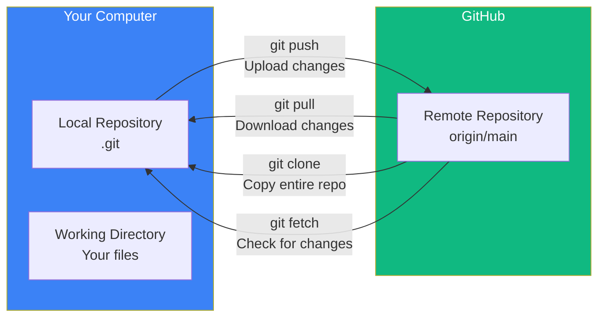

## Remotes

### 🤔 What is a Remote?

A **remote** is a link from your local repository to a copy hosted on GitHub (or another server). Think of it like a **cloud backup** for your code.

- **Local** = your computer
- **Remote** = GitHub (or GitLab, Bitbucket, etc.)



---

### 📥 Clone — Copy a Remote Repo

```bash
git clone https://github.com/username/project.git
# Cloning into 'project'...
# remote: Enumerating objects: 42, done.
# Receiving objects: 100% (42/42), done.

cd project
git remote -v
# origin  https://github.com/username/project.git (fetch)
# origin  https://github.com/username/project.git (push)
```

`origin` is the default name for the remote repository. Think of it as a nickname for the GitHub URL.

---

### 📤 Push — Upload Your Changes

```bash
# Push main branch to origin remote
git push origin main

# Push a new branch (creates it on GitHub too)
git push origin feature-login

# Set upstream (so next time just 'git push')
git push -u origin feature-login
# Now: git push  ← works without arguments
```

---

### 📥 Pull — Download & Merge

```bash
git pull origin main
# = git fetch + git merge
```

`git pull` is two commands in one:
1. `git fetch` — download the latest changes from GitHub
2. `git merge` — merge them into your current branch

```bash
# Better to use fetch + status first:
git fetch           # check what's new (safe)
git status          # see if you're ahead/behind
git pull            # then pull if needed
```

---

### 👁️ Fetch — Check for Changes (Safe)

```bash
git fetch
# remote: Enumerating objects: 5, done.
# From https://github.com/username/project
#    a1b2c3d..f6e5d4c  main -> origin/main
```

`fetch` downloads new data but **does not change your working files**. It's a safe way to check what's new.

After fetching, you can compare:
```bash
git log origin/main..main    # commits you have that origin doesn't
git log main..origin/main    # commits origin has that you don't
```

---

### 🗺️ Common Remote Commands

```bash
# List remotes
git remote -v

# Add a new remote
git remote add origin https://github.com/user/repo.git

# Remove a remote
git remote remove origin

# Rename a remote
git remote rename origin upstream

# Show info about a remote
git remote show origin
```

---

### In Simple Words

- A **remote** links your local repo to GitHub — `origin` is the default nickname
- `git clone` downloads a repo from GitHub to your computer
- `git push` uploads your commits to GitHub
- `git pull` downloads and merges changes (= `fetch` + `merge`)
- `git fetch` is safe — it checks for new changes without modifying your files
- Always **pull before you push** to avoid conflicts!
