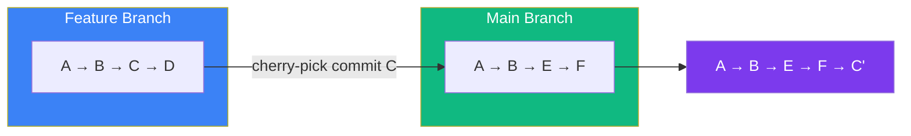

## Stash, Tags & Cherry-pick

### 📦 git stash — Save Work In Progress

`stash` temporarily saves your uncommitted changes so you can switch branches.

Think of it like **putting your work in a drawer** so you can do something else, then take it back out.

```bash
# Save current work (untracked + staged)
git stash

# Save including untracked files
git stash -u

# List all stashes
git stash list
# stash@{0}: WIP on main: fix login bug
# stash@{1}: WIP on feature: add dark mode

# Apply the most recent stash (keeps it in list)
git stash apply

# Apply and remove from list
git stash pop

# Apply a specific stash
git stash apply stash@{1}

# Drop (delete) a stash
git stash drop stash@{0}

# Clear all stashes
git stash clear
```

**Typical workflow:**
```bash
# 1. You're working on feature
git checkout -b feature-dark-mode
# (edit files)

# 2. Urgent bug on main! Save your work
git stash -u

# 3. Switch and fix bug
git checkout main
# (fix the bug, commit, push)
git checkout feature-dark-mode

# 4. Get your work back
git stash pop
```

> **Result:** Your half-finished work is saved, you fix the urgent bug, then get back to work.

---

### 🏷️ git tag — Mark Important Commits

Tags mark specific commits, usually for releases (v1.0, v2.0).

```bash
# Create a lightweight tag
git tag v1.0

# Create an annotated tag (with message — recommended)
git tag -a v1.0 -m "Release version 1.0"

# List all tags
git tag
# v1.0
# v1.1
# v2.0

# Tag a specific commit
git tag -a v1.0 a1b2c3d -m "Release v1.0"

# Push tags to GitHub
git push origin --tags

# Delete a local tag
git tag -d v1.0

# Delete a remote tag
git push origin --delete v1.0

# Checkout a tag (detached HEAD)
git checkout v1.0
```

---

### 🍒 git cherry-pick — Apply Specific Commits

`cherry-pick` applies a specific commit from one branch to your current branch.

Think of it like **picking one cherry from another tree** and putting it on yours.



```bash
# Cherry-pick a single commit
git cherry-pick a1b2c3d

# Cherry-pick a range of commits
git cherry-pick a1b2c3d..f6e5d4c

# Cherry-pick without committing (make changes to working directory)
git cherry-pick -n a1b2c3d
```

**Use cherry-pick when:**
- A bug fix was committed on a different branch and you need it here
- You want to bring a specific feature without merging an entire branch
- You accidentally committed to the wrong branch

---

### In Simple Words

- `git stash` saves work temporarily — like putting files in a drawer
- `git tag` marks important commits with names like `v1.0` for releases
- `git cherry-pick <commit>` applies a specific commit to your current branch
- Stash is for **half-finished work**, tags are for **releases**, cherry-pick is for **selective commits**
- Push tags with `git push --tags` so they appear on GitHub
