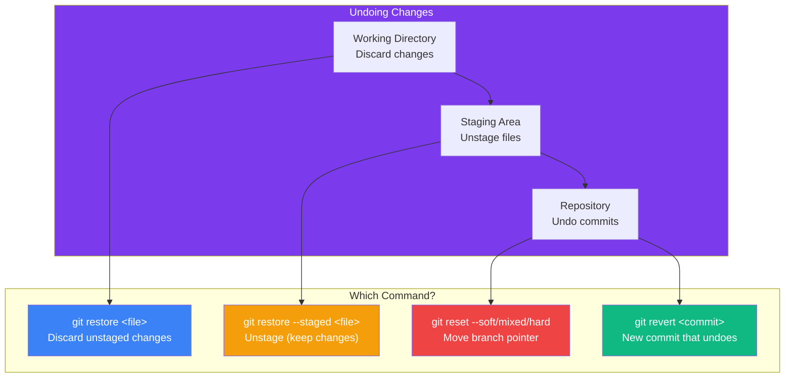

## Undoing Changes

### 🤔 Three Levels of "Undo"

Git has different undo tools depending on where the change is:

- **Working directory** — files you edited but haven't staged
- **Staging area** — files you `git add`-ed but haven't committed
- **Repository** — commits you already made



---

### 🔄 git restore — Discard Local Changes

```bash
# Discard changes in working directory (go back to last commit)
git restore index.html

# Unstage a file (but keep the changes)
git restore --staged index.html

# Unstage AND discard changes
git restore --staged --worktree index.html
```

---

### ↩️ git reset — Move the Branch Pointer

`reset` moves the current branch back to a previous commit. It comes in three flavors:

```bash
# ─── SOFT — move pointer back, keep everything staged ───
git reset --soft HEAD~1
# Changes are still in the staging area

# ─── MIXED (default) — move pointer, unstage, keep files ───
git reset --mixed HEAD~1
# git reset HEAD~1           (same thing)
# Changes are in working directory

# ─── HARD — DELETE changes permanently ⚠️ ───
git reset --hard HEAD~1
# Changes are GONE. Can't recover (usually)
```

**Visual:**
```
Before reset (HEAD is at D):
    A ──▶ B ──▶ C ──▶ D
                        ▲
                       HEAD

After git reset --hard HEAD~2:
    A ──▶ B
            ▲
           HEAD
    (C and D are discarded)
```

---

### ↩️ git revert — Safe Undo (Recommended)

`revert` creates a **new commit** that undoes a previous commit. It doesn't rewrite history.

```bash
# Revert the last commit
git revert HEAD
# Creates a new commit "Revert 'Add login page'"

# Revert a specific commit
git revert a1b2c3d

# Revert multiple commits
git revert HEAD~3..HEAD
```

```
Before revert:
    A ──▶ B ──▶ C ──▶ D (HEAD)
    
After revert:
    A ──▶ B ──▶ C ──▶ D ──▶ E (HEAD)
                                │
                                └── "Revert C — Remove login page"
```

> **Result:** Commit C's changes are undone, but the history is preserved. Everyone can `git pull` safely.

---

### 📊 reset vs revert

| | `git reset` | `git revert` |
|---|------------|--------------|
| Rewrites history? | ✅ Yes | ❌ No |
| Safe for shared branches? | ❌ No | ✅ Yes |
| Creates a new commit? | ❌ No | ✅ Yes |
| Use when... | Local changes you haven't pushed | Commits already pushed to shared branch |

**Golden rule:** Use `revert` for anything **pushed to shared branches**. Use `reset` for **local work only**.

---

### In Simple Words

- `git restore` — discard file changes in working directory or unstage files
- `git reset --soft/mixed/hard` — move branch pointer back (rewrites history)
- `git revert <commit>` — creates a **new undo commit** (safe for shared branches)
- Use **revert** for pushed commits; use **reset** for local work only
- `--hard` is **dangerous** — it permanently deletes uncommitted changes
