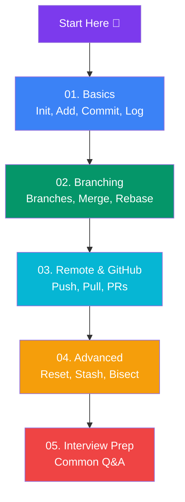

# Git & GitHub

Complete beginner-friendly guide to Git and GitHub — from basic commands to branching, remotes, and interview prep.

## Learning Path

## Sections

### 📂 01. Basics
- [What is Git?](/DSA-Notes-Problems/git/01-basics/what-is-git) — Version control, why Git, Git vs GitHub
- [Installing & Config](/DSA-Notes-Problems/git/01-basics/installing-and-config) — Install, git config, SSH keys
- [The Three Areas](/DSA-Notes-Problems/git/01-basics/the-three-areas) — Working dir, staging, repository
- [Core Commands](/DSA-Notes-Problems/git/01-basics/core-commands) — init, add, commit, status, log, diff

### 🌿 02. Branching
- [Branches](/DSA-Notes-Problems/git/02-branching/branches) — Create, switch, delete branches
- [Merging](/DSA-Notes-Problems/git/02-branching/merging) — Fast-forward vs 3-way merge
- [Merge vs Rebase](/DSA-Notes-Problems/git/02-branching/merge-vs-rebase) — When to use each, golden rule
- [Resolving Conflicts](/DSA-Notes-Problems/git/02-branching/resolving-conflicts) — Step-by-step conflict fix

### 🌐 03. Remote & GitHub
- [Remotes](/DSA-Notes-Problems/git/03-remote-and-github/remotes) — Clone, remote, push, pull, fetch
- [Pull Requests](/DSA-Notes-Problems/git/03-remote-and-github/pull-requests) — Fork vs branch, opening a PR
- [Collaboration Workflow](/DSA-Notes-Problems/git/03-remote-and-github/collaboration-workflow) — Feature branch, Git Flow, trunk-based

### 🔧 04. Advanced
- [Undoing Changes](/DSA-Notes-Problems/git/04-advanced/undoing-changes) — restore, reset, revert
- [Stash, Tags & Cherry-pick](/DSA-Notes-Problems/git/04-advanced/stash-tags-cherry-pick)
- [History & Blame](/DSA-Notes-Problems/git/04-advanced/history-and-blame) — log options, blame, bisect
- [.gitignore & Best Practices](/DSA-Notes-Problems/git/04-advanced/gitignore-and-best-practices) — Good commits, .gitignore, mistakes

### 💬 05. Interview
- [Interview Questions](/DSA-Notes-Problems/git/05-interview/interview-questions) — Common Git Q&A
