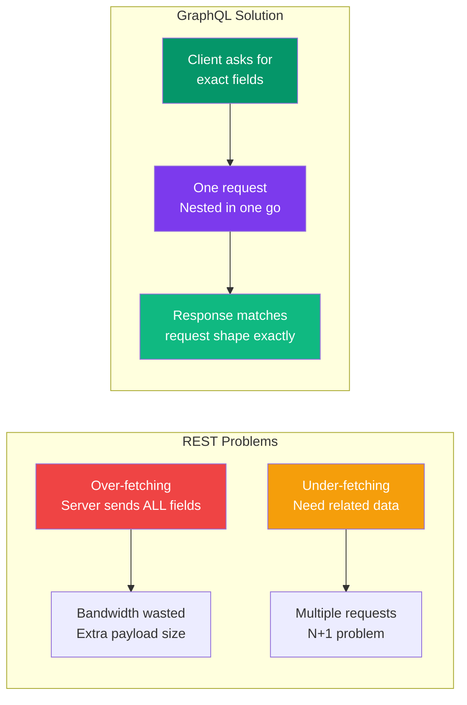
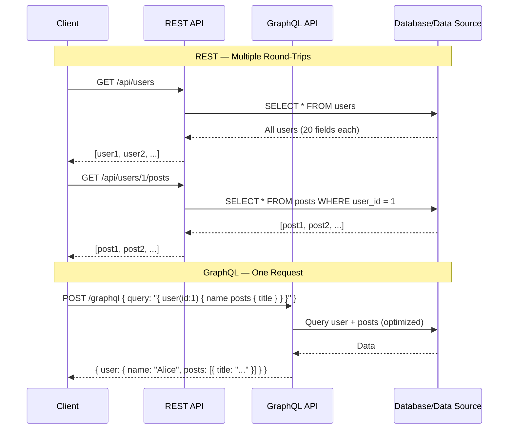

## GraphQL vs REST

Both GraphQL and REST are ways to build APIs. REST has been the standard for decades. GraphQL is a newer alternative that solves specific REST pain points.

> **Analogy:** REST is like ordering from a menu where each item comes as a fixed platter. GraphQL is like a build-your-own-bowl restaurant where you pick exactly the ingredients you want.

---

### Architecture: Many Endpoints vs One Endpoint

```mermaid
flowchart TB
    subgraph REST["REST Architecture"]
        C1[Client] --> E1[/api/users]
        C1 --> E2[/api/users/1]
        C1 --> E3[/api/users/1/posts]
        C1 --> E4[/api/posts/5/comments]
    end

    subgraph GraphQL["GraphQL Architecture"]
        C2[Client] -->|"POST /graphql"| Single[Single Endpoint]
        Single --> Q1["{ user(id:1) { name posts { title } } }"]
        Single --> Q2["{ post(id:5) { title comments { text } } }"]
    end

    style C1 fill:#ef4444,color:#fff
    style C2 fill:#7c3aed,color:#fff
    style Single fill:#7c3aed,color:#fff
    style E1 fill:#fca5a5,color:#333
    style E2 fill:#fca5a5,color:#333
    style E3 fill:#fca5a5,color:#333
    style E4 fill:#fca5a5,color:#333
```

---

### Over-fetching & Under-fetching

**Over-fetching** — Getting more data than you need.
**Under-fetching** — Not getting enough data in one request.



**Example — A dashboard showing user names and post counts:**

```javascript
// REST: GET /api/users — returns ALL user fields (over-fetching)
// Then for each user: GET /api/users/:id/posts (under-fetching, N requests)
[
  { "id": 1, "name": "Alice", "email": "alice@...", "age": 30, "city": "NYC",
    "phone": "...", "avatar": "...", "createdAt": "..." },
  // ... 100 users — each with 10+ fields we don't need
]

// GraphQL: one query, exactly the fields we want
query {
  users {
    name
    postsCount  // computed field, no extra request
  }
}
// Response: [{ "name": "Alice", "postsCount": 5 }, ...]
```

---

### Side-by-Side Comparison

| Aspect | REST | GraphQL |
|--------|------|---------|
| **Endpoint** | Multiple (`/users`, `/users/1/posts`) | Single (`/graphql`) |
| **Data fetching** | Server decides the response shape | Client decides the response shape |
| **Over-fetching** | Common — server sends everything | Never — only requested fields |
| **Under-fetching** | Common — need multiple round-trips | Rare — nested queries in one request |
| **HTTP methods** | GET, POST, PUT, PATCH, DELETE | POST only (queries and mutations) |
| **Caching** | Built-in HTTP caching (GET) | Requires custom caching layer |
| **Versioning** | `/v1/`, `/v2/` or headers | No versioning — evolve schema |
| **Documentation** | Swagger / OpenAPI | Introspection — self-documenting |
| **Tooling** | Postman, curl | GraphiQL, Apollo Studio, GraphQL Playground |
| **File uploads** | Built-in (multipart) | Requires extra setup |
| **Learning curve** | Low | Medium |
| **Performance** | Simple caching, predictable | Complex queries can be expensive |

---

### Request Flow: REST vs GraphQL



---

### When to Use Which

| Use GraphQL when... | Use REST when... |
|--------------------|-----------------|
| Multiple client types (web, mobile, IoT) | Single client type |
| Complex data relationships | Simple CRUD operations |
| Rapid iteration (avoid versioning) | Stable, well-known API |
| Client needs flexible data shapes | Fixed responses are fine |
| Real-time features (subscriptions) | Traditional request-response |
| Microservice aggregation layer | Internal service-to-service |

---

### In Simple Words

- REST uses **many endpoints**; GraphQL uses **one endpoint**
- REST can **over-fetch** (too much data) or **under-fetch** (too little data)
- GraphQL lets the client **ask for exactly what it needs**
- REST has **built-in HTTP caching**; GraphQL needs a custom cache
- GraphQL is **great for complex UIs**; REST is **simpler for basic APIs**
- Both can coexist — you can wrap REST APIs with a GraphQL layer
