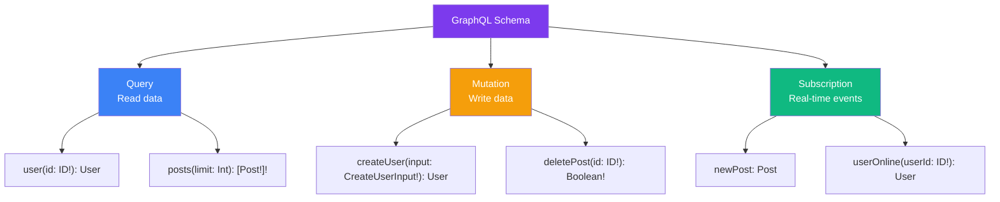
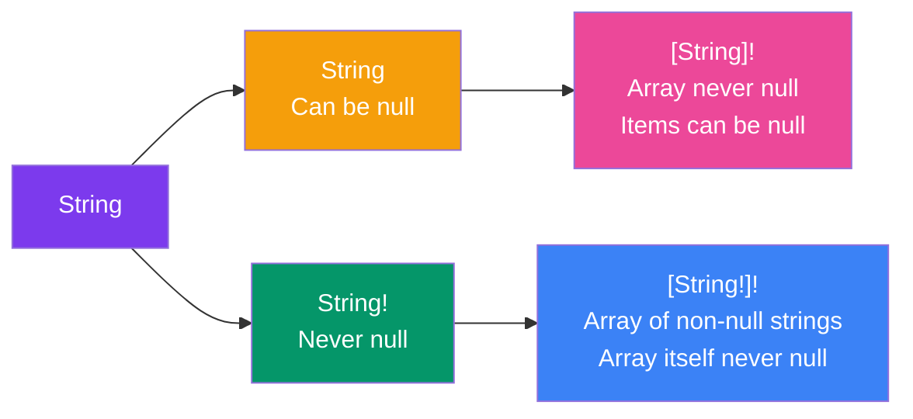

## Schema & Types

The **schema** is the heart of any GraphQL API. It defines what data is available, what types those data have, and what operations the client can perform.

> **Analogy:** A GraphQL schema is like a restaurant menu. It tells you what dishes are available (types), what ingredients they contain (fields), and whether you can order them (queries), customize them (mutations), or get notified when they're ready (subscriptions).

---

### Schema Structure: The Root Types

Every GraphQL schema has three special **root types** that define entry points for operations:



### Basic Schema Example

```graphql
# Root types — the entry points
type Query {
  users: [User!]!
  user(id: ID!): User
  posts: [Post!]!
}

type Mutation {
  createUser(input: CreateUserInput!): User!
  deleteUser(id: ID!): Boolean!
}

type Subscription {
  userCreated: User!
}
```

---

### Type System — The Building Blocks

GraphQL has its own type system. Here are the building blocks:

#### 1. Scalar Types (Primitives)

```graphql
type Product {
  id: ID!        # ID — unique identifier (serialized as string)
  name: String!  # String — UTF-8 characters
  price: Float!  # Float — decimal numbers
  inStock: Int!  # Int — 32-bit integer
  active: Boolean # Boolean — true/false (nullable!)
  tags: [String] # List of nullable strings
}
```

| Scalar | Description |
|--------|-------------|
| `Int` | 32-bit integer |
| `Float` | Double-precision floating point |
| `String` | UTF-8 string |
| `Boolean` | `true` or `false` |
| `ID` | Unique identifier (serialized as string) |

#### 2. Object Types

```graphql
type User {
  id: ID!
  name: String!
  email: String!
  age: Int
  posts: [Post!]!  # Relationship to another type
  profile: Profile  # Optional one-to-one relationship
}

type Post {
  id: ID!
  title: String!
  content: String!
  author: User!     # Back-reference
  published: Boolean!
}
```

#### 3. Non-Null & Lists

```graphql
type Example {
  # Non-null: This field MUST return a value
  requiredField: String!
  
  # Nullable: This field CAN return null
  optionalField: String
  
  # List of non-null items: Returns an array, each item is required
  listOfStrings: [String!]!
  
  # Nullable list: The list itself can be null, but items must be non-null
  nullableList: [String!]
  
  # List of nullable items: The list is required, but items can be null
  nonNullList: [String]!
}
```

---

### Type Modifiers Flow



---

### Input Types

For mutations that pass complex data, GraphQL provides **input types**:

```graphql
input CreateUserInput {
  name: String!
  email: String!
  age: Int
}

input PostFilter {
  published: Boolean
  authorId: ID
  search: String
}

type Mutation {
  createUser(input: CreateUserInput!): User!
  posts(filter: PostFilter): [Post!]!
}
```

---

### Enums

```graphql
enum Role {
  ADMIN
  EDITOR
  VIEWER
}

type User {
  id: ID!
  role: Role!
}

type Mutation {
  updateUserRole(userId: ID!, role: Role!): User!
}
```

---

### Full Schema Example

```graphql
# Enums
enum Role {
  ADMIN
  EDITOR
  VIEWER
}

# Input types
input CreateUserInput {
  name: String!
  email: String!
  role: Role!
}

# Object types
type User {
  id: ID!
  name: String!
  email: String!
  role: Role!
  posts: [Post!]!
}

type Post {
  id: ID!
  title: String!
  content: String!
  author: User!
  published: Boolean!
  createdAt: String!
}

# Query — read operations
type Query {
  users: [User!]!
  user(id: ID!): User
  posts: [Post!]!
}

# Mutation — write operations
type Mutation {
  createUser(input: CreateUserInput!): User!
  deleteUser(id: ID!): Boolean!
}

# Subscription — real-time
type Subscription {
  userCreated: User!
}
```

---

### In Simple Words

- The **schema** is a contract — it defines exactly what the API can do
- **Root types** (`Query`, `Mutation`, `Subscription`) are the entry points
- **Scalars** are the basic value types (String, Int, Float, Boolean, ID)
- **Object types** group fields together and form relationships
- `!` means **non-null** — the field is required
- `[]` means **list/array**
- **Input types** let you pass complex data to mutations
