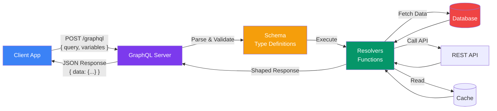

## What is GraphQL?

**GraphQL** is a **query language for APIs** and a **runtime** for fulfilling those queries with your existing data. It gives clients the power to ask for exactly what they need and nothing more.

> **Analogy:** Imagine you're at a hotel front desk. REST is like asking "Give me room 42" and getting a printed form with every field — room number, guest name, check-in date, mini-bar charges, previous guest history, everything. GraphQL is like asking "Tell me the guest name and check-out time for room 42" and getting *only* that information.

### The Single Endpoint Idea

Unlike REST which exposes multiple endpoints (`/users`, `/users/1/posts`), GraphQL exposes **one single endpoint** (usually `/graphql`). The client describes the data shape it wants in the query itself.

```graphql
# One endpoint, one request — client asks for exactly this shape
query {
  user(id: "42") {
    name
    email
    posts {
      title
    }
  }
}
```

### How GraphQL Works



### Key Concepts

| Concept | What It Means |
|---------|---------------|
| **Schema** | The blueprint of your API — defines what data is available |
| **Query** | A read operation — ask for data (like GET) |
| **Mutation** | A write operation — create, update, or delete data (like POST/PUT/DELETE) |
| **Resolver** | A function that returns data for a specific field |
| **Subscription** | A real-time connection — server pushes updates to client |

### A Minimal Example

```graphql
# Schema definition
type Query {
  hello: String!
}
```

```javascript
// Resolver
const resolvers = {
  Query: {
    hello: () => "Hello, GraphQL!"
  }
};
```

```graphql
# Client query
query {
  hello
}
```

```json
// Response
{
  "data": {
    "hello": "Hello, GraphQL!"
  }
}
```

### Why GraphQL Exists

REST APIs work well for simple CRUD, but modern apps face problems:

1. **Over-fetching** — A mobile app might need only 2 of 20 fields
2. **Under-fetching** — A page needs user + posts + followers → 3 separate requests
3. **Tight coupling** — Frontend changes often require backend changes
4. **Poor typing** — No built-in contract between client and server

GraphQL solves all four with a **typed, client-driven approach**.

---

### In Simple Words

- GraphQL is a **language for asking APIs questions**
- The **client controls what data it gets** — not the server
- Everything goes through **one endpoint** → `/graphql`
- A **schema** defines what's possible; **resolvers** do the actual work
- It solves **over-fetching** and **under-fetching** problems from REST
