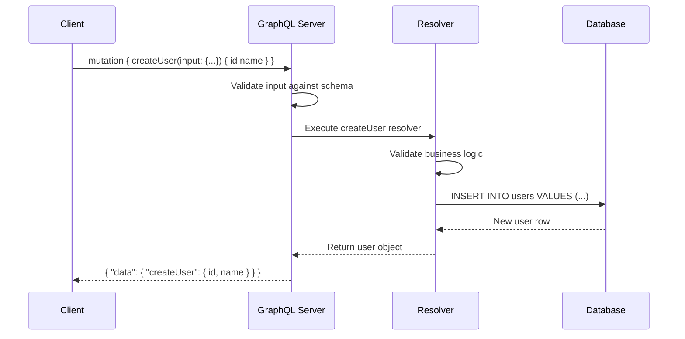

## Mutations

**Mutations** are how you **change data** in GraphQL — create, update, or delete. Think of them like `POST`/`PUT`/`DELETE` in REST, but you get to specify exactly what data the server returns after the change.

> **Analogy:** A query is like asking "What's in the fridge?" A mutation is like "I'm taking an apple" — and the server tells you "You now have 3 apples left."

---

### Basic Mutation

```graphql
# Define a mutation
mutation {
  createUser(name: "Charlie", email: "charlie@example.com") {
    id
    name
    email
  }
}
```

```json
{
  "data": {
    "createUser": {
      "id": "3",
      "name": "Charlie",
      "email": "charlie@example.com"
    }
  }
}
```

**Key difference from queries:** Mutations run **sequentially** (one after another) to avoid race conditions. Queries can run in parallel.

---

### Mutation with Input Types

For complex data, use **input types**:

```graphql
# Schema
input CreateUserInput {
  name: String!
  email: String!
  age: Int
  role: Role
}

type Mutation {
  createUser(input: CreateUserInput!): User!
}
```

```graphql
# Mutation with variables
mutation CreateUser($input: CreateUserInput!) {
  createUser(input: $input) {
    id
    name
    email
    createdAt
  }
}
```

```json
// Variables
{
  "input": {
    "name": "Diana",
    "email": "diana@example.com",
    "age": 28,
    "role": "EDITOR"
  }
}
```

---

### Update & Delete Mutations

```graphql
# Schema
type Mutation {
  updateUser(id: ID!, input: UpdateUserInput!): User!
  deleteUser(id: ID!): Boolean!
}

input UpdateUserInput {
  name: String
  email: String
  age: Int
}
```

```graphql
# Update
mutation UpdateUser($id: ID!, $input: UpdateUserInput!) {
  updateUser(id: $id, input: $input) {
    id
    name
    email
  }
}

# Delete
mutation DeleteUser($id: ID!) {
  deleteUser(id: $id)
}
```

---

### Mutation Flow



---

### Mutations vs Queries — What's Different?

| Aspect | Query | Mutation |
|--------|-------|----------|
| **Purpose** | Read data | Write data |
| **Side effects** | None (idempotent) | Creates/updates/deletes data |
| **Execution** | Can run in parallel | Runs sequentially |
| **HTTP method** | POST (but semantically GET) | POST |
| **Caching** | Can be cached | Never cached |
| **Return data** | Whatever you ask for | Whatever you ask for (often the modified object) |

---

### Why Return Data After a Mutation?

You might wonder — why does a mutation return data? Two reasons:

1. **Client needs the new state** — e.g., the auto-generated `id` or `createdAt`
2. **Optimistic updates** — the client can update its UI immediately with the expected result

```graphql
# Always ask for what you need after a mutation!
mutation {
  createUser(input: { name: "Eve", email: "eve@example.com" }) {
    id          # ← Server-generated, need this back
    name
    email
    createdAt   # ← Server-generated timestamp
  }
}
```

---

### Multiple Mutations in One Request

```graphql
mutation {
  createUser(input: { name: "Frank", email: "frank@example.com" }) {
    id
    name
  }
  deleteUser(id: "5")
}
```

Unlike queries which can run in parallel, mutations in the same request run **one by one** in order.

---

### In Simple Words

- **Mutations** change data — create, update, delete
- Always **return data** back to the client (especially server-generated fields)
- Use **input types** for complex mutation parameters
- Mutations run **sequentially** (one after another)
- Use with **variables** for clean, reusable mutation calls
- The response shape matches the mutation just like queries
