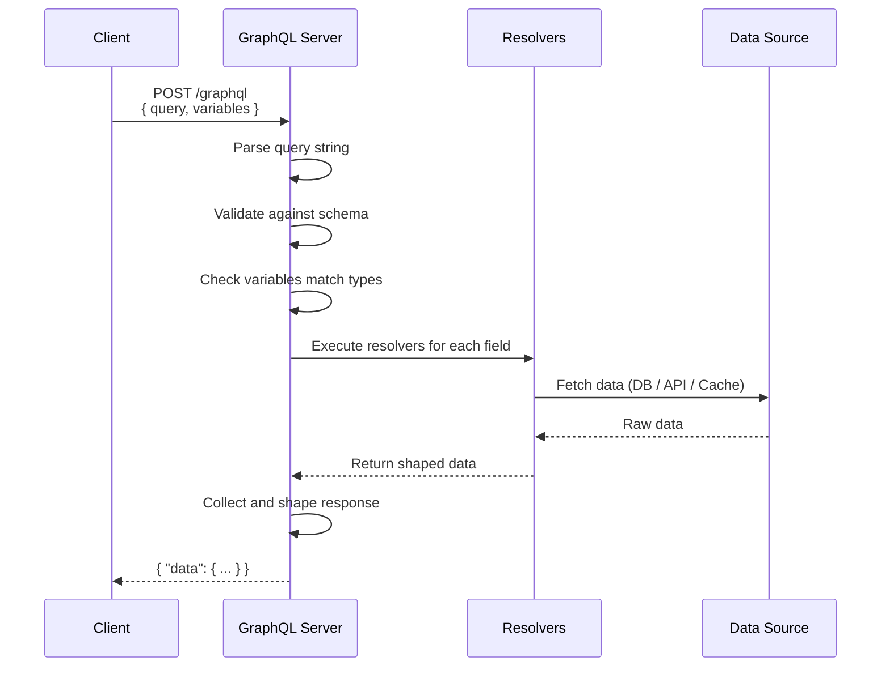

## Queries

In GraphQL, **queries** are used to **read data**. Think of them like `GET` requests in REST — but with the superpower of asking for exactly the fields you want.

> **Analogy:** A query is like a custom order form. You write down exactly what items you want and what details about each item, and the server fills in only those blanks.

---

### Basic Query

```graphql
# Query — ask for what you want
query {
  users {
    id
    name
    email
  }
}
```

```json
// Response — exactly what you asked for
{
  "data": {
    "users": [
      { "id": "1", "name": "Alice", "email": "alice@example.com" },
      { "id": "2", "name": "Bob", "email": "bob@example.com" }
    ]
  }
}
```

Notice the response shape **matches the query shape** exactly. This is a core GraphQL principle.

---

### Queries with Arguments

```graphql
# Pass arguments to filter or specify data
query {
  user(id: "1") {
    name
    email
    posts(limit: 3) {
      title
    }
  }
}
```

```json
{
  "data": {
    "user": {
      "name": "Alice",
      "email": "alice@example.com",
      "posts": [
        { "title": "GraphQL Basics" },
        { "title": "Advanced Schemas" },
        { "title": "Resolver Patterns" }
      ]
    }
  }
}
```

---

### Aliases — Same Field, Different Arguments

What if you need two users in one query? You can't use `user` twice with different IDs — so use **aliases**:

```graphql
query {
  alice: user(id: "1") {
    name
    email
  }
  bob: user(id: "2") {
    name
    email
  }
}
```

```json
{
  "data": {
    "alice": { "name": "Alice", "email": "alice@example.com" },
    "bob": { "name": "Bob", "email": "bob@example.com" }
  }
}
```

---

### Fragments — Reusable Field Sets

When multiple queries need the same fields, use **fragments** to avoid repetition:

```graphql
# Define a reusable fragment
fragment UserFields on User {
  id
  name
  email
  avatar
}

# Use it in multiple queries
query {
  friends: users(role: "user") {
    ...UserFields
    posts { title }
  }
  admins: users(role: "admin") {
    ...UserFields
    role
  }
}
```

---

### Variables — Dynamic Queries

Hard-coding arguments is impractical. Use **variables** instead:

```graphql
# Query with variables (defined at the top)
query GetUser($id: ID!, $limit: Int) {
  user(id: $id) {
    name
    email
    posts(limit: $limit) {
      title
    }
  }
}
```

```json
// Variables sent separately
{
  "id": "1",
  "limit": 5
}
```

**Variable rules:**
- Variables are **prefixed with `$`**
- Defined in the query signature: `query GetUser($id: ID!)`
- Passed separately from the query string (safer, reusable)
- Can have **default values**: `query GetUser($limit: Int = 10)`

---

### Query Flow



---

### Operation Name

Queries can (and should) be **named** for debugging and logging:

```graphql
# Without name (anonymous)
query {
  users { name }
}

# With name (recommended)
query GetUsers {
  users { name }
}
```

Naming is useful because:
- Easier to debug in GraphiQL/Studio
- Better server-side logging and metrics
- Multiple operations in one request need names

---

### Multiple Queries in One Request

```graphql
query HomePage {
  user(id: "1") {
    name
    recentPosts: posts(limit: 5) { title }
  }
  topPosts: posts(limit: 3) {
    title
    likes
  }
}
```

---

### In Simple Words

- **Queries** read data — like API GET requests with superpowers
- Use **arguments** to filter or specify what you need
- Use **aliases** when you need the same field with different arguments
- Use **fragments** to reuse field sets across queries
- Use **variables** for dynamic, reusable, and safe queries
- The **response shape always matches the query shape**
