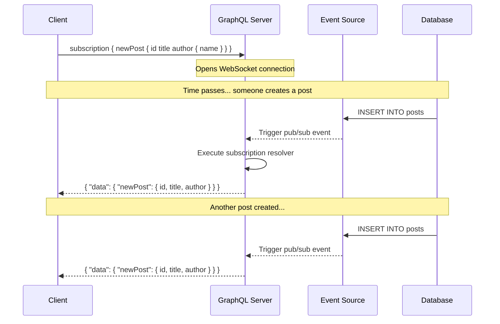
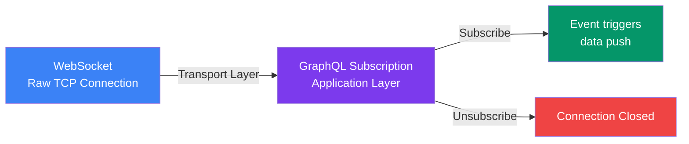

## Subscriptions

**Subscriptions** are GraphQL's answer to real-time communication. Unlike queries (one-time read) and mutations (one-time write), subscriptions maintain a **persistent connection** so the server can **push data to the client** whenever an event happens.

> **Analogy:** A query is like calling a restaurant to ask today's special. A mutation is like placing an order. A subscription is like subscribing to their newsletter — you get updates automatically whenever there's a new dish.

---

### How Subscriptions Work



---

### Subscription Schema

```graphql
type Subscription {
  newPost: Post!
  postUpdated(postId: ID!): Post
  userOnline(userId: ID!): User!
  notification(userId: ID!): Notification!
}

type Notification {
  id: ID!
  message: String!
  type: String!
  read: Boolean!
}
```

### Subscription Operation

```graphql
# Client subscribes to new posts
subscription OnNewPost {
  newPost {
    id
    title
    content
    author {
      name
    }
  }
}
```

---

### Subscription Use Cases

| Use Case | Example Subscription |
|----------|---------------------|
| **Live feed** | `newPost`, `newComment` |
| **Notifications** | `notification(userId: "1")` |
| **Chat** | `messageReceived(chatId: "42")` |
| **Real-time dashboard** | `metricUpdated` |
| **Collaborative editing** | `documentChanged(docId: "doc123")` |
| **Game state** | `playerMoved(gameId: "g1")` |

---

### Server-Side Implementation (with PubSub)

```javascript
const { PubSub } = require('graphql-subscriptions');
const pubsub = new PubSub();

const typeDefs = `#graphql
  type Subscription {
    postCreated: Post
  }

  type Mutation {
    createPost(title: String!, content: String!): Post!
  }
`;

const resolvers = {
  Subscription: {
    postCreated: {
      // Subscribe to events of type "POST_CREATED"
      subscribe: () => pubsub.asyncIterator(['POST_CREATED']),
    },
  },
  Mutation: {
    createPost: async (_, { title, content }, { db }) => {
      const post = await db.posts.create({ title, content });
      
      // Publish event — triggers the subscription
      pubsub.publish('POST_CREATED', { postCreated: post });
      
      return post;
    },
  },
};
```

---

### Client-Side Usage (with Apollo Client)

```javascript
import { gql, useSubscription } from '@apollo/client';

const NEW_POST_SUBSCRIPTION = gql`
  subscription OnNewPost {
    newPost {
      id
      title
      author { name }
    }
  }
`;

function LiveFeed() {
  const { data, loading, error } = useSubscription(NEW_POST_SUBSCRIPTION);

  if (loading) return <p>Connecting to live feed...</p>;
  if (error) return <p>Connection error</p>;

  return (
    <div>
      <h2>New Post: {data.newPost.title}</h2>
      <p>by {data.newPost.author.name}</p>
    </div>
  );
}
```

---

### Subscriptions vs WebSockets

Subscriptions in GraphQL are typically built on top of **WebSockets**. Here's how they relate:



---

### In Simple Words

- **Subscriptions** are for **real-time data** — server pushes updates to client
- They use a **persistent connection** (usually WebSocket)
- The client **subscribes** to an event; the server notifies when it happens
- Great for **chat apps, live feeds, notifications, and dashboards**
- Use `pubsub.asyncIterator` on the server to wire events to subscriptions
- Use Apollo Client's `useSubscription` hook for easy React integration
