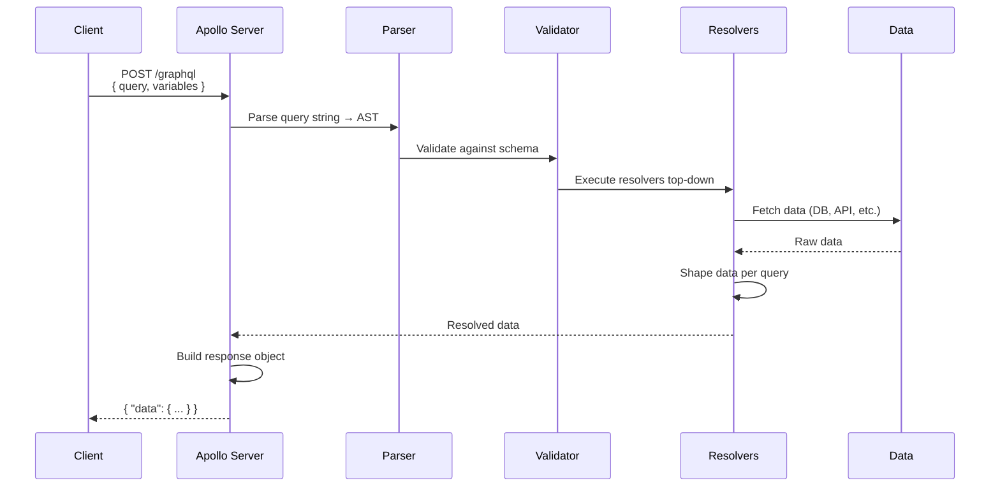
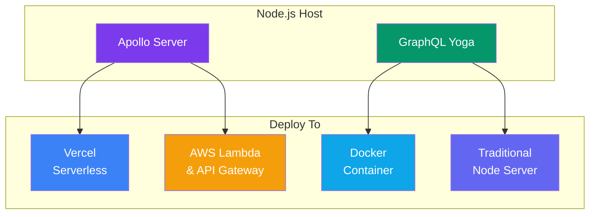

## Building a GraphQL Server

Let's build a complete **GraphQL server from scratch** using **Apollo Server** — the most popular GraphQL server library for Node.js.

> **Analogy:** Building a GraphQL server is like opening a restaurant. You write a menu (schema), hire chefs (resolvers), and open the doors (start the server).

---

### The Request Flow



---

### Step 1: Project Setup

```bash
mkdir graphql-server && cd graphql-server
npm init -y
npm install @apollo/server graphql
```

### Step 2: Define the Schema

```javascript
// schema.js
const typeDefs = `#graphql
  type Book {
    id: ID!
    title: String!
    author: String!
    publishedYear: Int
  }

  type Query {
    books: [Book!]!
    book(id: ID!): Book
  }

  type Mutation {
    addBook(title: String!, author: String!): Book!
    deleteBook(id: ID!): Boolean!
  }
`;
```

### Step 3: Write Resolvers

```javascript
// resolvers.js
let books = [
  { id: "1", title: "The Hobbit", author: "J.R.R. Tolkien" },
  { id: "2", title: "1984", author: "George Orwell" },
];

const resolvers = {
  Query: {
    books: () => books,
    book: (_, { id }) => books.find(b => b.id === id),
  },
  Mutation: {
    addBook: (_, { title, author }) => {
      const book = {
        id: String(books.length + 1),
        title,
        author,
      };
      books.push(book);
      return book;
    },
    deleteBook: (_, { id }) => {
      const index = books.findIndex(b => b.id === id);
      if (index === -1) return false;
      books.splice(index, 1);
      return true;
    },
  },
};
```

### Step 4: Create and Start the Server

```javascript
// server.js
import { ApolloServer } from '@apollo/server';
import { startStandaloneServer } from '@apollo/server/standalone';

const server = new ApolloServer({
  typeDefs,
  resolvers,
});

const { url } = await startStandaloneServer(server, {
  listen: { port: 4000 },
});

console.log(`🚀 Server ready at ${url}`);
```

```bash
node server.js
# 🚀 Server ready at http://localhost:4000/
```

---

### Step 5: Query Your API

Open **http://localhost:4000/** in your browser → Apollo Sandbox.

```graphql
# Query all books
query {
  books {
    id
    title
    author
  }
}

# Add a new book
mutation {
  addBook(title: "Dune", author: "Frank Herbert") {
    id
    title
  }
}
```

---

### Complete Server with Context

```javascript
import { ApolloServer } from '@apollo/server';
import { startStandaloneServer } from '@apollo/server/standalone';

const typeDefs = `#graphql
  type User {
    id: ID!
    name: String!
  }

  type Query {
    me: User
    users: [User!]!
  }
`;

const resolvers = {
  Query: {
    me: (_, __, { user }) => user,
    users: () => db.users.findAll(),
  },
};

const server = new ApolloServer({ typeDefs, resolvers });

const { url } = await startStandaloneServer(server, {
  context: async ({ req }) => {
    // Extract auth token
    const token = req.headers.authorization?.split(' ')[1];
    let user = null;

    if (token) {
      try {
        user = jwt.verify(token, process.env.JWT_SECRET);
      } catch {
        // Invalid token — user remains null
      }
    }

    return { user };
  },
  listen: { port: 4000 },
});
```

---

### Express Integration

For more control (middleware, routes, static files), integrate with Express:

```javascript
import { ApolloServer } from '@apollo/server';
import { expressMiddleware } from '@apollo/server/express4';
import express from 'express';
import cors from 'cors';

const app = express();
const server = new ApolloServer({ typeDefs, resolvers });

await server.start();

app.use(
  '/graphql',
  cors(),
  express.json(),
  expressMiddleware(server, {
    context: async ({ req }) => ({
      token: req.headers.authorization,
      db: connectToDatabase(),
    }),
  }),
);

app.get('/health', (req, res) => res.send('OK'));

app.listen(4000, () => console.log('Server on http://localhost:4000/graphql'));
```

---

### Server Architecture Options



---

### In Simple Words

- **Apollo Server** is the most popular GraphQL server for Node.js
- You need **three things**: schema (typeDefs), resolvers, and a server instance
- **Context** is where you put shared data (auth, DB connections, DataLoaders)
- Use **`startStandaloneServer`** for quick setup or **Express middleware** for production
- Apollo Sandbox (at `/graphql`) lets you test queries right in the browser
