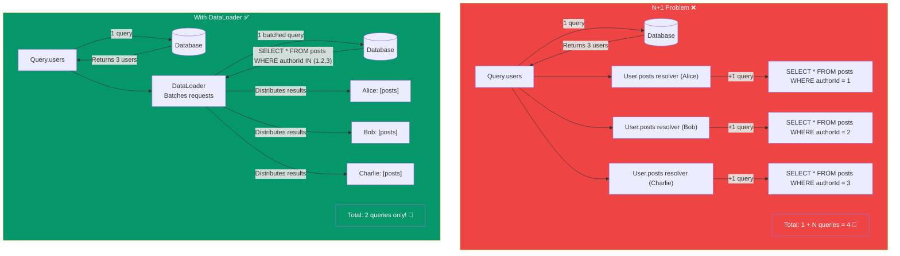
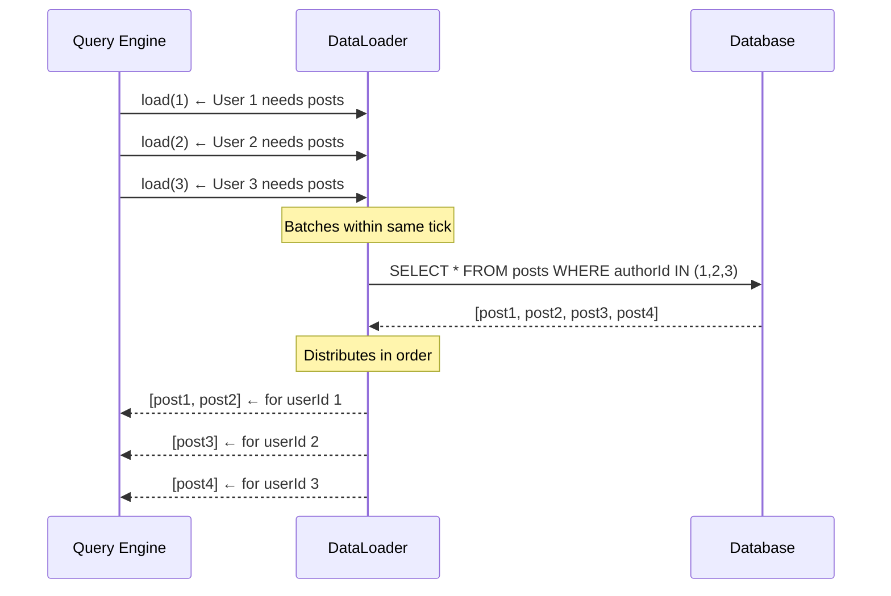

## Connecting Data

In real apps, resolvers need to fetch data from **databases** (MongoDB, PostgreSQL), **external APIs** (REST, third-party), or **caches** (Redis). This page covers common patterns and the infamous **N+1 problem**.

> **Analogy:** A resolver is like a delivery driver. The schema lists what can be delivered. The resolver actually goes to the warehouse (database), picks the items, and brings them back.

---

### Resolver → Database Connection

```javascript
// context.js — create DB connection once
import { PrismaClient } from '@prisma/client';

export const createContext = ({ req }) => ({
  db: new PrismaClient(),
  user: getUserFromToken(req),
});
```

```javascript
// resolvers.js — use db from context
const resolvers = {
  Query: {
    users: async (_, __, { db }) => {
      return await db.user.findMany();  // Prisma
    },
    user: async (_, { id }, { db }) => {
      return await db.user.findUnique({ where: { id } });
    },
  },
  Mutation: {
    createUser: async (_, { input }, { db }) => {
      return await db.user.create({ data: input });
    },
  },
};
```

---

### Resolver → REST API

```javascript
const resolvers = {
  Query: {
    githubUser: async (_, { username }) => {
      const response = await fetch(`https://api.github.com/users/${username}`);
      if (!response.ok) throw new Error('User not found');
      return response.json();
    },
  },
};
```

---

### The N+1 Problem

The **N+1 problem** is the most common performance issue in GraphQL. It happens when resolving nested fields causes **N additional database queries** for N parent items.



#### The Problem in Code

```javascript
const resolvers = {
  Query: {
    users: async () => {
      // 1 query
      return await db.user.findMany();
    },
  },
  User: {
    posts: async (parent) => {
      // N queries — one per user! (This is the problem)
      return await db.post.findMany({ where: { authorId: parent.id } });
    },
  },
};

// Query: { users { name posts { title } } }
// If there are 100 users → 1 + 100 = 101 database queries!
```

---

### Solution: DataLoader

**DataLoader** batches and caches individual requests into a single query.

```bash
npm install dataloader
```

```javascript
// loaders.js
import DataLoader from 'dataloader';

export const createPostLoader = (db) => {
  return new DataLoader(async (authorIds) => {
    // Batched: authorIds = [1, 2, 3, ...]
    const posts = await db.post.findMany({
      where: { authorId: { in: [...authorIds] } },
    });

    // Must return results in the SAME ORDER as authorIds
    return authorIds.map(id =>
      posts.filter(post => post.authorId === id)
    );
  });
};

// context.js — create DataLoader for each request
export const createContext = ({ req }) => ({
  db: new PrismaClient(),
  postLoader: createPostLoader(db),  // Fresh for each request
});
```

```javascript
// resolvers.js — use DataLoader
const resolvers = {
  User: {
    posts: (parent, _, { postLoader }) => {
      return postLoader.load(parent.id);  // Batched!
    },
  },
};

// Now: 100 users → only 2 queries total! 🚀
```

---

### DataLoader Request Flow



---

### Common Data Sources Pattern

```javascript
// resolvers.js — multiple data sources
const resolvers = {
  Query: {
    user: async (_, { id }, { dataSources }) => {
      // dataSources combine DB, REST API, and cache
      return dataSources.userAPI.getUser(id);
    },
  },
  User: {
    avatar: async (parent, _, { dataSources }) => {
      // Fetch avatar from external image service
      return dataSources.avatarAPI.getAvatar(parent.id);
    },
  },
};
```

---

### In Simple Words

- Resolvers can fetch data from **databases, REST APIs, caches** — anything
- The **N+1 problem**: querying N items causes N+1 separate database calls
- **DataLoader** solves N+1 by **batching** requests into one query with caching
- Always create a **fresh DataLoader per request** (never share globally)
- Use **context** to pass DB connections, DataLoaders, and auth info to resolvers
