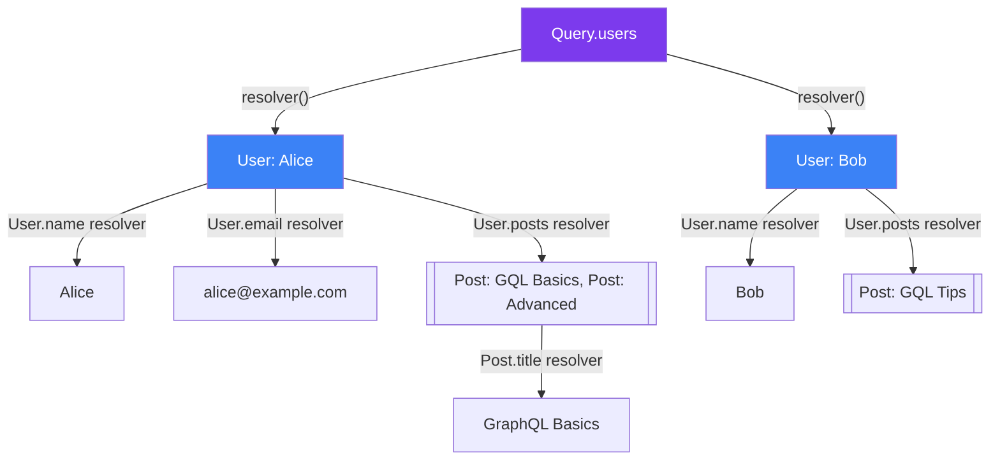
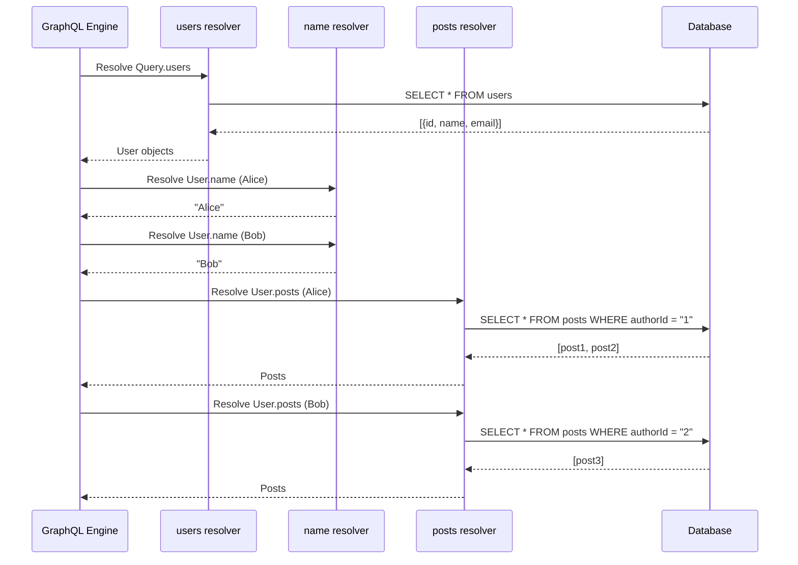

## Resolvers

**Resolvers** are the functions that **provide data** for each field in your GraphQL schema. The schema says "what data exists." Resolvers say "here's how to get it."

> **Analogy:** The schema is like a menu listing dishes. Resolvers are the chefs in the kitchen who actually cook each dish. When a client orders (sends a query), the server calls chefs (resolvers) to prepare each field.

---

### The Resolver Chain

Every field in a GraphQL query has a resolver. Resolvers form a **chain** — starting from the root and going deeper into nested fields.



---

### Resolver Structure

Every resolver receives **four arguments**:

```javascript
resolver(parent, args, context, info) {
  // Return data for this field
}
```

| Argument | What It Is |
|----------|-----------|
| `parent` | The result from the **parent** resolver (up the chain) |
| `args` | Arguments passed to the field (e.g., `{ id: "1" }`) |
| `context` | Shared object across all resolvers (auth, DB connections) |
| `info` | Query details — field name, path, AST (rarely used) |

---

### Basic Resolver Example

```javascript
const resolvers = {
  // Root-level resolvers
  Query: {
    users: () => {
      return [
        { id: "1", name: "Alice", email: "alice@example.com" },
        { id: "2", name: "Bob", email: "bob@example.com" },
      ];
    },
    user: (parent, args) => {
      return users.find(u => u.id === args.id);
    },
  },
};
```

---

### Resolvers with Context

The `context` object is shared across all resolvers — perfect for DB connections, auth info, etc.

```javascript
// Server setup — pass context
const server = new ApolloServer({
  typeDefs,
  resolvers,
  context: ({ req }) => ({
    db: connectToDatabase(),
    user: getUserFromToken(req.headers.authorization),
    dataLoader: createDataLoaders(),
  }),
});


// Resolvers use context
const resolvers = {
  Query: {
    posts: async (parent, args, context) => {
      // Access database via context
      return await context.db.posts.findAll();
    },
  },
  Mutation: {
    createPost: async (parent, args, context) => {
      // Check auth from context
      if (!context.user) throw new Error("Not authenticated");
      
      const post = await context.db.posts.create({
        ...args.input,
        authorId: context.user.id,
      });
      return post;
    },
  },
};
```

---

### Nested Field Resolvers

For **relationships** between types, you need resolvers on the child type:

```javascript
const resolvers = {
  Query: {
    users: () => db.users.findAll(),  // Returns [{ id, name, email }]
  },
  
  // Resolvers for fields on the User type
  User: {
    // 'parent' is the user object from the Query.users resolver
    posts: async (parent) => {
      return await db.posts.findAll({ where: { authorId: parent.id } });
    },
    fullName: (parent) => {
      return `${parent.firstName} ${parent.lastName}`;
    },
    postsCount: async (parent) => {
      const posts = await db.posts.findAll({ where: { authorId: parent.id } });
      return posts.length;
    },
  },
};
```

---

### Resolver Flow for a Nested Query



---

### Default Resolvers (Auto-Mapping)

If you don't define a resolver for a field, GraphQL uses a **default resolver** that simply reads the property with the same name from the parent object:

```javascript
// Schema
type User {
  id: ID!
  name: String!
}

// If Query.users returns { id: "1", name: "Alice" }
// GraphQL automatically resolves User.id and User.name
// No extra resolvers needed!

const resolvers = {
  Query: {
    users: () => [
      { id: "1", name: "Alice" }  // ← default resolvers handle the rest
    ],
  },
};
```

---

### Resolver Signatures Cheat Sheet

```javascript
const resolvers = {
  Query: {
    users: (parent, args, context, info) => { /* ... */ },
    user: (parent, { id }, context, info) => { /* ... */ },
  },
  Mutation: {
    createUser: (parent, { input }, context, info) => { /* ... */ },
  },
  Subscription: {
    postCreated: {
      subscribe: (parent, args, context, info) => {
        return context.pubsub.asyncIterator(['POST_CREATED']);
      },
    },
  },
  // Type field resolvers
  User: {
    posts: (parent, args, context, info) => { /* ... */ },
  },
};
```

---

### In Simple Words

- **Resolvers** are functions that **return data** for each field in the schema
- Every field **can** have a resolver; if missing, GraphQL uses a default
- Resolvers receive **(parent, args, context, info)** — each serves a specific purpose
- `parent` is the result from the **parent resolver**; `args` holds field arguments
- `context` is a **shared object** — great for DB, auth, and DataLoader instances
