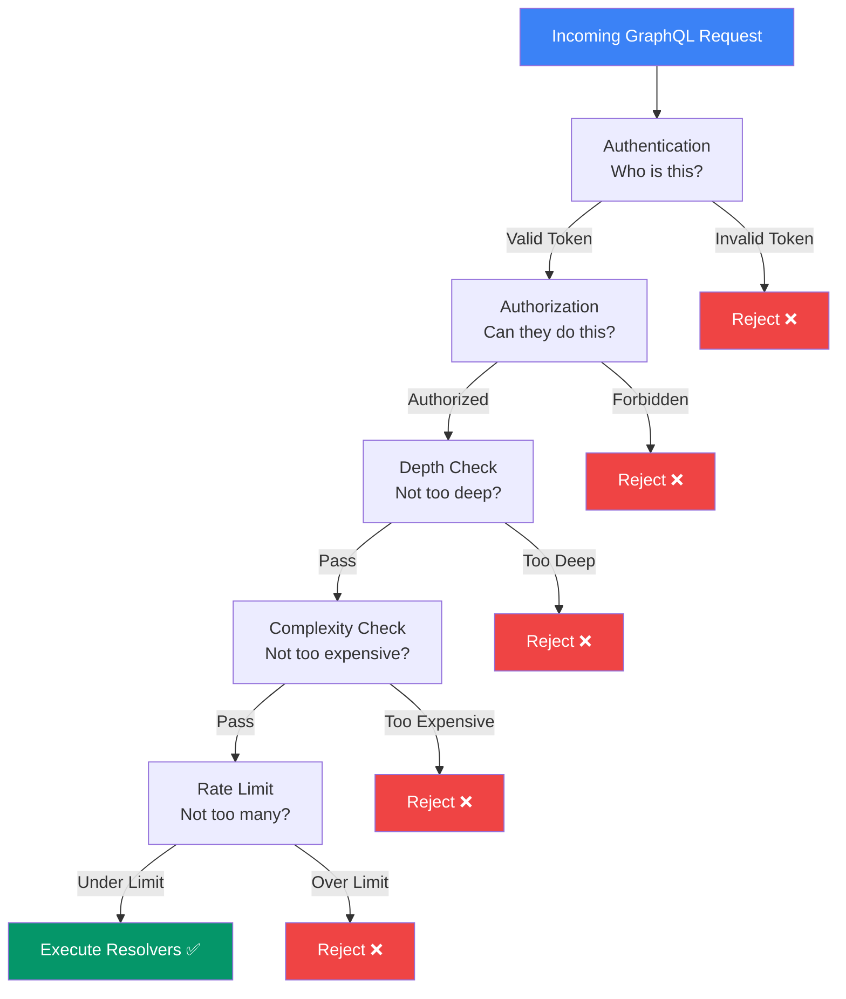

## Best Practices

GraphQL gives clients a lot of power — but with great power comes great responsibility. This page covers **pagination, security, performance, and common mistakes**.

> **Analogy:** GraphQL is like an all-you-can-eat buffet. Best practices are the restaurant rules: use a plate (pagination), don't take more than you can eat (query limits), and keep the serving area clean (security).

---

### 1. Pagination

Always paginate list fields. Never return unbounded arrays.

```graphql
# ❌ Bad — no limit
type Query {
  users: [User!]!
}

# ✅ Good — cursor-based pagination (Relay spec)
type Query {
  users(first: Int!, after: String): UserConnection!
}

type UserConnection {
  edges: [UserEdge!]!
  pageInfo: PageInfo!
}

type UserEdge {
  node: User!
  cursor: String!
}

type PageInfo {
  hasNextPage: Boolean!
  hasPreviousPage: Boolean!
  startCursor: String
  endCursor: String
}
```

```graphql
# ✅ Simpler alternative — offset pagination
type Query {
  users(page: Int, limit: Int): [User!]!
}
```

---

### 2. Security — Query Depth Limiting

Prevent clients from writing deeply nested queries that crash your server:

```javascript
import { depthLimit } from 'graphql-depth-limit';

const server = new ApolloServer({
  typeDefs,
  resolvers,
  validationRules: [depthLimit(5)],  // Max 5 levels deep
});

// ❌ Blocked: depth of 6+
query {
  user { posts { author { posts { author { posts { title } } } } } }
}

// ✅ Allowed: depth of 4
query {
  user { name posts { title author { name } } }
}
```

---

### 3. Security — Query Complexity Limiting

Some queries are more expensive than others:

```javascript
import { simpleEstimator, createComplexityRule } from 'graphql-query-complexity';

const server = new ApolloServer({
  typeDefs,
  resolvers,
  validationRules: [
    createComplexityRule({
      estimators: [simpleEstimator({ defaultComplexity: 1 })],
      maximumComplexity: 100,
    }),
  ],
});

// ✅ Allowed: complexity = 6
query { users { name email } }

// ❌ Blocked: complexity = 105
query {
  users { posts { comments { author { posts { comments { text } } } } } }
  posts { author { posts { comments { author { name } } } } }
}
```

---

### 4. Security — Authentication & Authorization

```javascript
// Context-based auth
const server = new ApolloServer({
  typeDefs,
  resolvers,
  context: ({ req }) => ({
    user: getUserFromToken(req.headers.authorization),
  }),
});

// Resolver-level authorization
const resolvers = {
  Mutation: {
    deletePost: async (_, { id }, { db, user }) => {
      if (!user) throw new GraphQLError('Not authenticated', {
        extensions: { code: 'UNAUTHENTICATED' },
      });

      const post = await db.post.findUnique({ where: { id } });
      if (post.authorId !== user.id) {
        throw new GraphQLError('Not authorized', {
          extensions: { code: 'FORBIDDEN' },
        });
      }

      return await db.post.delete({ where: { id } });
    },
  },
};
```

---

### Security Layers



---

### 5. Performance — DataLoader

Always use **DataLoader** for related data (covered in detail on the [Connecting Data page](../03-server/connecting-data)):

```javascript
// 📦 Always batch requests for nested resolvers
const resolvers = {
  User: {
    posts: (parent, _, { postLoader }) => postLoader.load(parent.id),
  },
};
```

### 6. Naming Conventions

```graphql
# ✅ Good naming
type Query {
  getUser(id: ID!): User        # Verb + noun
  listUsers(filter: UserFilter): [User!]!  # List prefix for arrays
}

type Mutation {
  createUser(input: CreateUserInput!): User!
  updateUser(id: ID!, input: UpdateUserInput!): User!
  deleteUser(id: ID!): Boolean!
}

# ❌ Avoid
type Query {
  user: User         # Unclear what it returns
  usersList: [User]  # Inconsistent naming
}
```

---

### 7. Common Mistakes to Avoid

| Mistake | Why It's Wrong | Fix |
|---------|---------------|-----|
| **No pagination** | Client can query millions of records | Always paginate list fields |
| **No depth limit** | Malicious nested queries crash server | Use `graphql-depth-limit` |
| **N+1 queries** | Performance disaster for nested data | Use DataLoader |
| **Returning raw DB errors** | Leaks internal info | Catch and sanitize errors |
| **No input validation** | Bad data pollutes your database | Validate in resolvers |
| **Global DataLoader** | Cached data leaks across requests | One DataLoader per request |
| **Over-fetching auth** | Querying DB for every resolver | Put user in context |
| **Ignoring `__typename`** | Cache issues with Apollo Client | Always include typename |

---

### 8. Schema Design Tips

```graphql
# ✅ Design for the client's needs
type Query {
  # Specific queries for common use cases
  currentUser: User
  recentPosts(limit: Int = 10): [Post!]!
  
  # Generic queries for flexibility
  user(id: ID!): User
  users(filter: UserFilter, pagination: Pagination): UserConnection!
}

# ✅ Use interfaces for shared fields
interface Node {
  id: ID!
  createdAt: String!
  updatedAt: String!
}

type User implements Node {
  id: ID!
  createdAt: String!
  updatedAt: String!
  name: String!
  email: String!
}

type Post implements Node {
  id: ID!
  createdAt: String!
  updatedAt: String!
  title: String!
  content: String!
}
```

---

### In Simple Words

- **Pagination** every list — never return unbounded arrays
- **Limit query depth** (max 5-7 levels) and **complexity** to prevent abuse
- **Always authenticate and authorize** — never trust the client
- **Use DataLoader** to solve N+1 issues; one DataLoader per request
- **Design schema for the client** and **sanitize errors** to hide internals
