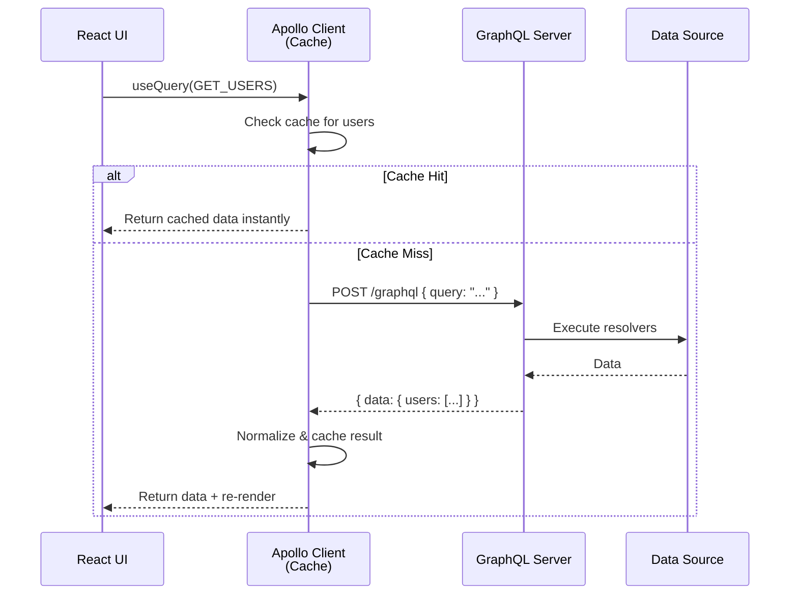

## Client Usage

Once you have a GraphQL server running, you need to **query it from the frontend**. This page covers the two main approaches: using **Apollo Client** (recommended) or plain **fetch**.

> **Analogy:** Your GraphQL server is a library. Apollo Client is a librarian who fetches, organizes, and caches books for you. Plain `fetch` is walking to the shelves yourself.

---

### Client → Server Flow



---

### Option 1: Apollo Client (Recommended)

```bash
npm install @apollo/client graphql
```

```javascript
// ApolloClient.js
import { ApolloClient, InMemoryCache, gql } from '@apollo/client';

const client = new ApolloClient({
  uri: 'http://localhost:4000/graphql',
  cache: new InMemoryCache(),
});

export default client;
```

```javascript
// App.jsx — wrap your app
import { ApolloProvider } from '@apollo/client';
import client from './ApolloClient';

function App() {
  return (
    <ApolloProvider client={client}>
      <Users />
    </ApolloProvider>
  );
}
```

```jsx
// Users.jsx — query component
import { useQuery, gql } from '@apollo/client';

const GET_USERS = gql`
  query GetUsers {
    users {
      id
      name
      email
      posts {
        title
      }
    }
  }
`;

function Users() {
  const { loading, error, data } = useQuery(GET_USERS);

  if (loading) return <p>Loading...</p>;
  if (error) return <p>Error: {error.message}</p>;

  return (
    <ul>
      {data.users.map(user => (
        <li key={user.id}>
          {user.name} — {user.email}
          <ul>
            {user.posts.map(post => (
              <li key={post.id}>{post.title}</li>
            ))}
          </ul>
        </li>
      ))}
    </ul>
  );
}
```

---

### Mutations with Apollo Client

```jsx
import { useMutation, gql } from '@apollo/client';

const CREATE_USER = gql`
  mutation CreateUser($input: CreateUserInput!) {
    createUser(input: $input) {
      id
      name
      email
    }
  }
`;

function SignupForm() {
  const [createUser, { loading, error }] = useMutation(CREATE_USER);

  const handleSubmit = async (e) => {
    e.preventDefault();
    try {
      const { data } = await createUser({
        variables: {
          input: { name: "Alice", email: "alice@example.com" },
        },
      });
      console.log('Created user:', data.createUser);
    } catch (err) {
      console.error('Mutation failed:', err);
    }
  };

  return (
    <form onSubmit={handleSubmit}>
      <input name="name" placeholder="Name" />
      <input name="email" placeholder="Email" />
      <button type="submit" disabled={loading}>
        {loading ? 'Creating...' : 'Sign Up'}
      </button>
      {error && <p>Error: {error.message}</p>}
    </form>
  );
}
```

---

### Option 2: Plain Fetch (No Library)

You don't need Apollo Client — GraphQL works over regular HTTP POST:

```javascript
async function getUsers() {
  const query = `
    query GetUsers {
      users {
        id
        name
        email
      }
    }
  `;

  const response = await fetch('http://localhost:4000/graphql', {
    method: 'POST',
    headers: { 'Content-Type': 'application/json' },
    body: JSON.stringify({ query }),
  });

  const { data, errors } = await response.json();

  if (errors) {
    console.error('GraphQL Errors:', errors);
    throw errors;
  }

  return data.users;
}
```

```javascript
// With variables
async function getUser(id) {
  const query = `
    query GetUser($id: ID!) {
      user(id: $id) {
        name
        email
        posts { title }
      }
    }
  `;

  const response = await fetch('/graphql', {
    method: 'POST',
    headers: { 'Content-Type': 'application/json' },
    body: JSON.stringify({
      query,
      variables: { id },
    }),
  });

  return response.json();
}
```

---

### Caching in Apollo Client

Apollo Client's cache is **normalized** — each object is stored by its `id` and `__typename`:

```javascript
// Apollo automatically caches by type + id
// Schema types: User, Post
// Response: { user: { id: "1", name: "Alice", __typename: "User" } }
// Cache key: "User:1"

// Benefits:
// - If two queries fetch the same user → cache hit
// - After a mutation → cache automatically updates
// - Optimistic UI → update cache before server responds
```

```javascript
// Update cache after a mutation
const [createUser] = useMutation(CREATE_USER, {
  update(cache, { data: { createUser } }) {
    // Read existing users from cache
    const { users } = cache.readQuery({ query: GET_USERS });

    // Write back with new user included
    cache.writeQuery({
      query: GET_USERS,
      data: { users: [...users, createUser] },
    });
  },
});
```

---

### Fragments on the Client

```javascript
// Shared fragment — used by multiple components
const USER_FIELDS = gql`
  fragment UserFields on User {
    id
    name
    email
    avatar
  }
`;

const GET_USERS = gql`
  query GetUsers {
    users {
      ...UserFields
    }
  }
  ${USER_FIELDS}
`;

const GET_USER = gql`
  query GetUser($id: ID!) {
    user(id: $id) {
      ...UserFields
      posts { title }
    }
  }
  ${USER_FIELDS}
`;
```

---

### In Simple Words

- **Apollo Client** is the most popular GraphQL client for React
- Wrap your app in `<ApolloProvider>` with the client; use `useQuery` and `useMutation`
- GraphQL also works with **plain `fetch`** — it's just HTTP POST under the hood
- Apollo's **normalized cache** automatically deduplicates and updates objects
- Use **fragments** to share field selections across components
- Always handle `loading`, `error`, and `data` states in your UI
